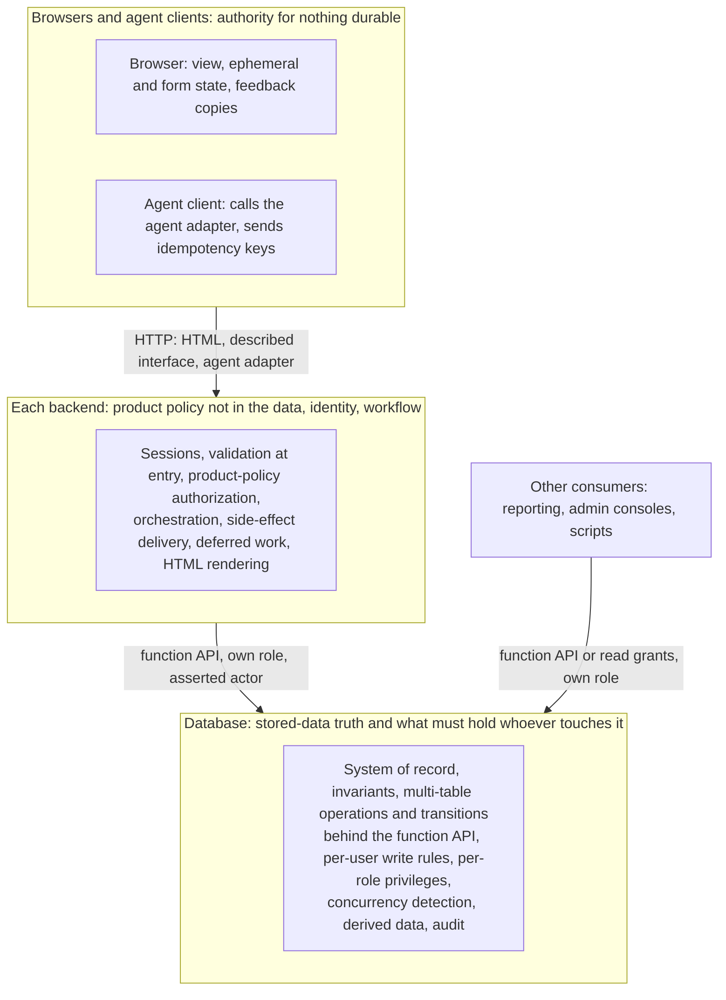

# Allocation of Responsibilities

Who does what across database, backends and browsers, decided per responsibility before any tier is designed. Stack-neutral [placements](glossary.md#placement) come first, then the stack placements for Postgres, Python and browser JavaScript. Each section ends with its graph uid: query it for the grounds, the positions considered and the sources.

## Table of Contents

1. [Overview](#overview) _(Lines 23-52)_
1. [Forces](#forces) _(Lines 55-89)_
1. [Context](#context) _(Lines 92-124)_
1. [Rules](#rules) _(Lines 127-167)_
1. [Allocation Matrix](#allocation-matrix) _(Lines 170-194)_
1. [Data Authority Placements](#data-authority-placements) _(Lines 197-233)_
1. [Guarding Placements](#guarding-placements) _(Lines 236-306)_
1. [Acting Placements](#acting-placements) _(Lines 309-354)_
1. [Derivation Placements](#derivation-placements) _(Lines 357-388)_
1. [Presentation Placements](#presentation-placements) _(Lines 391-414)_
1. [Stack Placements](#stack-placements) _(Lines 417-489)_

---

## Overview
<!-- Lines 23-52 -->

Every responsibility is placed before any tier is designed. Its placement record (format inferred) names the one tier that is its [authority](glossary.md#authority), the copies other tiers may hold and why, the tiers forbidden to hold it, and the context that would move it. Default split:
- **Database**: authority for the truth of stored data and for everything that must hold whoever touches it.
- **Each backend**: authority for product policy not stored in the data, its users' identity and its workflows.
- **Browsers and agent clients**: authority for nothing durable.

Decide placements before designing any tier; tier branches realize a placement and never re-decide it. Exactly one tier is the authority for each responsibility; every other tier holds at most [a copy](glossary.md#copy). Read a placement in the [Allocation Matrix](#allocation-matrix), then in its section.

Per-user read visibility follows the sensitivity of the read: simple reads are written by each backend directly; sensitive, complex or shared reads, per-user visibility rules included, go through database functions ([Authorization](#authorization)).

`ALLOCATION`

## Forces
<!-- Lines 55-89 -->

The forces act in order, not on one scale (the order and the repairability criterion are inferred):
1. Correctness and security are vetoes: they decide which tiers may be the authority at all.
2. Among admissible tiers, the force whose loss is hardest to repair later wins: changeability of the rule's location, then performance, then scalability. Each placement settled this way names the force it preferred.
3. Latency and performance justify copies in other tiers, never a move of authority.

Never reduce the forces to a weighted sum per placement. `ALLOCATION.FORCES`

### Correctness

The deciding tier sees every writer and every fact the decision needs, and completes the decision atomically with the data it guards. With several [consumers](glossary.md#consumer) writing, rules about stored data and operations spanning tables go to the database; rules that need the end user's identity or the request go to the backend. A veto force. `ALLOCATION.FORCES.1`

### Security

A decision that grants access or protects integrity runs in a tier the requester cannot modify, on every access path. Model output and client hints are input, never a decision. Every consumer is bounded by its own database role. A veto force. `ALLOCATION.FORCES.2`

### Performance

Place data reduction (filter, aggregate, sort, page) with the data by design: that is a placement, not an optimisation. Make no other performance-driven move or copy without a measurement that identifies the path; never optimise up front. `ALLOCATION.FORCES.3`

### Latency

Latency is a design criterion from the start: count round trips per interaction, browser to server and backend to database, at design time, and budget them against about 0.1 s, 1 s and 10 s and the field vitals targets. Latency justifies copies near the user under [Authority and Copies](#authority-and-copies), never a move of authority; micro-optimisation waits for measurement. `ALLOCATION.FORCES.4`

### Scalability

Weigh each placement against the single write primary, the tier hardest to scale out. Set-based reductions that return small results, and database functions that replace several round trips by one, are exempt. Do not place logic off the database pre-emptively.
- Changes when: a measured write or connection load approaches the primary's limit; otherwise scalability is a tie-breaker.
- The premise is inferred: no primary source on it was read. Gap: no source measures one placement against another.
`ALLOCATION.FORCES.5`

### Changeability

The costs of database logic are explicit inputs to every placement: testing needs a live database, tooling and debugging are poor, the onboarding skill floor is higher and expressiveness is limited. Portability is a sunk cost when the DBMS is a long-term commitment. Where the database holds what must hold for every consumer, these costs are accepted and paid with tooling: functions in versioned migrations, tested against a live database in CI. `ALLOCATION.FORCES.6`

## Context
<!-- Lines 92-124 -->

Project variables move a placement in a stated direction; the [default context](glossary.md#default-context) fixes their values: a classic website (documents, forms, CRUD), one team, single tenant, humans and agents as users, and a database shared by several backends and by reporting, admin consoles and scripts. With several consumers, rules that must hold for all of them belong in the database behind a [function API](glossary.md#function-api).
- Assume several database consumers; a single consumer is a context change that moves placements.
- Give every consumer its own role: each backend, a read-only reporting role, an operator role, an [owner role](glossary.md#owner-role) for migrations; none for browsers and agents.
- The database verifies the consumer's role only. The acting user is the consumer's claim, and each role may assert only its own kind of [actor](glossary.md#actor) (a backend an end user; operator and owner roles only themselves).
- Record the interface origin (description first or code first) per project, by the criteria of [Type and Contract Definitions](#type-and-contract-definitions); neither is the residual default.
- A change of a variable moves only the placements its row lists, in the stated direction.

| Variable | Moves toward | Placements moved |
|---|---|---|
| Database consumers: several (default) or one only | database function API; or rules may live in that one backend | Data Access Interface, Business Rules, Database Function API |
| Access paths and their roles (backends, reporting, consoles, scripts, owner) | per-role privileges and function grants | Authorization, Data Access Interface |
| [Per-user rules](glossary.md#per-user-rule) every consumer must respect | writes: the [writer function](glossary.md#writer-function); reads: database read functions, as [sensitive reads](glossary.md#sensitive-read) | Authorization, Business Rules |
| Which consumer may assert which actor | trusted-actor pairing checked by functions and audit triggers | Authorization, Audit and History |
| Client kind: same-site browser; mobile, third-party, agent | server session; bearer tokens with server-held revocation | Identity and Session State |
| Automated callers (agents) | required [idempotency keys](glossary.md#idempotency-key), audit with delegation | Duplicate Suppression, Audit and History |
| Offline need, user-owned data | client replica (local-first) | System of Record, UI and Ephemeral State, Concurrency Control |
| Latency budget | copies near the user | Authority and Copies, Caching |
| Data volume against result size | the database | Filtering, Sorting, Paging and Search |
| Write load near the primary's limit | computation and [backing roles](glossary.md#backing-role) off the database (inferred) | [Scalability](#scalability), [Postgres First](#postgres-first-for-backing-roles) |
| Team SQL skill: low | application; conflicts with the default, which presupposes the skill | Business Rules |
| Policy change cadence: fast | backend, for product policy not stored in the data | Authorization |
| Domain complexity | domain model and use cases in the backend, for workflow | Business Rules |
| DBMS commitment | portability cost sunk (inferred) | Business Rules, Database Function API |
| Conflict rate, data shape, edit length | concurrency policy | Concurrency Control |
| Effect losable; crosses a service with its own database | post-commit hook; saga | Side Effects and Integrations |
| Staleness tolerance | cache tier and lifetime | Derived Data, Caching |
| UI interdependence, update frequency, crawlability | client rendering, JavaScript server | Rendering, JavaScript Server Tier |
| Consumer outside the owning team | function API published as a contract, or that team's service | Data Access Interface |
| Project type | description or code as the interface origin, recorded per project | Type and Contract Definitions, Type Definition Chain |

`ALLOCATION.CONTEXT`

## Rules
<!-- Lines 127-167 -->

Five rules turn forces and context into a placement, applied to every responsibility in this order: [Trust Boundary](#trust-boundary) (who may decide at all), [End-to-End Placement](#end-to-end-placement) (which end can complete it), [Authority and Copies](#authority-and-copies), [One Core for Every Client](#one-core-for-every-client), [Atomicity Ends at the Transaction](#atomicity-ends-at-the-transaction). The first two are the security and correctness vetoes; the order is inferred. `ALLOCATION.RULES`

### Authority and Copies

Exactly one tier is the authority for each responsibility; every other copy is a snapshot that may be stale without breaking correctness.
- Every copy carries a version or timestamp that detects staleness, and never decides.
- A copy that rejects input early (a validator) is generated from or tested against the authority, never hand-maintained, so it cannot refuse what the authority accepts (inferred).
- Store the minimum and derive the rest.
- Where a second copy exists, after an asynchronous step show the pending state from the [status resource](glossary.md#status-resource) or the optimistic local value.

Principle: [One Place per Fact](../software_development_guidelines/construction.md#one-place-per-fact).
`ALLOCATION.RULES.1`

### End-to-End Placement

Place a function at the end that has the knowledge and finality to complete it, after identifying the ends: every writer converges on the database, so the database is an end for rules about stored data (inferred); the user is the end for feedback. A partial copy in another tier exists only for performance or latency. A rule in a shared lower tier needs measured performance, unless every consumer needs the same rule (the default under several consumers). `ALLOCATION.RULES.2`

### Trust Boundary

Any check that grants access or protects integrity runs in a tier the requester cannot modify: the backend or the database. The browser, agent clients, model output and client-supplied hints never decide; browser checks are feedback, and every submitted value is re-checked on the server. Principle: [Parse or Validate at the Edge](../software_development_guidelines/construction.md#parse-or-validate-at-the-edge). `ALLOCATION.RULES.3`

### One Core for Every Client

Every client drives the same core through adapters that translate and shape only; rules, validation, authorization and state transitions exist once, never in an adapter or a prompt.
- With several database consumers the core has two levels: the database function API for what must hold for every consumer (operations, transitions with their single writer function, per-user write rules decidable from the row and the actor); each backend's use cases for its own workflow and product policy.
- Browsers and agents are adapters to a backend.
- Per-user read visibility across backends goes through database read functions, so this rule and the ban on default row security do not pull apart; see [Authorization](#authorization).
`ALLOCATION.RULES.4`

### Atomicity Ends at the Transaction

Atomicity exists only inside one database transaction.
- One business operation is one function call in its own transaction; a backend never opens a transaction around several API calls (inferred).
- A step that must be atomic with another is a new business operation, hence a new function. It may call other domains' published functions in the same transaction; direct access to another domain's tables is forbidden.
- Workflows across operations advance through [state columns](glossary.md#state-column) and the [outbox](glossary.md#outbox), with idempotent steps.
- Anything spanning the database and an external system is reconciled (outbox, idempotency keys), never committed in a distributed way.
- Keep aggregates addressable by key so that a later split stays possible.
- Acceptable when a split of the data across nodes or services is planned: atomicity scoped to one entity, messages across entities.
`ALLOCATION.RULES.5`

## Allocation Matrix
<!-- Lines 170-194 -->

One line per responsibility in the default context. The authority decides; copies serve feedback or latency and never decide; forbidden tiers may not hold it; the last column names what would move it. The seven stack placements follow in [Stack Placements](#stack-placements).

| Responsibility | Authority | Copies | Forbidden | Moved by |
|---|---|---|---|---|
| [System of Record](#system-of-record) | database | browser server-state cache (versioned), HTTP caches, cache tables, search index, reporting copy, browser drafts of unsent input | any copy acting as authority; dual writes from any consumer | offline need with user-owned data; many external derived stores at high write rate |
| [Data Access Interface](#data-access-interface) | database function API, owned by the database owner | replica or reporting copy for reporting | direct consumer writes to tables with state columns or multi-table effects; database connections from browsers or agents; views as contract | a single consumer; a consumer outside the team needing independent deploys; team SQL skill |
| [Type and Contract Definitions](#type-and-contract-definitions) | database for stored facts and the function API's contract; the project's recorded origin for interface-only facts | generated persistence models, generated or checked interface models and description, generated browser types (build time only) | hand-copied types without a CI comparison; drift between description and implementation; the browser as an origin | project type |
| [Validation](#validation) | backend (parsing, request-level meaning); database (function parameters, meaning about stored data) | browser checks, for feedback | browser, agent client or model output as the deciding check | tiers with different owners or trust levels |
| [Invariants](#invariants) | database | generated or tested backend validators and types; browser feedback | application-only enforcement of a rule that must hold for every writer; a procedural check under Read Committed without a lock | nothing in the default |
| [Authorization](#authorization) | writer function (per-user write rules); backend (product policy not in the data, identity); database (per [consumer role](glossary.md#consumer-role); read functions for sensitive reads, per-user visibility included) | backend check of per-user write rules (generated or tested); browser hides controls (cosmetic) | browser, agent client, model output, client hints; row security by default; a consumer role owning tables or bypassing grants; a write without an actor, or with one its role may not assert | row security's three conditions |
| [Identity and Session State](#identity-and-session-state) | backend (session store in the database by default) | the browser's opaque cookie; an agent's own bearer token | tokens readable by page script; credentials in URLs (one exception: short-lived signed file URLs); session state in process memory; stateless, non-revocable sessions; end users as database roles | client kind; instant revocation; no backend possible |
| [Concurrency Control](#concurrency-control-and-conflict-resolution) | database (detection in the writer function); backend carries the version | the version the browser read | browser or agent resolving conflicts; locks across requests | conflict rate, data shape, edit length, offline use |
| [Duplicate Suppression](#duplicate-suppression) | database (key and effect in one transaction; unique constraint as final arbiter); backend passes the key | browser pending state and form token; agent clients send keys | the browser as the only guard; a key store separate from the effect | automated callers; payment-like or external effects |
| [Business Rules and State Transitions](#business-rules-and-state-transitions) | database (operations, transitions, invariants, per-user write rules); backend (workflow, product policy not in the data, external calls) | backend check of per-user write rules; browser preview of allowed actions | multi-table writes composed in a backend; a backend transaction wrapping several API calls; rules in the browser, agent adapters or prompts; a second writer of a state column | a single consumer with low SQL skill |
| [Side Effects and Integrations](#side-effects-and-integrations) | backend (delivery, external calls); database (the [staged intent](glossary.md#staged-intent)) | none | third-party credentials in the browser (inferred); external calls from inside the database; dual writes to database and broker; remote calls inside an open transaction; a foreign call in the request without its intent recorded first; post-commit hooks for foreign effects | an outcome the user must see within a few seconds, under the request timeout; a business transaction across services with their own databases |
| [Deferred and Scheduled Work](#deferred-and-scheduled-work) | backend (what is deferred); database (staged intent, data schedules) | the status resource shows the pending state | deferring core writes; foreign effects inside the request, except the in-request phase | duration, foreign effects, set-based data work |
| [Audit and History](#audit-and-history) | database (history, transitions); backend supplies actor and business events; a separate sink for security events | none | application-only audit; audit only in a model transcript; an actor from a client-supplied id; a write without an actor, or with one its role may not assert | nothing in the default |
| [Derived Data and Aggregation](#derived-data-and-aggregation) | database | derived columns and tables with a stated staleness | consumers writing derived stores beside the source | number of external derived stores, write rate, staleness tolerance |
| [Filtering, Sorting, Paging and Search](#filtering-sorting-paging-and-search) | database, including collation | the browser, over rows already loaded, same collation | loading full sets into a backend or browser to reduce them; queries in loops; a browser re-sort with another collation | data volume against result size; write load |
| [Caching](#caching) | none: the source is the authority | database tables, a shared backend store, HTTP intermediaries, the browser | process memory beyond one request; personalised responses in shared caches | staleness tolerance, number of processes, need for atomic invalidation |
| [Rendering](#rendering) | backend (HTML and navigation) | browser view state; [islands](glossary.md#island)' client state | business rules in browser code | UI interdependence, offline use, update frequency, crawlability |
| [Formatting and Localization](#formatting-and-localization) | the rendering tier (formatting); database (canonical values) | none | formatted or local-time values stored as data | which tier renders the text |
| [UI and Ephemeral State](#ui-and-ephemeral-state) | by kind: browser, URL, database, channel | the browser's server-state cache | presence in database tables; durable state held only in the browser | offline use; sharing between users or tabs |

## Data Authority Placements
<!-- Lines 197-233 -->

The server database is the one system of record; consumers reach it through the function API and their own roles; each fact has one origin; every interface description consumers read stays in sync with the implementation by process. `ALLOCATION.RECORD`

### System of Record

The server database is the single system of record for governed business data. Caches, search indexes, browser state, messages and history derive from it in transaction order, because only one global order lets uniqueness, balances and authorization hold for every write. No consumer writes two stores.
- Acceptable when offline use, multi-device sync or user ownership matter more than central enforcement and the data is user-owned: a client replica (local-first).
- Acceptable with many derived stores outside the database at a high write rate and a team able to run stream infrastructure: an ordered log as the truth.
`ALLOCATION.RECORD.1`

### Data Access Interface

Every consumer reaches the data through a database function API owned by the database owner, with one role per consumer. The interface is a published contract that evolves additively.
- Backends, consoles and scripts write through API functions; base tables get at most read grants, for simple reads.
- One direct-write exception: a single-table write grant for a table that only one consumer writes and that has no state column or multi-table effect.
- Reporting reads through a read-only role with table and column grants, on a replica or reporting copy when its load matters.
- Breaking changes are coordinated with every consumer. "[Deployed together](glossary.md#deployed-together)" holds only when every consumer of the changed object ships in the same deployment as the migration; otherwise [expand, migrate, contract](glossary.md#expand-migrate-contract).
- A consumer outside the owning team gets the function API as a published contract; a service interface wins where that team needs deploys independent of the database.
- Acceptable when one backend is truly the only consumer and the team wants no SQL interface: one application owns the database and others go through its service.
- Tension recorded: research favours one application owning its database; the shared-database default overrides it.

Principle: [Data Ownership by One Application](../software_development_guidelines/construction.md#data-ownership-by-one-application), [The Contract Over Stored Data](../software_development_guidelines/construction.md#the-contract-over-stored-data).
`ALLOCATION.RECORD.2`

### Type and Contract Definitions

Every fact has one origin. Facts about stored data (type, nullability, enum values, ranges, lengths) originate in the database schema, in versioned migrations; the function API's contract is its signatures. Every interface description consumers read is always in sync with the implementation by process.
- Persistence models are generated from the live schema; interface fields that echo a stored fact are generated from the catalogue or checked against it in CI. A hand-written mirror with a CI comparison only when no generator fits.
- "Always in sync" covers the HTTP description (OpenAPI or equivalent), the function API catalogue and the agent tool surface: one origin per fact, the other side generated or conformance-checked, review rules on contract diffs, a CI/CD gate that fails on drift.
- A catalogue diff in CI fails on a removed function or an incompatible signature unless every consumer of the changed object ships in the same deployment; otherwise expand, migrate, contract.
- Record the origin direction per project: description first when consumers are independent of the team (third parties, other teams, agent hosts the team does not control), when several implementations must agree, or when the contract is agreed before the code; code first when every consumer is code the team ships together.
- Acceptable when the API shape equals the storage shape, as in simple CRUD: one class for table and API.
- Open: which generators to use; none was read.

Principle: [One Source of Description](../software_development_guidelines/assurance_interfaces_data.md#one-source-of-description).
`ALLOCATION.RECORD.3`

## Guarding Placements
<!-- Lines 236-306 -->

Deciding checks run in the database for rules about stored data, multi-table operations, concurrent change, duplicate suppression and per-role access; in the backend for meaning and access that need the end user's identity, policy or request context, and for sessions. Browsers and agent clients echo checks only, for feedback. Reads that are sensitive, complex or shared, per-user visibility rules included, go through database functions. `ALLOCATION.GUARD`

### Validation

Input is parsed into the most precise type once, at every point where data enters a process from outside its type system, and trusted inside that process.
- Entry points: browser to backend, agent to backend, queue or stored payload to worker, any consumer to a database function, whose parameter types and domains are the precise types.
- Meaning sits with the tier that holds the state: constraints and functions for stored rows; the backend for rules that need the end user or policy (inferred).
- Checks in the browser or an agent client are feedback copies, generated from or tested against the authority.

Principle: [What Counts as Valid](../software_development_guidelines/construction.md#what-counts-as-valid).
`ALLOCATION.GUARD.1`

### Invariants

Rules that must hold whatever writes the data are enforced by the database. Only declarative constraints bind every writer, owner-run migrations included.
- Declarative constraints (NOT NULL, CHECK, UNIQUE, foreign keys, domains) are required for every rule they can express; CHECK constraints are not optional.
- Cross-row rules: a partial unique index or an exclusion constraint first.
- Other multi-row rules, legal state transitions included: a constraint trigger or the writer function, under serializable isolation with retry or after locking the governing row; the trigger or function asserts the isolation it needs. Read Committed alone admits violations; Repeatable Read admits write skew.
- Set the default isolation per consumer role; reports on a replica accept snapshot anomalies.
- Backend and browser validators are generated from or tested against the constraints; named constraints map violations to stable errors.
- Departs from the maintainer's practice, which treats CHECK constraints and triggers as optional defence in depth: declarative constraints are required for every rule they can express.

Principle: [Where Integrity Rules Live](../software_development_guidelines/assurance_interfaces_data.md#where-integrity-rules-live).
`ALLOCATION.GUARD.2`

### Authorization

Two layers, divided by where the rule's facts live:
- **Writer function**: decides per-user write rules decidable from the stored row and the acting user ("only the assignee may close a task"). A backend's identical check is a generated or tested copy for early feedback.
- **Each backend**: decides product policy not stored in the data (product roles, plan limits, feature flags, workflow steps) and who the user is: one central mechanism, deny by default, object level, on every request from every client.
- **Database, per consumer role**: each consumer has its own role, neither owner nor all-powerful; grants say which API functions it may call and which tables and columns it may read; state columns are revoked from direct update, so the writer function is the only path.
- Functions read the acting user that the backend asserted for the transaction from its verified identity, treat it as a claim, refuse a write without an actor, check that the session role may assert that kind of actor, and record both the role and the actor.
- No [row-level security](glossary.md#row-level-security) by default. Acceptable only when all hold: the data model is simple; the scoping key (client, tenant or owner id) is present in every table the policy covers, in practice composite primary keys led by that key; no all-powerful administrator role must read or write across scopes.
- Tension recorded: research calls for row security when several consumers share the database; the maintainer's decision against default row security overrides it.
- Reads: simple reads that carry no logic (a basic select, a few joins) are written by each backend directly; a read that is sensitive, complex, high-impact, built by a function, or an abstraction several backends share goes through a database function that receives the verified actor. Per-user visibility rules count as sensitive reads ("a draft is visible only to its author"; comments on restricted targets included).
- Roles that read the base tables: the reporting role reads comment content and comments with a narrower audience than their target only through database functions; the operator role (administrators, all-powerful by the maintainer's model) sees every row; any other role that may read the base tables sees every row unless its own role is restricted.

`ALLOCATION.GUARD.3`

### Identity and Session State

Each backend holds the sessions and credentials of its users; the browser holds only an HttpOnly, Secure, SameSite cookie carrying an opaque identifier. Database roles identify consumers, never end users.
- First-party, same-site browser (default): an opaque server-side session, revoked on logout, stored in a backing service, never in process memory.
- Login through an external identity provider: a [backend-for-frontend](glossary.md#bff) holds the tokens.
- Agents and other non-browser clients: bearer tokens per delegation, short-lived, with server-held state that can revoke them.
- The cookie carries an identifier, never application state. No credential travels in a URL, except a short-lived, single-purpose, scope-limited signed URL for file delivery, with lifetime and scope stated.
- An end user reaches the database only as the actor a backend asserts for the transaction from its verified identity.
- Acceptable only when no backend is possible: bearer tokens held by the browser application.
`ALLOCATION.GUARD.4`

### Concurrency Control and Conflict Resolution

The database detects concurrent changes inside the writer function, in one short transaction (constraints, isolation, row locks, version checks); the conflict policy follows the data shape.
- Discrete fields edited by users (default): optimistic version. A stale write is rejected (412) and the condition is required (428) where a lost update matters; the writer function takes the expected version as a parameter.
- Toggles, status, assignment, ordering: per-property last-writer-wins.
- Frequent conflicts with costly lost work: a [lease](glossary.md#lease) with owner and expiry, checked by the writer function.
- Long collaborative text: a text engine with the server as central authority.
- Never silent whole-record last-writer-wins; never check-then-write without serializable isolation or a lock; never a transaction or lock held across user think time.
- Acceptable with local-first data, or offline and peer-to-peer text: merging on the client.
`ALLOCATION.GUARD.5`

### Duplicate Suppression

Layered, and the database decides. Exactly-once is unavailable across a process or network boundary, so effects are made effectively-once by at-least-once delivery plus idempotence.
1. Idempotent by design where the domain allows: client-supplied identifiers, upserts, absolute assignments.
2. Otherwise an idempotency key recorded by the API function in the same transaction as the effect; the first response is replayed and a different payload under the same key is rejected. Required on every mutation offered to agents that is not idempotent by design, and on payment-like creates.
3. A unique constraint as the final arbiter.

Browser measures (disabled resubmission, 303 after POST, a form token minted at render) only reduce repeats. `ALLOCATION.GUARD.6`

## Acting Placements
<!-- Lines 309-354 -->

The database carries the business operations that change data (functions behind the API, one writer per state column), the invariants, the staged intent of side effects and deferred work, and the history. The backends orchestrate operations into workflows, call the outside world and decide what to defer. `ALLOCATION.ACT`

### Business Rules and State Transitions

Everything that must hold whoever writes is in the database.
- Every operation that changes several tables as one business operation is one database function, called as one call in its own transaction ([Atomicity Ends at the Transaction](#atomicity-ends-at-the-transaction)).
- Each state column has exactly one authoritative writer function, which every entry point routes through and which logs each transition. Consumer roles hold no direct update on state columns and no direct write on tables with multi-table effects.
- Per-user write rules decidable from the stored row and the acting user are decided by the writer function.
- Owner-run jobs change a state column only through its writer function, or as a recorded exception under the [data-job checklist](glossary.md#data-job-checklist), with the operator and ticket id set as actor.
- The backend keeps workflow orchestration across operations, product policy not stored in the data, external calls, presentation, sessions and authentication. External calls never run inside a database transaction.
- Costs accepted: tests need a live database; tooling and onboarding costs, paid with versioned migrations and CI against a live database. Gains: one round trip per operation, locks held for one call.
- Acceptable when one backend is the only writer, the team's SQL skill is low and policy changes faster than migrations can follow: application first, hot spots moved to SQL.
- Tension recorded: research puts domain logic in the application first; the shared-database default decides it for the database.
`ALLOCATION.ACT.1`

### Side Effects and Integrations

The database function that changes state also writes the intent of its side effects (an outbox row or staged job) in the same transaction; a backend worker delivers it after commit to idempotent consumers. External calls are made by backends, never by the database, and no transaction stays open across a remote call.
- Foreign mutations (a payment, a remote API write) run as atomic phases with recovery points and an idempotency key, in a worker behind a 202 response with a status resource.
- In the request only when the user waits for the outcome in the same response and the call is expected to finish within a few seconds, under the request timeout (inferred): the database function records the intent first and commits; the request performs the call as one atomic phase and marks the row done; a worker completer picks the row up if the request dies.
- Post-commit hooks only for losable work that touches no foreign system, such as cache invalidation.
- Acceptable when one business transaction spans services with separate databases: a saga with compensation.
`ALLOCATION.ACT.2`

### Deferred and Scheduled Work

- Inside the request: validation, authorization, every change atomic with what the user sees next, and the persisted intent of deferred work, in one transaction. Core writes are never asynchronous.
- Deferred: foreign effects, fan-out, derived data, and work expected to last more than a few seconds or past the request timeout. About 1 s stays the design target for interactive responses ([Latency](#latency)), not the cut-off for deferral; a lower cut-off follows measured worker capacity (inferred). Foreign mutations follow [Side Effects and Integrations](#side-effects-and-integrations).
- Hosts: workers fed from the database-staged queue; scheduled pure data work inside the database.
- An operation that outlasts the request answers 202 with a status resource; every asynchronous stream states its staleness window and a convergence check.
- In-process background tasks only for small tasks that may be lost.
`ALLOCATION.ACT.3`

### Audit and History

Business history is written by the database in the same transaction as the change; the security event log is a separate record with its own store, integrity and retention.
- Triggers write append-only history tables; writer functions log each transition.
- Each history row records the session role, which the database verifies, and the claimed actor. A write with no actor is refused, and the session role must be allowed to assert that kind of actor (a backend an end user; operator and owner roles only themselves, with the ticket id for owner-run jobs).
- Agent actions record acting identity, delegating subject, operation, correlation id and outcome, on the server; agent-originated writes are marked in the data.
- Business events that row changes do not express (reason, intent) are passed by the backend to the function, which records them in the same transaction.
- Acceptable when only one application writes and business events matter more than row changes: application-level history. Never in the default context.

Principle: [Business Audit Trail](../software_development_guidelines/transverse_security.md#business-audit-trail).
`ALLOCATION.ACT.4`

## Derivation Placements
<!-- Lines 357-388 -->

Derived data is computed where its source is, as close to the source transaction as its freshness requires; queries reduce data where it lives, with the database's collation; every derived copy states its staleness. `ALLOCATION.DERIVE`

### Derived Data and Aggregation

Choose by required freshness and atomicity, in this order:
1. Compute on read when affordable (the order is inferred).
2. When it must change atomically with the source: maintain it in the database in the same transaction (generated column, trigger).
3. When a stated staleness is acceptable: database cache tables with an invalidation queue or scheduled refresh.

No consumer writes a derived store beside the source. Acceptable with many derived stores outside the database, a high write rate and a team able to run stream infrastructure: derivation from an ordered log by a dedicated process. Principle: [Derived Data Sync and Staleness](../software_development_guidelines/assurance_interfaces_data.md#derived-data-sync-and-staleness). `ALLOCATION.DERIVE.1`

### Filtering, Sorting, Paging and Search

The database reduces many rows to the few a client needs, set-based, in one statement or read function; only the result travels.
- Enforce a maximum page size. Structured-data and agent collections, and any list over a large or growing set, page by keyset behind an opaque continuation. A human-facing HTML list over a bounded result may page by offset with page numbers; offset never for deep pages or bulk work.
- The database owns the collation of every order it serves; a browser re-sort over rows already loaded uses the same collation or none. Which collation is open ([Column Types](stack_defaults_data.md#column-types)).
- Reads that need no domain behaviour may be plain queries; search follows the same placement.
`ALLOCATION.DERIVE.2`

### Caching

Every cache is a copy with a stated staleness bound and an expiry or invalidation plan; the source stays the authority.
- Derived-data caches: database tables, invalidated in the source transaction.
- HTTP: every response labelled on purpose. HTML no-cache with validators, fingerprinted assets immutable, personalised responses private or no-store, lifetimes set by tolerable staleness.
- Server state in client-rendered parts: a client cache with background refresh.
- Response and fragment caches shared by processes: the database by default, a cache service on measured need.
- Never process memory shared beyond one request; never a cache as permanent storage.

Principle: [Shared Derived State](../software_development_guidelines/construction.md#shared-derived-state).
`ALLOCATION.DERIVE.3`

## Presentation Placements
<!-- Lines 391-414 -->

Backends render HTML and format what they render; the browser enhances, holds ephemeral and in-progress state and formats what it renders itself; durable and shared state stays in the database. `ALLOCATION.PRESENT`

### Rendering

Server-rendered HTML is the default contract with the browser: the backend holds rendering and navigation, and pages work as HTML enhanced with CSS and JavaScript. Grounds: one source of logic, the largest paint from server-visible content, a small JavaScript budget. The default is a judgment (inferred).
- A page or region becomes a client-rendered island only when it meets the island criteria: many interdependent UI parts, offline use, high-frequency or real-time state.
- Agents get their own adapter over the same core.
- Acceptable when most of the product meets the island criteria: a client-rendered application over a JSON API. For transitional apps whose team commits to a JavaScript server: hybrid server-first.
`ALLOCATION.PRESENT.1`

### Formatting and Localization

Storage is canonical (UTC timestamps with zone, plain numbers, codes); the tier that renders the text formats it for the reader's locale and time zone: the backend for the HTML, email and PDF it renders, the browser runtime for client-rendered islands. Formatted or local-time values are never stored. Collation belongs to [Filtering, Sorting, Paging and Search](#filtering-sorting-paging-and-search); internationalisation stays deferred. The placement is inferred from one capability source. `ALLOCATION.PRESENT.2`

### UI and Ephemeral State

Interaction state is placed by lifetime and sharing (the four kinds are inferred):
- ephemeral view state in the browser; form state in the browser until submitted;
- shareable view state in the URL;
- durable or shared state in the database; server state held in the browser is a stale-able cache;
- presence broadcast through a channel with a timeout, never written to tables.
`ALLOCATION.PRESENT.3`

## Stack Placements
<!-- Lines 417-489 -->

For JavaScript, Python and Postgres; refines the [Overview](#overview). Postgres carries the data, the function API every consumer calls, the per-role grants and the backing roles (queue, schedules, derived caches, sessions, documents) until a measured limit. Python backends own sessions, identity, product-policy authorization, workflow and HTML rendering; browser JavaScript enhances. No JavaScript server tier and no row-level security by default. The tiers are realized in [Postgres Data Tier](stack_defaults_data.md#data-tier-overview), [Python Application Tier](stack_defaults_logic.md#python-tier-overview) with [Backend Security](stack_defaults_logic_security.md#backend-security-overview), [Browser Surface](stack_defaults_interaction.md#browser-surface-overview) with [Agent Surface](stack_defaults_agents.md#agent-surface-overview), and [Transverse Concerns](stack_defaults_transverse.md#transverse-overview).

`PIG-WEB-ALLOCATION`

### Postgres First for Backing Roles

One Postgres carries the job queue, schedules, derived caches, sessions and documents until a measured limit for that role: fewer components, and the backing roles share the data's transaction. Realizes [Caching](#caching) and [Deferred and Scheduled Work](#deferred-and-scheduled-work).
- Each role names its trigger to leave Postgres (inferred: rests on secondary sources): queue lock contention or backlog age; NOTIFY commit serialisation under write concurrency; cache latency or cache load on the primary.
- NOTIFY is a low-rate wake-up, never the message carrier. No second store is written beside Postgres without staging.
- Acceptable past a measured limit, or where the framework's only production backend is a service (Django's channel layer on Redis): specialised services.
- Open: the thresholds for queue contention and NOTIFY.

Principle: [One General-Purpose Store for Several Roles](../software_development_guidelines/evolution.md#one-general-purpose-store-for-several-roles).
`PIG-WEB-ALLOCATION.POSTGRES_FIRST`

### Database Function API

Refines [Data Access Interface](#data-access-interface). The default contract to the data is a function API in a dedicated Postgres schema, so the database owner can change internals without redeploying consumers.
- Each consumer role has EXECUTE on the functions it uses and nothing to write on base tables; no consumer role owns objects.
- Every multi-table operation and every state transition is a function; state columns are written only by their writer functions; one business operation is one API call in its own transaction.
- A direct single-table write grant only for a table that one consumer writes, with no state column or multi-table effect.
- Simple reads may query base tables under SELECT grants; read functions where a read must apply a rule. Views are never contract objects. A procedure only where transaction control is needed.
- Evolution is additive, with no formal version numbers: a new function name carries the change. "Deployed together" only when every consumer of the changed object ships in the same deployment as the migration; otherwise expand, migrate, contract.
- [Drift gate](glossary.md#drift-gate): a catalogue diff in CI fails on a removed function or an incompatible signature unless that condition holds; typed wrappers are generated from the same catalogue. Functions live in versioned migrations, tested against a live database in CI.
- Acceptable when a CRUD-dominant application is served by a database-as-API server with a strong Postgres team: the schema as the API. Changes when: a single consumer (direct queries become the default again); team SQL skill.
`PIG-WEB-ALLOCATION.DB_API`

### Type Definition Chain

Refines [Type and Contract Definitions](#type-and-contract-definitions).
- Stored facts originate in the Postgres schema, in migrations. Python persistence models and typed wrappers of API functions are generated from the live catalogue; interface field types that echo a stored fact are generated from it or checked against it in CI.
- The OpenAPI description, and the agent tool descriptions derived from the same core, are always in sync with the Pydantic models: the other side generated or conformance-checked, contract diffs reviewed, a CI/CD gate that fails on drift.
- Record per project which side originates interface-only facts: OpenAPI first for independent consumers or agent hosts the team does not control; Pydantic first when every consumer ships with the team.
- The default chain starts at HTML form and query input parsed into Pydantic models (the browser receives HTML), then reaches the agent surface and any JSON endpoints. TypeScript types are generated from the description for client-rendered islands only, at build time.
- Acceptable for simple CRUD where the shapes are equal: one class for table and validation.
- Open: which generators; none was read. The whole chain is inferred: no source recommends it.
`PIG-WEB-ALLOCATION.TYPE_CHAIN`

### Row Security Placement

Refines [Authorization](#authorization). Postgres row-level security is not used by default; authorization follows the layers: writer functions for per-user write rules, Python backends for product policy and identity, per-role privileges as the bound on every consumer.
- Acceptable only when all three hold: the data model is simple; the scoping key (client, tenant or owner id) is present in every table the policy covers, in practice composite primary keys led by that key; no all-powerful administrator role must read or write across scopes. The mechanics are then those of [Request Context and Row Security](stack_defaults_data.md#request-context-and-row-security).
- Never row security replacing backend checks; never a request role that owns tables or bypasses policies.
- Tension recorded: research favours row security exactly when several applications or agents read the database. Sensitive reads, per-user visibility included, go through database read functions instead.
`PIG-WEB-ALLOCATION.ROW_SECURITY`

### Job and Schedule Host

Refines [Deferred and Scheduled Work](#deferred-and-scheduled-work).
- Jobs with Python logic or foreign effects: a queue table in Postgres, written by the database function in the same transaction as the data change, claimed by Python workers with `FOR UPDATE SKIP LOCKED`.
- Scheduled pure data work: a Postgres scheduler extension whose entries are thin calls to named functions. A schedule that needs Python inserts a job row for the workers.
- Jobs are short, idempotent and monitored, whatever the host; never an enqueue to a broker outside the data transaction.
- Changes when: measured lock contention, backlog or multi-server fan-out. Then a broker, fed from rows staged in Postgres.
- Open: the contention threshold.
`PIG-WEB-ALLOCATION.JOB_HOST`

### Cache Store

Refines [Caching](#caching).
- Derived-data caches: Postgres tables, invalidated in the source transaction.
- Response and fragment caches shared by processes: Postgres by default (inferred; hit latency not measured), `UNLOGGED` when rebuildable. Atomic invalidation and one fewer component outweigh cache-service latency until measured otherwise.
- Per-process memory is never shared beyond one request; a cache is never permanent storage.
- Acceptable when measured cache latency or cache load on the primary demands it, or for ephemeral cross-process state the framework requires there: Redis or Memcached.
`PIG-WEB-ALLOCATION.CACHE_STORE`

### JavaScript Server Tier

Refines [Rendering](#rendering). No request-time JavaScript server in the default: Python renders HTML, and build-time rendering serves pages whose URL set is known.
- Acceptable only when the rendering placement picks a client-rendered application for most of the product and first load or crawlability needs server rendering.
- Changes when: search-engine visibility and first-load needs, team JavaScript skill, the rendering placement.
- Gap: no source weighs the extra tier's operating cost.
`PIG-WEB-ALLOCATION.JS_SERVER`
