# Recipe — how this guideline was built, and how to build the next one

The procedure that produced this guideline's two IntentGraphs, written so a later session can
build a sibling guideline (for example a JavaScript guideline) the same way. The `build/`
folder holds every intermediate artifact named here.

## Table of Contents

1. [Principle](#principle) _(Lines 26-36)_
1. [Pipeline at a glance](#pipeline-at-a-glance) _(Lines 39-55)_
1. [Steps](#steps) _(Lines 58-58)_
   1. [1. Research the authoritative sources](#1-research-the-authoritative-sources) _(Lines 61-75)_
   1. [2. Consolidate the evidence](#2-consolidate-the-evidence) _(Lines 78-82)_
   1. [3. Fix the hierarchy and the selection rule with the maintainer](#3-fix-the-hierarchy-and-the-selection-rule-with-the-maintainer) _(Lines 85-95)_
   1. [4. Re-skeleton on that hierarchy](#4-re-skeleton-on-that-hierarchy) _(Lines 98-102)_
   1. [5. Judge, allocation first](#5-judge-allocation-first) _(Lines 105-111)_
   1. [6. Review every judgment adversarially](#6-review-every-judgment-adversarially) _(Lines 114-118)_
   1. [7. Build, link, validate, critique](#7-build-link-validate-critique) _(Lines 121-126)_
1. [Lessons from this run](#lessons-from-this-run) _(Lines 129-147)_
1. [Cost and models](#cost-and-models) _(Lines 150-155)_

---

## Principle
<!-- Lines 26-36 -->

A guideline is a set of **decisions between competing intents**, not a summary of what sources
say. Evidence is gathered wide (many agents, tiered sources), then filtered by an explicit
rule (**max**: the most demanding practice that best serves the node's purpose), node by node,
by judges whose every verdict is reviewed by a separate agent. The maintainer decides the
structure, the selection rule and the genuine trade-offs; agents decide nothing silently.

The result is held as two IntentGraphs: a stack-neutral **philosophy** graph (why) and a
stack-specific **projection** graph (`PIG-*`, what to do on this stack), linked node to node.
Human-readable documents are projections of the graphs.

## Pipeline at a glance

```mermaid
flowchart LR
    R[1 Research<br/>parallel slots, tiered sources] --> C[2 Consolidate<br/>ledger + source register]
    C --> H[3 Maintainer fixes<br/>hierarchy + max rule]
    H --> S[4 Re-skeleton<br/>evidence re-attached]
    S --> J1[5a Judge allocation]
    J1 --> RV1[6 Review]
    RV1 -->|maintainer decisions| J1
    RV1 --> JT[5b Judge tiers<br/>philosophy then projection]
    JT --> RV2[6 Review per branch]
    RV2 --> F[fixes, cross-branch resolutions]
    F --> B[7 Build batches, link, validate]
    B --> K[critique]
    K --> P[project to markdown]
```

<!-- Lines 39-55 -->

## Steps
<!-- Lines 58-58 -->

### 1. Research the authoritative sources
<!-- Lines 61-75 -->

- One research agent per area, in parallel, each with a slot folder and a shared brief
  (`research/brief_shared.md`): source tiers (T1 standards and official docs, T2 recognized
  authorities, T3 reputable practice, T4 community), a claim format (id, normative sentence,
  level principle/decision/practice, stack, sources, agreement, positions, certainty) and a
  result at three levels of detail.
- Follow with a coverage check (one agent reads every L2) that lists gaps, overlaps and
  contested topics, then a second round for the gaps.
- From the round where the selection rule is max, ask researchers for the **strongest
  argument per position** and, for every claim, which force it serves and when it wins.
- A maintainer's private codified practice can enter as a slot of anonymized claims with a
  single non-citable source id; the trace map to the private files stays outside the public
  repository.
- Spot-check claims marked grounded against their sources before building on them.

### 2. Consolidate the evidence
<!-- Lines 78-82 -->

One strong agent merges every claim into a ledger (one row per merged claim, every original id
placed exactly once, checked by script) and deduplicates the source register. Keep this
evidence base even when its proposed structure is rejected: later structures re-attach it.

### 3. Fix the hierarchy and the selection rule with the maintainer
<!-- Lines 85-95 -->

Before any judging, write `distill/target_hierarchy.md` with the maintainer:

- the functional hierarchy, top-down from the maintainer's model of the system, not from the
  clustering of the evidence;
- the first decision of the domain as its own branch (here: **allocation**, who does what
  across database, backend and browser), with its forces, context variables, rules and one
  placement node per responsibility;
- the selection rule (max) and the judge record (positions, forces, decision, rejected with
  the condition under which each would win).

### 4. Re-skeleton on that hierarchy
<!-- Lines 98-102 -->

A fresh agent (not the one that built the rejected structure) cuts both graphs on the
hierarchy, re-attaches every ledger row, lists the competing positions per node without a
verdict, and writes the judge plan (units, order, rows to read).

### 5. Judge, allocation first
<!-- Lines 105-111 -->

- Judge the first-decision branch alone, review it, and put its open choices to the
  maintainer. Record each maintainer answer as a numbered decision (`distill/maintainer_decisions.md`)
  that every later agent reads and cites.
- Then judge the tier branches: philosophy units in parallel, each projection unit after its
  philosophy counterpart. Settled placements are input; tier judges never re-decide them.

### 6. Review every judgment adversarially
<!-- Lines 114-118 -->

A separate strong agent reviews each judged unit for averaging, grounding, consistency and
missed positions. Findings that cross branches are resolved once in a shared file
(`distill/03_judge/cross_branch_fixes.md`) and applied verbatim by every fixer.

### 7. Build, link, validate, critique
<!-- Lines 121-126 -->

One writer per graph branch turns final records into an `ig-tool` batch and dry-runs it on a
copy; the coordinator applies the batches in order; a linker deduplicates and creates intra and
inter links; `ig-tool validate -m intent_resources.yaml` must pass; a critic agent reviews the
built graphs; then documents are projected from the graphs.

## Lessons from this run
<!-- Lines 129-147 -->

- **Averaging is the default failure.** An agreement-based rule (consensus known, contested
  undecided) produced the average of the web; the maintainer rejected it. Use max from the
  start.
- **Structure from the purpose, not from the evidence.** The first skeleton mirrored what
  sources discuss; the maintainer's functional model, with allocation first, replaced it.
- **State the default context as a decision.** A judge assumed one backend owns the database;
  the maintainer's context is a database shared by several backends and BI. Ask early, record
  it, and re-judge everything that leaned on the old assumption.
- **Questions must be self-contained.** Internal labels (Q1, ledger ids, node uids) mean
  nothing to the maintainer: state the situation, the options with their costs, the
  recommendation and what is recorded if unanswered.
- **Ask the right question.** "Design-first or code-first" was the wrong question; the
  requirement is that documentation is always in sync, by process.
- **Check the tool's uid rules before writing batches.** The projection root must be `ROOT`
  and children must extend their parent's uid; projection L1 uids are `PIG-{AREA}-{X}`.
- **Verify the artifact.** Every count (claims placed, nodes, names) was re-checked by script;
  one writer put link targets in node names, caught by the linker and a name check.

## Cost and models
<!-- Lines 150-155 -->

About 12M agent tokens in this run (sum of the agents' reported usage). Research, writers and linker on a mid tier; consolidation,
skeleton, judges, reviewers and the critic on the strongest tier, confirmed with the
maintainer first. The two largest costs were the rejected first distillation and the review
rounds; settling the hierarchy, the selection rule and the default context before any judging
would have saved most of the first.
