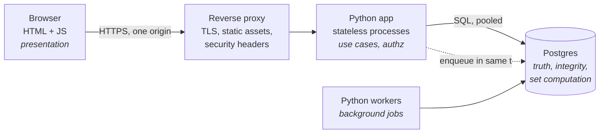
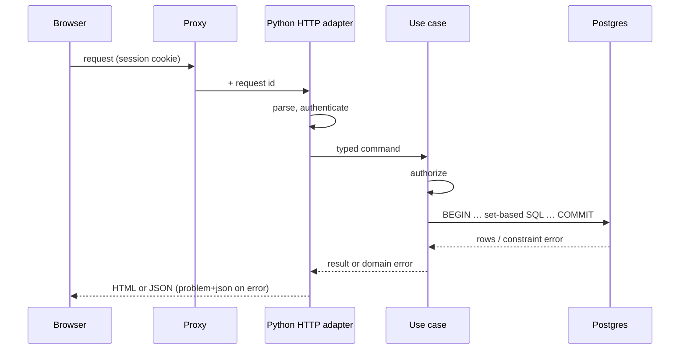

# Web Architecture Guidelines: JavaScript + Python + Postgres

Architecture-level guidance for a classic three-tier website: a browser running JavaScript, a
Python application server, a Postgres database. It decides **what each tier owns, how the tiers
talk, and which decisions a project must record**. Code-level conventions live elsewhere: Python
in [`../python_guidelines/`](../python_guidelines/README.md), JavaScript in a dedicated JS
guideline, CLI tools in [`../cli_guidelines/`](../cli_guidelines/README.md).

## TL;DR

- **Postgres holds the truth and enforces it; Python decides what may happen; JavaScript shows it.** Every invariant has exactly one authoritative tier. Copies elsewhere are conveniences.
- **The schema is the foundation.** Normalized, constrained, migrated by one owner. API shapes, Python code and UI are derived from it and from the use cases, never the other way round.
- **Default to the simplest topology that fits:** one origin, server-side sessions, stateless Python processes, Postgres for queueing and sessions before adding Redis or a broker.
- **Make the big choices explicitly and write them down:** rendering strategy, data-access style, schema owner, auth model, job queue. The [Decision Register](#level-3--decision-register) lists them with defaults.

## LEVEL 0 — MISSION

**Project a durable data model to people, through a browser, safely and fast.** The data
outlives the code: the frontend will be rewritten, the backend framework will change, the
schema and its data stay. Every rule below serves three properties, in this order:

1. **Correctness** — invalid states cannot be stored; unauthorized actions cannot run.
2. **Changeability** — each concern has one home, so a change touches one place.
3. **Operability** — every request can be traced, measured and replayed in thought.

Derivation order for any feature: usage → data flow → schema → contract → backend → frontend.

---

## LEVEL 1 — THE TIER MODEL



**Ownership — one authority per concern**

| Concern | Authority | Others may (convenience only) |
|---|---|---|
| Validity of stored data: types, nullability, uniqueness, references, row and set invariants | **Postgres** constraints | Python pre-checks for friendly errors; JS for instant feedback |
| Whether an action is allowed, workflows, external calls | **Python** use-case layer | Postgres row-level security as defense in depth |
| Rendering, interaction, transient UI state | **Browser** (JS / templates) | — |
| Persistent state | **Postgres** | Caches anywhere, if derived and disposable |

**The authority rule:** if the convenience copy is deleted or wrong, the system must still be
correct. A rule enforced only in JavaScript is not enforced. A uniqueness rule checked only in
Python is a race condition.

**One request, end to end**



---

### LEVEL 1.A — DATA TIER (Postgres)

**Rationale:** the database is the only tier that sees every write, from every process, forever.
Integrity enforced there cannot be bypassed by a new endpoint, a script or a bug.

**1.A.1 — Schema as source of truth**
- The schema is owned by **versioned, forward-only migrations**, reviewed like code. Pick **one owner**: a SQL migration tool (Alembic, sqitch, dbmate) or the framework's (Django migrations). Never two, never manual DDL in production.
- Normalize to **3NF by default**. Denormalization (JSONB columns, arrays, cached counters, materialized views) needs a written justification and a **drift guard**: a generated column, a trigger, a scheduled refresh, or a check query in CI.
- **Make invalid states unrepresentable:** `NOT NULL` by default; `CHECK`, `FOREIGN KEY`, `UNIQUE` (including partial unique indexes), exclusion constraints for overlaps. Reference data in lookup tables with a foreign key; Postgres `ENUM` only for closed sets that never lose values.
- JSONB is for genuinely schemaless payloads (third-party webhooks, user-defined attributes), not for avoiding a migration.

**1.A.2 — Types and keys**
- `timestamptz` for every instant; store UTC, localize in the UI. `date` for calendar dates.
- Money: `numeric` with explicit scale, or integer minor units. Never `float`.
- `text` over `varchar(n)` unless the length limit is itself a domain rule (then a `CHECK`).
- Internal keys: `bigint GENERATED ALWAYS AS IDENTITY`. Keys exposed in URLs or generated outside the database: UUIDv7 (time-ordered, index-friendly; native `uuidv7()` from Postgres 18). Do not expose sequential IDs where enumeration is a risk.

**1.A.3 — Namespaces and read contracts**
- One Postgres **schema per bounded context** (`catalog`, `billing`, `identity`), not everything in `public`.
- When the physical tables are likely to change, give the backend a **stable read contract** as views; the tables can then be refactored behind them.

**1.A.4 — Where logic lives: database or Python**
- **In Postgres:** what is a *property of the data* — integrity, derived values that must never drift (generated columns, audit triggers), set-based computation (aggregation, reporting, bulk updates).
- **In Python:** what is a *process applied to the data* — workflows, authorization, external I/O, anything needing a library, anything that changes weekly.
- Stored functions are fine for set-based operations called from Python; avoid business workflows in PL/pgSQL (hard to test, deploy and observe).

**1.A.5 — Set-based access**
- One query per set, not one per row: no N+1, no `for row in rows: execute(...)`. Bulk writes via `COPY`, multi-row `INSERT`, or `unnest()` over arrays.
- Every query that runs per request has an index plan checked with `EXPLAIN ANALYZE` on realistic data volumes.

**1.A.6 — Roles, connections, history, recovery**
- **Roles:** a migration role owns the schema; the application role has DML only on what it needs; a read-only role for analytics. The application never connects as owner or superuser.
- **Connections:** always pooled (in-process pool or PgBouncer). Size the pool to what Postgres can serve, not to request concurrency. With transaction-mode pooling, session state (`SET`, advisory locks, server-side prepared statements) does not survive between transactions; use `SET LOCAL`.
- **History:** decide explicitly. Minimum `created_at`/`updated_at`; audit trail via trigger into an audit table when "who changed what" matters. Prefer hard delete plus audit or an archive table over a `deleted_at` flag: soft delete leaks into every query and every unique constraint (if used, pair it with partial unique indexes and views that filter it).
- **Recovery:** point-in-time recovery enabled, and a restore actually tested. An untested backup is a hypothesis.

---

### LEVEL 1.B — APPLICATION TIER (Python)

**Rationale:** Python is where intent becomes action: it decides who may do what, sequences
workflows and talks to the outside world. Its structure should mirror the use cases, not the
framework.

**1.B.1 — Three layers, dependencies pointing inward**
- **HTTP adapter** — routing, parsing, authentication, serialization. Thin; framework-specific.
- **Use cases** — one function or class per user intention (`place_order`, `invite_member`). Authorizes, owns the transaction boundary, returns domain results or domain errors. Imports no web framework.
- **Data access** — queries; returns plain data (dataclasses, typed dicts, Pydantic models), not live ORM objects that lazy-load across layers.
- The same use cases serve HTTP handlers, background workers and admin scripts.

**1.B.2 — Transactions**
- **Transaction boundary = use case.** One unit of work per request by default.
- No transaction stays open across an external HTTP call. To trigger external effects from a database change, write an outbox row (or enqueue a job) **in the same transaction**, and let a worker perform the call.

**1.B.3 — Data-access style (decide and record)**
- **SQL-first** (psycopg 3 or SQLAlchemy Core; queries in modules or `.sql` files): default for data-centric applications, reporting, set-based work. The SQL you review is the SQL that runs.
- **ORM** (Django ORM, SQLAlchemy ORM): when the app is CRUD-heavy and the framework's admin, forms and auth are worth it. Rules: inspect generated SQL, forbid lazy loading inside loops, drop to SQL for set operations.
- Either way: **parameterized queries only**, never string-built SQL.

**1.B.4 — Framework choice, at architecture level**
- **Django** — batteries included (admin, auth, forms, ORM, migrations, templates); best for server-rendered sites and back-office.
- **FastAPI** — API-first with typed contracts; OpenAPI generated from Pydantic models; best behind a SPA.
- **Flask / Starlette** — small services where you assemble the parts yourself.
- Code-level details: [Python KB, web](../python_guidelines/LOD_3_domains/7.1.2_web.md) and [APIs](../python_guidelines/LOD_3_domains/7.1.5_apis.md).

**1.B.5 — Runtime model**
- **Stateless processes** (Twelve-Factor VI): nothing a later request needs lives in process memory. Sessions, uploads metadata, job state go to Postgres (or object storage for files).
- **Sync vs async, chosen once per app.** Sync is simpler and enough for most CRUD. Async pays when a request waits on several I/O calls concurrently, or for websockets and long-lived connections. Never call blocking I/O inside an async handler.
- **Configuration** from the environment, read once at startup into one typed settings object. Secrets never in the repository.

**1.B.6 — Background work**
- Anything slower than the request budget, retryable, or scheduled goes to a **job queue**.
- Start with a **Postgres-backed queue** (`SELECT … FOR UPDATE SKIP LOCKED`; libraries such as Procrastinate): transactional enqueue, no new infrastructure. Add Redis or a broker only when measured throughput demands it.
- Jobs are **idempotent** (safe to run twice) and carry their own retry and dead-letter policy.

---

### LEVEL 1.C — CONTRACT (Browser ↔ Python)

**Rationale:** the contract is the only thing frontend and backend both depend on. Make it an
explicit artifact so either side can change behind it.

**1.C.1 — What the contract is depends on rendering** ([1.D.1](#level-1d--presentation-tier-javascript))
- Server-rendered pages: the contract is **URLs, forms and HTML fragments**. Keep URLs stable and meaningful; forms post to the same use cases an API would.
- SPA or islands: the contract is a **JSON API** described by **OpenAPI**.

**1.C.2 — JSON API rules**
- The OpenAPI document is **the artifact**: checked in or generated in CI, diffed on every change. TypeScript types and the client are **generated** from it; no hand-written duplicate types.
- **Resources are shaped by use cases, not by tables.** Never serialize ORM rows or `SELECT *` directly; a column rename must not silently break clients.
- **Errors:** one format, RFC 9457 Problem Details (`application/problem+json`) with a stable machine-readable `type`, field paths for validation errors, no stack traces.
- **Pagination:** keyset (cursor) for unbounded or large lists; offset only for small bounded lists.
- **Idempotency:** `GET`, `PUT`, `DELETE` idempotent; a `POST` that creates something costly (order, payment) accepts an `Idempotency-Key`.
- **Time and numbers:** ISO 8601 with offset (UTC) on the wire; money as string decimal or integer minor units, never float.

**1.C.3 — Evolution**
- Additive change by default (new optional fields, new endpoints). Breaking change only through expand → migrate clients → contract.
- Even a first-party frontend deployed with the backend needs **one release of backward compatibility**: browsers keep old JS bundles open for hours.

**1.C.4 — Same origin**
- Serve pages, assets and API under **one origin** through the reverse proxy. No CORS to configure, cookies stay simple. CORS only for genuinely third-party consumers.

---

### LEVEL 1.D — PRESENTATION TIER (JavaScript)

**Rationale:** the browser is untrusted and ephemeral. It renders state and captures intent; it
never decides what is true or allowed. Code-level JS conventions belong to the JS guideline.

**1.D.1 — Rendering strategy (the first architectural decision)**

| Strategy | Fits | Cost |
|---|---|---|
| **Server-rendered pages + progressive enhancement** (Django/Jinja templates; htmx, Alpine or small vanilla modules) | Content sites, forms, CRUD, back-office, SEO. **Default for a classic website.** | Rich client interactions get awkward at scale |
| **Islands** — server pages with a few JS-framework widgets | Mostly-classic site with a handful of rich components (editor, map, dashboard) | Two rendering models to keep coherent |
| **SPA** (React, Vue, Svelte; built by Vite) + JSON API | App-like products: heavy interaction, offline, long sessions | Contract, client state, routing, SEO and auth all become your problem |
| **JS meta-framework SSR** (Next, Nuxt, SvelteKit) | When SSR plus SPA navigation is required | Adds a **Node server tier**: four tiers, Python becomes a pure API. Adopt only deliberately |

**1.D.2 — State classification**
- **Server state** — a cached copy of database truth. Fetch, cache, invalidate (a query-cache library for SPAs); never promote it to a global store and treat it as authoritative.
- **URL state** — filters, sort, page, selected tab, open item. If a user would bookmark or share it, it lives in the URL.
- **Form state** — drafts until submitted; validated in the browser for feedback, re-validated server-side for truth.
- **Ephemeral UI state** — open menus, hover, focus. Local to the component.

**1.D.3 — Build and delivery**
- One build tool producing content-hashed static assets; served by the proxy or a CDN with long-lived caching. HTML responses not cached (or short-lived), so new asset hashes are picked up.
- Semantic HTML first: accessibility and performance targets (Core Web Vitals) are set at architecture level, measured in CI or real-user monitoring.

---

## LEVEL 2 — CROSS-CUTTING CONCERNS

### CROSS-CUTTING 2.A — IDENTITY AND ACCESS
- **Browser authentication:** server-side sessions in `HttpOnly`, `Secure`, `SameSite=Lax` cookies, session store in Postgres or the framework's. Avoid JWTs in `localStorage` for a first-party browser app: readable by any XSS, hard to revoke.
- Tokens (OAuth 2 / OpenID Connect) for SSO through an identity provider, mobile apps or third-party API clients.
- **CSRF protection** is mandatory with cookie authentication: `SameSite` plus a token on state-changing requests.
- **Authorization** is decided in the use-case layer, through **one policy module**, never ad hoc in route handlers, never only in JS.
- **Multi-tenant data:** add Postgres row-level security as defense in depth, tenant set per transaction with `SET LOCAL`.
- Passwords: delegate to an identity provider, or use the framework's hasher (argon2id or equivalent). Never roll your own.

### CROSS-CUTTING 2.B — SECURITY BY TIER

| Risk | Control | Tier |
|---|---|---|
| Injection | Parameterized queries only; no dynamic identifiers without allowlist | Python, Postgres |
| Cross-site scripting | Auto-escaping templates; no `innerHTML` with untrusted data; Content-Security-Policy | Browser, proxy |
| Broken access control | Central policy module; row-level security for tenants; deny by default | Python, Postgres |
| Excessive privilege | Least-privilege database roles; app never owner | Postgres |
| Server-side request forgery | Allowlist outbound destinations for user-supplied URLs | Python |
| Secrets exposure | Environment or secret manager; never in repo, logs or the JS bundle | All |
| Vulnerable dependencies | Lockfiles on both sides; `pip-audit` and `npm audit` in CI | Python, JS |
| Transport and headers | TLS at the proxy; HSTS, CSP, `X-Content-Type-Options`, `frame-ancestors` | Proxy |

### CROSS-CUTTING 2.C — OBSERVABILITY
- **One request id**, created at the proxy, carried in every log line, returned in error responses, and attached to SQL (`application_name`, or a SQL comment via sqlcommenter) so a slow query traces back to its endpoint.
- **Structured logs** (JSON) from Python; frontend errors reported to the same place.
- **Metrics per endpoint:** rate, errors, duration. Postgres: `pg_stat_statements` on, slow-query logging on.
- OpenTelemetry as the vendor-neutral instrumentation layer when tracing is needed.

### CROSS-CUTTING 2.D — PERFORMANCE AND CACHING
- **Measure first.** Order of remedies: fix the query or index (`EXPLAIN ANALYZE`) → rewrite set-based → HTTP caching (`Cache-Control`, `ETag`) → materialized view or summary table → application cache (Redis) last.
- Every cache has a named owner, a key scheme and an invalidation rule written down. Caches are disposable: deleting one only costs speed.

### CROSS-CUTTING 2.E — TESTING BY TIER
- **Database:** constraints, functions and migrations tested against **real Postgres, same major version** (containers). Never substitute SQLite: different types, constraints and locking.
- **Migrations:** applied in CI on an empty database and on a prod-like snapshot; long locks caught before production.
- **Use cases:** tested through the real database, each test in a rolled-back transaction. Fast enough when the database runs locally.
- **Contract:** OpenAPI diff in CI flags breaking changes; responses validated against the schema.
- **Browser:** component tests for logic; a **few** end-to-end journeys (Playwright) across the full stack for the critical paths.

### CROSS-CUTTING 2.F — DELIVERY AND ENVIRONMENTS
- Twelve-Factor: build once, promote the same artifact through environments; dev/prod parity (same Postgres major locally, via containers).
- **Migrations run as their own release step, before the new code.** Zero-downtime changes follow expand → contract: add (nullable column, new table) → backfill → deploy code using it → enforce (`NOT NULL`, constraint) → remove the old.
- Avoid long locks: `CREATE INDEX CONCURRENTLY`; add constraints `NOT VALID`, then `VALIDATE CONSTRAINT`; set `lock_timeout` on migrations.
- Topology: reverse proxy (TLS, static files, headers, single origin) → WSGI/ASGI server (gunicorn, uvicorn) → Postgres. Workers deploy from the same artifact as the app.

### CROSS-CUTTING 2.G — REPOSITORY LAYOUT
One product, one repository, top-level folders by tier:

```
project/
├── db/          # migrations, SQL views and functions, seed data
├── backend/     # Python package: http/, usecases/, data/ (+ templates/ if server-rendered)
├── frontend/    # JS sources and build config (SPA or islands)
├── contract/    # openapi.yaml, when there is a JSON API
├── deploy/      # compose files, proxy config, infrastructure as code
└── docs/        # architecture overview, decisions/ (one record per decision)
```

---

## LEVEL 3 — DECISION REGISTER

Every project records these decisions (`docs/decisions/`, one short file each: context, choice,
consequences). The default applies when nothing argues otherwise.

| Decision | Default | Choose otherwise when |
|---|---|---|
| Rendering strategy | Server-rendered + progressive enhancement | App-like interaction → islands or SPA |
| Python framework | Django (server-rendered) / FastAPI (behind a SPA) | Small service → Flask or Starlette |
| Schema owner | One migration tool, SQL-first | Django ORM project → Django migrations |
| Data-access style | SQL-first (psycopg 3 / SQLAlchemy Core) | CRUD-heavy with admin → ORM, with the rules in 1.B.3 |
| Sync or async | Sync | Concurrent I/O fan-out, websockets |
| Browser auth | Server-side session cookie | SSO → OIDC; third-party clients → tokens |
| Key type | Identity `bigint` internal, UUIDv7 exposed | — |
| Deletion and history | Hard delete + audit table | Legal retention or undo → archive table or soft delete with partial unique indexes |
| Background jobs | Postgres-backed queue | Measured throughput beyond it → broker |
| Caching | None until measured | Hot read path proven by metrics |
| Multi-tenancy | Tenant column + central authz | Strong isolation needed → row-level security, or schema per tenant |

---

## LEVEL 4 — ANTI-PATTERNS

- **Validation only in the browser**, or uniqueness checked only in Python: the authority rule is broken.
- **The schema as a by-product** of ORM classes nobody reviews as a data model.
- **Two schema owners** (ORM auto-sync plus hand-written SQL migrations).
- **N+1 queries** hidden behind lazy loading; row loops where one set-based statement would do.
- **API = tables:** endpoints that mirror the table layout, so every migration is a breaking change.
- **Business workflows in PL/pgSQL**, or integrity rules in Python: logic in the wrong tier.
- **A global client store as a second database**, with its own idea of truth.
- **JWT in `localStorage`** for a first-party site.
- **Redis, a broker and a cache on day one**, before any measurement asked for them.
- **Transactions held across external HTTP calls.**
- **Soft-delete flags** added everywhere "just in case".
- **A Node SSR tier added by default** in front of a Python backend, without a recorded decision.

---

## Sources

- The Twelve-Factor App — https://12factor.net
- RFC 9457, Problem Details for HTTP APIs — https://www.rfc-editor.org/rfc/rfc9457
- OWASP Top 10 and Application Security Verification Standard — https://owasp.org
- PostgreSQL documentation: constraints, row security policies, explicit locking, `CREATE INDEX CONCURRENTLY` — https://www.postgresql.org/docs/
- Martin Fowler, *Patterns of Enterprise Application Architecture* (Service Layer, Unit of Work)
- Martin Kleppmann, *Designing Data-Intensive Applications*
- Alistair Cockburn, Hexagonal Architecture (ports and adapters)
- OpenTelemetry — https://opentelemetry.io
