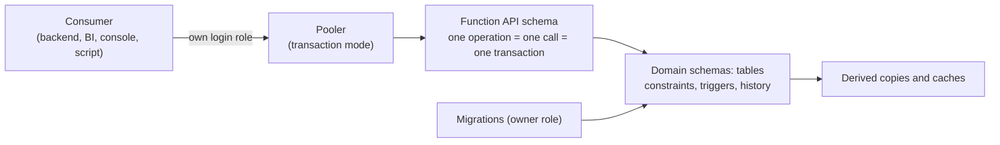

# Stack Defaults: Postgres Data Tier

Defaults for the Postgres data tier of a web application on this stack: how the schema is laid out, what the database guarantees whoever writes, how concurrency, change over time and derived data are handled, and how [consumers](glossary.md#consumer) reach the data. It refines [Durable Data](philosophy.md#durable-data) of the philosophy and the [Allocation Matrix](allocation.md#allocation-matrix).

## Table of Contents

1. [Data Tier Overview](#data-tier-overview) _(Lines 20-52)_
1. [Schema Organization](#schema-organization) _(Lines 55-134)_
1. [Declared Integrity](#declared-integrity) _(Lines 137-192)_
1. [Concurrency Mechanics](#concurrency-mechanics) _(Lines 195-251)_
1. [Data Maintenance](#data-maintenance) _(Lines 254-321)_
1. [Derived Data](#derived-data) _(Lines 324-347)_
1. [Database Interface](#database-interface) _(Lines 350-382)_
1. [Deferred Topics](#deferred-topics) _(Lines 385-390)_

---

## Data Tier Overview
<!-- Lines 20-52 -->

Postgres is the system of record and holds everything that must hold whoever touches the data. Assume the database is shared by several backends and other consumers (reporting, admin consoles, scripts). Therefore constraints, multi-table operations, per-role privileges and audit live in the database, and its [function API](glossary.md#function-api) is the default contract to the data. `PIG-WEB-DATA`

| Area | Practice in one line |
|---|---|
| [Schema organization](#schema-organization) | Normalized tables, scope-leading keys, precise types, readable names, bounded validated JSON, domain schemas, justified indexes |
| [Declared integrity](#declared-integrity) | Every expressible rule is a named constraint; one role per consumer, no DELETE; no [row-level security](glossary.md#row-level-security) by default; triggers for a closed list |
| [Concurrency mechanics](#concurrency-mechanics) | Serializable with caller retry for every writer; version checks on edited rows; transaction-scoped locks |
| [Data maintenance](#data-maintenance) | Online-safe versioned migrations with a [drift gate](glossary.md#drift-gate); deletion per table, basic soft delete by default; trigger-written history; proven restores |
| [Derived data](#derived-data) | [Derived copies](glossary.md#copy) only with a sync plan and drift guard; caches classified and invalidated in the source transaction |
| [Database interface](#database-interface) | Function API through a transaction-mode pooler with per-role limits |

### Maintainer Decisions in This File

- **Deletion**: a design choice per table; the default is basic soft delete, and hard delete with a same-transaction archive is the case for some caches and for data consumers must be unable to reach ([Deletion, Retention and Partitioning](#deletion-retention-and-partitioning)).
- **Reads**: simple reads that carry no logic query base tables directly; sensitive, complex or shared reads, per-user visibility rules included, go through database read functions that receive the verified [actor](glossary.md#actor). The reporting role reads comment content and narrower-audience comments only through those functions; the operator role sees every row ([Roles and Privileges](#roles-and-privileges), [Functions and Views](#functions-and-views)).

### Gaps and Deferred Topics

- Gap: collation (no evidence grounds a choice); tamper-detection mechanism for history; recovery objectives (how much loss, how long a restore).
- Deferred, recorded only: personal-data erasure, high availability and replication, search. See [Deferred Topics](#deferred-topics).

---

## Schema Organization
<!-- Lines 55-134 -->

The schema in migrations is the origin of every stored fact and of the function API's contract. Persistence models and function wrappers are generated from the live catalogue, never hand-copied. `PIG-WEB-DATA.ORGANIZE`

### Tables and Normalization

- Repeating groups are always a child table with a foreign key.
- A vertical split of a wide table is a physical choice, made only when a measured access pattern needs it: same key in each part, a one-to-one foreign key from each part to the main row.
- Subtype tables share the parent's key, which is both their primary key and a foreign key to the parent.
- An array column is allowed only for a bounded, read-heavy set of values that reference nothing. Declare its bound and element rules on the column (a CHECK over an immutable function, or the write-time trigger of [Triggers](#triggers) where the rule is not row-local; inferred). A rule that only callers apply does not count.

Refines [Organized Facts](philosophy.md#organized-facts). `PIG-WEB-DATA.ORGANIZE.1`

### Keys

- Every table has a primary key. A row scoped to a parent that most queries filter by gets a composite key led by the scope column, down to the most selective scope level and at most about four columns. Foreign keys carry every key column in order, so a child cannot reference a row in another scope (inferred). Top-level entities get a single surrogate key.
- Identity columns, never `serial`; no auto-number for natural or composite keys. 8-byte by default; 4-byte only where the table's size is bounded by design (lookup, status, type, configuration), not by forecast. Types are identical on both sides of every relationship.
- UUID only for a stated technical reason (global uniqueness, integration with external systems, avoiding sequence contention, client-supplied ids for idempotent creates (inferred)), and then UUIDv7, never v4. A UUIDv7 timestamp is never the creation time. A deterministic UUID in a stored generated column serves a public identifier over a composite natural key.
- Soft deletion does not decide key shape; only the scope question does.
- Departs from the maintainer's practice, which sizes integer keys by expected cardinality (4 bytes under about two billion rows): 8-byte keys by default, because an overflowing key is repaired by rewriting the table and every referencing column at its largest.

Changes when no query family filters by the parent and no cross-scope reference must be prevented: a single surrogate key for scoped rows.

`PIG-WEB-DATA.ORGANIZE.2`

### Column Types

Choose for precision, so the structure refuses wrong values.

| Value | Type and rule |
|---|---|
| Time | `timestamptz` everywhere; event times named `*_at` and ordered by CHECK |
| Text | `text` with CHECK for a length limit; never `char(n)` or `varchar(n)` |
| Money, quantities | `numeric` with declared precision; never `money` |
| Enumerations | Lookup table with a foreign key; CHECK IN only for short sets stable by definition; no native enums |
| Booleans | NOT NULL, a default, a positive name |
| Audit columns | `created_at` on every table (append-only included); `updated_at` on every table whose rows change, set by the trigger of [Triggers](#triggers); none on append-only tables |

Store canonical values (UTC instants, plain numbers, codes); format only where rendered.
- Departs from the maintainer's practice, which puts `updated_at` on every table: none on append-only tables (history, archive and queue rows), whose rows never change, so the column would state nothing (inferred).
- Open: collation is left undecided; no evidence grounds a default.

`PIG-WEB-DATA.ORGANIZE.3`

### Naming

- Lower-case snake_case; schema-qualified in production code (this also closes the search-path attack on functions run with their owner's rights).
- Names carry role and type: `entity_id`, `*_at`, `is_`/`has_`/`can_`, named constraints. No bare `id` or `status` in new tables.
- Constraint names spell source and target, so a violation maps to a stable error.
- Conventions evolve forward only: new objects follow the rule; legacy names change through [expand, migrate, contract](glossary.md#expand-migrate-contract) ([Migrations](#migrations)).

`PIG-WEB-DATA.ORGANIZE.4`

### JSON Documents

- `jsonb` only where no relational shape exists: an indivisible object, or a flexible periphery on a normalized core. Never for core entities or queried fields; anything that drives logic, filtering or joins is a column. No deep nesting (over three levels), no binary content, bounded size.
- Every stored document is validated on write by a trigger that calls the registry's validate function, against schemas held in a registry table (binding by trigger inferred). A CHECK cannot do it (the validator reads the registry and is not immutable). Gap: the validator mechanism was not read.
- A relaxing schema change happens in place. A breaking change adds a new named version beside the old; the stored documents migrate in the same release, so no table holds mixed versions.

Acceptable when a single writer path exists and the document never crosses a boundary: validation by caller convention alone.

`PIG-WEB-DATA.ORGANIZE.5`

### Schemas and Tenancy

- Schemas are business-domain namespaces. Nothing in `public`; CREATE on `public` revoked. The function API schema is the one technical namespace, justified by the permissions it carries.
- The default is a single tenant: build no tenancy mechanism. A multi-tenant project records its choice: separate databases where tenants are few and contractual or regulatory isolation is required; otherwise shared tables with the tenant key leading every composite key (criteria inferred). Row-level security only under the conditions in [Request Context and Row Security](#request-context-and-row-security); application checks are kept and denial is tested through the deployed role.

`PIG-WEB-DATA.ORGANIZE.6`

### Indexes

- Every foreign-key column leads some index.
- Every other index names the query pattern it serves, in its comment or migration. Unique, partial unique and exclusion constraints count as integrity indexes.
- Index the predicates [writer functions](glossary.md#writer-function) filter by: under Serializable, unindexed predicates take relation-level predicate locks (inferred).
- Indexes on live tables are built concurrently.

`PIG-WEB-DATA.ORGANIZE.7`

---

## Declared Integrity
<!-- Lines 137-192 -->

Every rule a declarative constraint can express is declared and named, because only what is bound to the table holds for every writer. Consumers get narrow roles, the acting user travels as a checked claim, and triggers do only a closed list of atomic work. `PIG-WEB-DATA.GUARD`

### Constraints

- NOT NULL by default; a nullable column states the absence it means. Columns that must be present together get a CHECK.
- Foreign keys: every reference declared, across schemas too. NO ACTION by default; SET NULL for optional links; CASCADE only for a component meaningless without its parent, never for core entities, soft-deletable tables or cross-schema links. Other deletion goes through a deletion function ([Deletion, Retention and Partitioning](#deletion-retention-and-partitioning)).
- CHECK: row-local and immutable, paired with NOT NULL (ranges, lengths, either-or, conditional requirements, time ordering). Complex row-local rules live in reusable immutable functions called from the CHECK.
- Cross-row rules, in order: partial unique index, `NULLS NOT DISTINCT`, exclusion constraint; beyond them a constraint trigger under Serializable, or a lock.
- Junction tables: both foreign keys NOT NULL plus uniqueness on the pair; a surrogate id only when the junction has attributes.
- Hierarchies: fixed depth is one table per level (inferred). Unbounded depth keeps the parent link as a declared self-referencing foreign key, with acyclicity checked by a constraint trigger under Serializable (inferred). A materialized path, closure table or nested set is a derived read structure, kept in the same transaction with a sync plan and drift guard, never the only representation.
- Deferrable constraints only for circular dependencies or in-transaction reordering. Domains for value types used in several places; changing a domain check on a large table uses NOT VALID then VALIDATE (inferred).
- Every constraint is named with source and target. Backend validators are generated from, or tested against, the constraints. Same-row derived values are stored generated columns.
- Departs from the maintainer's practice, which treats CHECK constraints and triggers as optional defence in depth: every expressible rule is declared.
- Departs from the maintainer's practice, which avoids self-referencing foreign keys and prefers a materialized path, closure table or nested set: the parent link stays the declared fact, and those structures are derived copies.

`PIG-WEB-DATA.GUARD.1`

### Roles and Privileges

- One login role per consumer (each backend, the reporting tool, the console, each script family): never owner, never superuser, member of narrow NOLOGIN group roles per functional branch (read, API, admin). Writes are EXECUTE on writer functions, not table DML. Direct INSERT or UPDATE is granted only under the single-consumer exception of [Database Function API](allocation.md#database-function-api), and never on [state columns](glossary.md#state-column). Humans have personal login roles, members of the operator or read roles; they assert only themselves as actor.
- No consumer holds DELETE or owns objects. The [owner role](glossary.md#owner-role) owns tables and runs migrations and human-run jobs; it never serves requests and does not own functions that run with their owner's rights.
- A function that must write what the caller cannot is owned by a narrow NOLOGIN role holding only that DML (a deletion role, a history-writer role, a cache-maintenance role), with a fixed `search_path` and schema-qualified references (inferred). No consumer is a member of these roles.
- Revoke EXECUTE on functions, and CONNECT and TEMPORARY, from PUBLIC; set default privileges; each REVOKE in the creating transaction.
- Reporting role: SELECT on the tables and columns it needs, personal-data columns withheld by default, on a replica when its load matters. It gets no SELECT on comment content or on comments with a narrower audience than their target and reads them only through database functions. The operator role sees every row; any other role that may SELECT a table sees every row unless its own role is restricted.
- Authentication: `scram-sha-256`, TLS for every remote connection, trust only on local sockets. Per-role settings (timeouts, default isolation) are set on the role.
- A function lists a role's effective permissions, and CI checks the grant matrix against the role design (inferred).

`PIG-WEB-DATA.GUARD.2`

### Request Context and Row Security

- The acting user, and the person an agent acts for, always reach the database as transaction-local settings (`SET LOCAL` or `set_config(..., true)`) in a reserved namespace, derived from the backend's verified identity. This holds with or without row security, and keeps context from leaking across pooled connections.
- The actor is a claim, not a verified fact. Writer functions and audit triggers refuse a write with no actor and check that the session role may assert that kind of actor (a backend: an end user or agent; an operator or owner role: only itself and, for owner-run jobs, a ticket id). One table, read by one function, holds the pairing (inferred).
- Fixture context lives in a separate namespace production code never reads.
- **Row-level security is not enabled by default.** It is acceptable only when the data model is simple, the scoping key (client, tenant or owner id) is present in every table the policy covers, in practice composite primary keys led by that key, and no all-powerful administrator role must read or write across scopes. Authorization stays a backend decision with database privileges per role as the second gate. Where row security is used: keep the backend checks; the request role is neither owner nor superuser and FORCE is set where the owner connects; policies get a design review and denial tests through the deployed role and connection path; policy columns are indexed. See [Row Security Placement](allocation.md#row-security-placement).

`PIG-WEB-DATA.GUARD.3`

### Triggers

Triggers do work that must be atomic with the write and hold for every writer:

- history rows (AFTER ROW, append-only);
- constraint triggers for invariants no declarative constraint expresses, asserting the isolation level they need (including refusing an active child of a soft-deleted parent, and dependencies lost by a Boyce-Codd decomposition when no declarative form exists);
- same-transaction maintenance of a derived copy;
- JSON validation on write and actor checks;
- `updated_at`: a narrow BEFORE UPDATE trigger stamps only when the row changes (`NEW IS DISTINCT FROM OLD`; inferred). Writers also skip no-op rows with an `IS DISTINCT FROM` predicate. Code-written `updated_at` is acceptable only when every writer of the table is a writer function that sets it, with no direct-write grant and no owner-run job.
- Departs from the maintainer's practice, which writes `updated_at` in code: the trigger holds for every writer, and stamping only on change meets the practice's aim of no needless writes.

Not in triggers: state transitions and multi-table business operations (writer functions), [outbox](glossary.md#outbox) and job rows (written explicitly by the writer function), anything that calls outside the database. Each trigger is documented in its table comment and named so that name order is firing order; a trigger does not fire another trigger's work.

`PIG-WEB-DATA.GUARD.4`

---

## Concurrency Mechanics
<!-- Lines 195-251 -->

Every writing role runs Serializable with a whole-call retry owned by the caller; user-edited rows also carry a checked version. Locks are transaction-scoped and exceptional; sequences are treated as gappy; facts are written before the state label. `PIG-WEB-DATA.CONCURRENCY`

### Default Concurrency Strategy

- Serializable is the default isolation of every writing role, owner included (inferred for the owner), set on the role (`ALTER ROLE ... SET default_transaction_isolation`) so it survives transaction pooling. No writing role is exempt: one lower-isolation writer voids the guarantee for all.
- Writer functions and constraint triggers assert `serializable` and raise otherwise.
- A serialization failure aborts the transaction, so the function cannot retry itself: every caller of a writer function owns a bounded retry of the whole call (backend: at the use-case boundary; job runner: per idempotent batch; consoles and scripts: their own, named in the shared specification).
- User-edited rows: a version column; the writer function takes the expected version and writes with it in the predicate. Where conflicts are frequent or lost work is costly, a [lease](glossary.md#lease) row checked by the writer function.
- Read-only roles: reporting on the primary reads at Repeatable Read, or `SERIALIZABLE READ ONLY DEFERRABLE` where a report must be serializable; replica reports accept snapshot anomalies. No check that decides a write reads a replica.
- Exceptions, recorded: a write protected on a replica uses Repeatable Read plus explicit locks on the primary; a human-run job that cannot run Serializable is a recorded exception under the [data-job checklist](glossary.md#data-job-checklist) and takes explicit locks on what it writes (inferred). Throughput under the default is not measured.

`PIG-WEB-DATA.CONCURRENCY.1`

### Isolation Mechanics

- Record the isolation of each operation: Serializable by default, every deviation named with its reason.
- Read-modify-write never spans backend and database: one statement, or a version predicate, inside the writer function. A version write affecting zero rows raises a stable error the backend maps to a precondition failure.
- Keep Serializable cheap: declare read-only transactions, keep transactions short, bound connections with the pooler, index predicates, remove locks Serializable made redundant.
- Retry `40001` and `40P01` as the whole call, logic included, with bounded attempts and backoff. Do not retry `23505` blindly (it may be persistent).
- Critical invariants are constraints, not isolation alone. Keep the server on a current minor release.
- Tests: logic tests run in never-committing transactions; behaviour visible only at commit (retries, lock waits, deferred constraints, outbox) is tested with committing sessions in a disposable database, never a shared one. Concurrency tests are part of the default suite.

`PIG-WEB-DATA.CONCURRENCY.2`

### Locks

- Explicit locks serve three cases: contention on a hot logical key, the exceptions of the default strategy, and claiming queue rows (`FOR UPDATE SKIP LOCKED`, queue tables only).
- Transaction-scoped only; session-level advisory locks never. Several objects are locked in one documented order; never a locking call beside a LIMIT at the same query level.
- Advisory lock key: a 64-bit hash of a text built from every key dimension, not the two-int4 form.
- No lock outlives a transaction and none spans user think time; a lease for long edits is a row the writer function checks.

`PIG-WEB-DATA.CONCURRENCY.3`

### Atomic Statements

- An inseparable change is one statement, or separate statements in one transaction (one writer function) when one must see another's effect. In batch jobs, where statements run in their own transactions, the single statement is required.
- Re-runnable work (jobs, migrations, deliveries) is idempotent by form: absolute assignments, upserts, conflict-ignoring inserts, self-limiting predicates.
- Operations behind an [idempotency key](glossary.md#idempotency-key) recorded in the same transaction may use relative updates such as `n = n + 1` (inferred).
- Insert-or-update is `ON CONFLICT DO UPDATE`, never select-then-branch.

`PIG-WEB-DATA.CONCURRENCY.4`

### Sequences and Commit Order

- Sequences are identifiers only: gaps are normal, never a business count, and no value leaves the database before commit.
- Gapless business numbers (invoices) come from a counter row updated by the writer function in the business transaction, accepting serialized writers for that series.
- Readers that must see every row avoid cursors where possible: claim rows with `SKIP LOCKED` and mark or delete them when processed (inferred). Where a cursor is needed (ordered feed, incremental export), use an `xid8` column and the snapshot horizon. Never a bare id or `updated_at > last` cursor (the timestamp case inferred).

`PIG-WEB-DATA.CONCURRENCY.5`

### State Transition Order

Where one fact spans several places, the single writer function of the state column writes the facts first and flips the state label last, after a transition audit against the data. A new transition is enforced from its first release. Observe-only checks are a time-boxed migration aid, acceptable only when introduced over existing data that already violates them, with the violations listed and the release that turns enforcement on recorded (exit condition inferred). `PIG-WEB-DATA.CONCURRENCY.6`

---

## Data Maintenance
<!-- Lines 254-321 -->

Structure changes only through small, re-runnable, online-safe versioned migrations with a CI drift gate; every change leaves append-only history; deletion is chosen per table, basic soft delete by default; recovery is proven by rehearsal. `PIG-WEB-DATA.MAINTAIN`

### Migrations

- Path: versioned, reviewed migrations in version control, run by automation as a release step in every environment, a database per developer, the same CI pipeline as code.
- Form: each change small; DDL re-runnable (conditional create and drop, create or replace); one owner role per table, set in its creation script.
- Online safety: short `lock_timeout` with retry on every DDL; a column default added only when non-volatile, otherwise the multi-step route; constraints NOT VALID then VALIDATE; SET NOT NULL proven by a validated CHECK; indexes built concurrently outside a transaction (a failed build is dropped and retried); type changes as add, backfill, switch, drop.
- Schema and data apart: a backfill is a separate, batched step outside the schema migration's transaction; beyond the bulk-job threshold it is a human-run job.
- Incompatible changes: expand, migrate, contract (dual write, verified read switch, write switch, removal). Drops and renames only in the contract phase, once no deployed consumer references the old object. "Deployed consumer" covers backends, BI queries, consoles and scripts.
- Drift gate: CI applies every migration to an empty database and compares its catalogue with production's (schema objects, grants, function signatures; mechanism inferred). A difference fails the release and is reconciled by a migration, never by editing the live database.

Principle: [Locks and Online Schema Change](../software_development_guidelines/change_flow_data_and_measure.md#locks-and-online-schema-change), [Bulk and Backfill Design](../software_development_guidelines/change_flow_data_and_measure.md#bulk-and-backfill-design).
`PIG-WEB-DATA.MAINTAIN.1`

### Deletion, Retention and Partitioning

Deletion is a design choice per table, weighed on the data's importance, whether it can be reconstructed easily (caches can), how often it changes and its business value; it always runs through functions owned by a narrow deletion role that no consumer can use directly.
- Decide per table and record it: the reason the data is kept selects the mechanism. Lookup, configuration and ephemeral rows are hard-deleted. Rebuildable caches are invalidated or dropped, never soft-deleted. Bulk expiry of time-bounded data is a partition drop or detach; adopt partitioning only when size justifies it, with partition keys in primary and unique keys. Queryable past values use the temporal model of [History Tables](#history-tables).
- Default: basic soft delete, a `deleted_at` column with no change to the primary key; every consumer excludes deleted rows. Soft delete comes in two kinds: last-state (the row stays, marked deleted) and full-history (every past state is kept). Foreign keys are required in every case; where they are not enough (full-history soft delete), database functions or triggers maintain the soft-delete logic.
- Whatever the mechanism: deletion goes only through functions owned by the narrow deletion role, which holds DELETE on the target tables and INSERT on the archive; no consumer holds DELETE. A hard delete of retained data copies the row to an archive in the same transaction. Hard delete without archive for retained data: never.
- Where soft delete is used, all of these apply:
  - `deleted_at` is a nullable `timestamptz`, never a boolean; NULL means active; every read filters on it; partial indexes cover active rows.
  - Constraints exempt deleted rows (row-local checks carry an "or deleted" escape; uniqueness uses a partial unique index over active rows).
  - Cascades shadow the foreign-key graph: the child set and order equal what a native cascade would remove unless a deviation is explicit and justified. They run in dedicated functions, not bare updates, that validate business rules, invalidate derived caches, report per-table counts and log.
  - Soft-delete functions are idempotent (an already deleted or missing row affects zero rows, no error), polyvalent (one signature for single and bulk; bulk needs an explicit confirmation flag), and reject a deletion time earlier than the row's creation. They exist as a wrapper only where a cascade or business rule exists; leaf tables get the single-table base function only.
  - Safeguards (inferred): (1) a constraint trigger on the child table refuses an active row whose parent is soft-deleted, under Serializable or with a lock on the parent row, since no foreign key does; (2) the active-row predicate is written once in the shared specification every consumer reads with, and the reporting role's documentation names it; (3) a restore re-checks the row against current constraints; (4) soft deletion propagates down a hierarchy of soft-deleting tables as the model requires, by database functions or triggers, children in order.

Acceptable for some cache profiles, and when consumers must be guaranteed unable to reach past, historical or outdated data: hard delete plus a same-transaction archive. Its weaknesses are a performance cost at scale and, the biggest, keeping the current and archive table schemas in sync.

Principle: [Layered Protection and Deletion Form](../software_development_guidelines/assurance_interfaces_data.md#layered-protection-and-deletion-form).
`PIG-WEB-DATA.MAINTAIN.2`

### History Tables

- Every table holding business data has an AFTER ROW trigger writing an append-only history row in the same transaction: table, key, operation, old and new values, session role, claimed actor, the person an agent acts for, transaction id, record time `created_at`, and the business time and reason when the writer passes them. Agent actions add correlation id and outcome.
- Append-only by privilege: no consumer holds UPDATE or DELETE on history; the trigger function is owned by the narrow history-writer role (INSERT only; inferred). Retention purges are owner-run jobs under the data-job checklist. Writes with no actor, or an actor the session role may not assert, are refused.
- High-value data adds tamper detection (chained row hashes or an external anchor), because the owner role owns the history tables and bypasses grants. The requirement stands; the mechanism is open.
- Where the product queries past values: a temporal model with `WITHOUT OVERLAPS` and `PERIOD` foreign keys on Postgres 18 or later, exclusion constraints with ranges before; check the version per project.
- Statement-level audit of owner and operator sessions (DDL, human-run jobs) uses pgaudit or logging, routed to the security event log, not the history tables.

Acceptable when one application is the only writer: application-written audit instead of trigger history.

`PIG-WEB-DATA.MAINTAIN.3`

### Bulk Data Jobs

- Large data changes are batched, idempotent jobs run by a human after a checklist, not by automation. They run as the owner role, setting the operator and a ticket id as actor. A state column changes only through its writer function or as a recorded exception.
- Shard a statement across parallel workers only at roughly 10^7 to 10^9 rows; smaller work is an ordinary batched step outside the migration. Never shard DDL.
- Four decisions, in order: batching key (primary-key part or indexed foreign key, then numeric range over an indexed surrogate, modulo last; keyset rather than offset paging); work list generated from the data, with batches per entity = ceiling of count over batch size; fan-out over disjoint rows, pool sized by the smallest of connection headroom, IO headroom and tolerable lag, ramped from one batch to one worker to four; observe and recover on lock waits, dead tuples and replica lag.
- Each batch is its own Serializable transaction and idempotent by form (a procedure with transaction control is the tool for per-batch commits). Keep a job log so only failures resume. A convergence query must reach zero before the job is done; state the stop plan.

Principle: [Running and Watching a Production Data Job](../software_development_guidelines/change_flow_data_and_measure.md#running-and-watching-a-production-data-job).
`PIG-WEB-DATA.MAINTAIN.4`

### Backup and Recovery

- Point-in-time recovery by default: base backups plus continuous [WAL](glossary.md#wal) archiving to a repository on another host, with retention and tracked chains. Test and monitor archiving before the first base backup.
- A backup counts only once a restore of it has been rehearsed, and restores are rehearsed on a schedule.
- Logical dumps (roles dumped separately) serve portability and partial copies, never as the recovery plan. Configuration is in version control.
- `fsync` on, write caches safe. `synchronous_commit` on by default; off only per transaction or role for data that may be lost on a crash, such as rebuildable caches (per-transaction scope inferred).
- Gap: recovery objectives (how much loss, how long a restore) are not set here; each project states them.

Principle: [Backup Scope and Design](../software_development_guidelines/operation_recovery_and_feedback.md#backup-scope-and-design), [Backup Protection and Isolation](../software_development_guidelines/operation_recovery_and_feedback.md#backup-protection-and-isolation).
`PIG-WEB-DATA.MAINTAIN.5`

---

## Derived Data
<!-- Lines 324-347 -->

Postgres stores the minimum and derives the rest. A stored derived value is a copy, chosen in the order generated column, same-transaction trigger, cache table with stated staleness; every copy has a sync plan and a drift guard. `PIG-WEB-DATA.DERIVE`

### Denormalization and Sync

- A copy exists only when computing on read is measured too costly. Record the sync plan in the table comment before building it.
- Mechanism, in order (the order inferred): a stored generated column for same-row values; a same-transaction trigger when any reader decides a write from the copy or shows it as authoritative (the writer function instead only when the source table admits no other writer: no direct-write grant, no owner-run job); a cache table with stated staleness otherwise.
- Every copy except a generated column gets a drift guard that recomputes and alerts on divergence. "Documentation only" never stands alone.
- The database guards the redundancy, not "the application": several applications write.
- The indivisible-object and flexible-periphery cases are organizing choices, governed by [JSON Documents](#json-documents).

`PIG-WEB-DATA.DERIVE.1`

### Cache Tables

- Caches are hand-managed tables classified by recomputability (aggregates of immutable source, outputs of logic outside SQL, expensive SQL aggregates). The key follows the query pattern; timestamps allow staleness detection; the name carries a cache-class suffix; the table comment states sync level, freshness requirement, source and impact of divergence.
- Invalidation: the source change inserts the cache key in the same transaction (trigger, or writer function only when no other writer exists). Workers claim keys with `FOR UPDATE SKIP LOCKED` in bounded batches and recompute set-based, not row by row (inferred). A cache whose sources other consumers also write keeps its invalidation in the source's transaction; full ownership applies only to a service that is the only writer of the sources.
- `UNLOGGED` only for rebuildable caches no replica reader needs (contents are not replicated to standbys, so a reporting role reading there cannot see them; exact standby behaviour inferred). Materialized views only for an atomic full refresh.
- Cache rows are invalidated or dropped by functions owned by the narrow cache-maintenance role, never soft-deleted, never served from process memory.

`PIG-WEB-DATA.DERIVE.2`

---

## Database Interface
<!-- Lines 350-382 -->

The database offers a function API in its own schema, with one business operation per call, reached through a transaction-mode pooler. Refines [Database Function API](allocation.md#database-function-api) and [Offered Contract](philosophy.md#offered-contract). `PIG-WEB-DATA.INTERFACE`

### Functions and Views

- One business operation is one database function call in its own transaction; backends never compose several calls into one operation. A database function may call another domain's published functions in the same transaction; what is forbidden across domains is direct access to another domain's tables.
- Ladder: every write that is a business operation is a function; simple reads query base tables, except sensitive, complex or shared reads and per-user visibility rules, which go through read functions ([Access Control Enforcement](stack_defaults_logic_security.md#access-control-enforcement)); a procedure only where transaction control is needed, in practice owner-run batch jobs (inferred), since a procedure that commits inside cannot be a consumer's call.
- Views are never contract objects. A throwaway view uses `security_invoker` when the caller's rights must apply and `security_barrier` for filters.
- Conventions: names by entity, action, variant; parameters validated first; a safe variant over a base operation; errors naming the function with stable codes (which, with named constraints, backends map to their interface errors); one result row per affected table with action and count; a change log per function; set-based statements. The override flag for blockable business rules is honoured only for roles granted it (inferred), and its use is recorded in history with the actor.
- Parameters the [placements](glossary.md#placement) require: the expected version for user-edited rows, the idempotency key where the operation is not idempotent by design, the business reason where history needs it. The actor comes from the transaction-local context, never from a parameter.
- Security: EXECUTE revoked from PUBLIC and granted per [consumer role](glossary.md#consumer-role); owner's rights only where the function must write what the caller cannot, the owner a narrow NOLOGIN role, with a fixed `search_path`.
- Evolution: additive changes (new functions, new parameters with defaults) need nothing more. A breaking change goes expand, migrate, contract: the new behaviour ships as a new function or variant beside the old; consumers move; the old one is removed in a change marked coordinated once no consumer calls it, checked by the catalogue diff in CI and by evidence of zero calls over a stated window (inferred). "[Deployed together](glossary.md#deployed-together)" only when every consumer of the changed object ships in the same deployment as the migration.
- Departs from the maintainer's practice, where "deployed together" is the general rule for breaking changes: it holds only under that same-deployment condition; otherwise expand, migrate, contract.
- The interface description stays in sync with the implementation by process; for the function API, the catalogue diff in CI is that process, and generated wrappers are its consumer-side copy.
- Functions ship as migrations and are tested against a live database in CI, under the test boundary of [Isolation Mechanics](#isolation-mechanics).

`PIG-WEB-DATA.INTERFACE.1`

### Connections and Pooling

- An external pooler in transaction mode for backends and consoles. The design avoids session state: context in transaction-local settings, transaction-scoped advisory locks only, settings on the role. Prepared statements, LISTEN and WITH HOLD cursors are not used through it. A listener for database notifications connects directly or in session mode.
- Gap: two points not checked against a source. Newer PgBouncer releases are reported to support protocol-level prepared statements in transaction mode; drivers that cache prepared statements by default must be configured to match the pooler, in backends, consoles and scripts.
- Owner-run jobs and migrations use session-mode or direct connections.
- Pool size: start from cores x 2 plus effective spindles and measure on the workload (inferred: a heuristic from one practitioner source).
- Per consumer role: a connection limit (so BI or a script cannot starve the backends); `statement_timeout`, `lock_timeout` and `idle_in_transaction_session_timeout` on the role (short for backends, longer for reporting, short `lock_timeout` for the owner's DDL); default isolation on the role. Reserve slots for administration. No global timeouts in server configuration.
- Remote connections over TLS with `scram-sha-256`.

Acceptable when a consumer needs session state the design cannot avoid: session-mode pooling for that backend.

`PIG-WEB-DATA.INTERFACE.2`

---

## Deferred Topics
<!-- Lines 385-390 -->

Out of scope for this guideline; recorded only, not decided.

- **Personal Data Erasure**: how personal data is erased or anonymized on request. `PIG-WEB-DATA.MAINTAIN.6`
- **High Availability and Replication**: how the database survives the loss of its primary. `PIG-WEB-DATA.MAINTAIN.7`
- **Search**: how full-text and faceted search is provided. `PIG-WEB-DATA.DERIVE.3`
