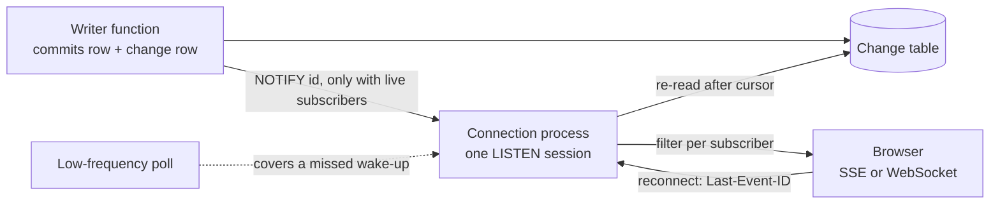

# Stack Defaults: Browser Surface

How browsers show, edit and discuss the data on this stack: HTML rendered per request by Python, editing without loss, real-time channels as hints over a correct pull, comments and collaboration, and the browser environment. The agent surface of the same tier is in [Stack Defaults: Agent Surface](stack_defaults_agents.md#agent-surface-overview).

## Table of Contents

1. [Browser Surface Overview](#browser-surface-overview) _(Lines 18-24)_
1. [Browser Rendering](#browser-rendering) _(Lines 27-76)_
1. [Editing Without Loss](#editing-without-loss) _(Lines 79-89)_
1. [Real-Time Channels](#real-time-channels) _(Lines 92-166)_
1. [Comments and Collaboration](#comments-and-collaboration) _(Lines 169-212)_
1. [Browser Environment](#browser-environment) _(Lines 215-236)_

---

## Browser Surface Overview
<!-- Lines 18-24 -->

The browser and the agent surface hold copies and decide nothing durable. Python renders HTML per request, enhanced with JavaScript only where a part is interactive; agents reach the same HTTP core through an OAuth-protected adapter ([Agent Surface](stack_defaults_agents.md#agent-surface-overview)). Each holds only copies (the version it read, drafts, a server-state cache, its own credential), and every decision reaches a backend and the database's [writer functions](glossary.md#writer-function). Refines [Interaction](philosophy.md#interaction) of the philosophy and rests on the [Allocation Matrix](allocation.md#allocation-matrix).

Per-user reads go through database read functions, as [sensitive reads](glossary.md#sensitive-read) ([Authorization](allocation.md#authorization)); this reaches [Channel Security](#channel-security) and [Notifications and Moderation](#notifications-and-moderation).

`PIG-WEB-INTERACTION`

## Browser Rendering
<!-- Lines 27-76 -->

Per-request HTML from Python, JavaScript only for interactive parts, client state held by kind (navigable state in the URL), the [LCP](glossary.md#lcp) element in the first HTML, [WCAG](glossary.md#wcag) 2.2 AA with native HTML before [ARIA](glossary.md#aria). Refines [Perceivable Interface](philosophy.md#perceivable-interface). `PIG-WEB-INTERACTION.VISUALIZE`

### Rendering Technique

Request-dependent pages are rendered per request by Python; pages whose URL set is known ahead (documentation, marketing, help) are built ahead; partial updates are server-rendered HTML fragments. Server and build-time rendering keep first content fast and pages crawlable.
- No request-time JavaScript server ([JavaScript Server Tier](allocation.md#javascript-server-tier)). Enhancement swaps server-rendered HTML; it never renders large HTML in the browser and never fully rehydrates a server page.
- JavaScript only where a part is interactive, added by feature detection ([Capability and Page Lifecycle](#capability-and-page-lifecycle)); navigation and core forms work without it.
- Client-rendered [islands](glossary.md#island) only under the criteria of [Rendering](allocation.md#rendering) (many interdependent controls, very high update frequency, real-time collaboration). Independent widgets are independent islands; widgets sharing live state get one client-state owner for the region or share it through the URL, never state synchronized between islands. An island never renders a page's main content or its error state.
- Secrets never reach the browser bundle: no credential, key or private setting compiled into JavaScript or exposed through client build-time variables; a framework's server/client boundary is explicit (inferred).
- Open: which fragment-swap library and which island component library; none was compared. Choose per project against a small script budget and native semantics ([Accessibility](#accessibility)).

Changes when: a client-rendered application is chosen for most of the product. Then use a framework with routing, data loading and server rendering, which also triggers the JavaScript-server condition.
`PIG-WEB-INTERACTION.VISUALIZE.1`

### Client State

Browser state is held by kind; the browser only holds copies of what the server owns (inferred: rests on one vendor source).

| State | Where it lives |
|---|---|
| Server data on server-rendered pages | The HTML is the copy; freshness by validators and the HTTP cache rules of [Response Caching](stack_defaults_logic.md#response-caching) |
| Server data in a client-rendered island | A dedicated server-state cache (deduplication, background refresh, explicit staleness), never a general-purpose store; each record keeps the version it was read at, so a write carries it |
| Navigable view state (filters, sort, page, tab, open record) | The URL, through the History API; fragments only for in-page anchors |
| Form state | The browser until submitted; unsaved input persisted per [Capability and Page Lifecycle](#capability-and-page-lifecycle) |
| Presence | The real-time channel with a timeout, never tables |

Never in browser storage: credentials or session tokens, and any state that must survive as data. Refines [UI and Ephemeral State](allocation.md#ui-and-ephemeral-state), [Identity and Session State](allocation.md#identity-and-session-state) and [Concurrency Control](allocation.md#concurrency-control-and-conflict-resolution).
`PIG-WEB-INTERACTION.VISUALIZE.2`

### Page Performance

One release rule for every page template, so loading, interaction and layout stay fast and stable.
- The LCP element is in the server HTML, its resource referenced there (preloaded when not discoverable early), never lazy-loaded, never rendered by an island.
- Small DOM; handlers yield and split long work into tasks; reserved dimensions for images, embeds and late content.
- Targets and field measurement belong to [Page Experience Targets](stack_defaults_transverse.md#page-experience-targets): LCP 2.5 s, [INP](glossary.md#inp) 200 ms, [CLS](glossary.md#cls) 0.1.

`PIG-WEB-INTERACTION.VISUALIZE.3`

### Accessibility

WCAG 2.2 level AA is the conformance target of every full page, embedded third-party content included. Controls use native HTML before ARIA, so everyone can perceive and operate the interface.
- A widget or embed that cannot meet AA is replaced or given an AA alternative on the same page.
- AAA criteria are adopted where content allows (for example enhanced contrast) and recorded per project; never required site-wide.
- Native elements before ARIA, every control keyboard-operable with visible focus. Server-rendered HTML gives this by default; islands meet the same rules.
- Checked from the first design: automated checks in delivery plus keyboard and screen-reader passes on each new template (test method inferred).
- Gap: accessibility mandates of other jurisdictions were not read.

`PIG-WEB-INTERACTION.VISUALIZE.4`

## Editing Without Loss
<!-- Lines 79-89 -->

Every state-changing form POSTs and answers 303, and every edit of a user-edited record carries the version it read. A stale write is shown as a conflict with both versions, never merged silently or lost. Duplicate submissions are suppressed in layers; unsaved input survives the page. Refines [Concurrency Control](allocation.md#concurrency-control-and-conflict-resolution) and [Duplicate Suppression](allocation.md#duplicate-suppression).
- Forms POST; success answers 303; failed validation re-renders with the user's input kept (inferred). Search and filter forms use GET so state lands in the URL.
- The version travels with every edit: a hidden field in HTML forms (a plain form cannot send If-Match; inferred), If-Match with the ETag from JavaScript and agent clients. The backend passes it to the writer function as the expected version. Required, except per-property last-writer-wins updates (toggles, status, assignment, ordering), which go without it.
- Codes: If-Match mismatch 412; missing condition 428 on every such endpoint. A stale hidden version is a conflict with current state, 409 (mapping in [Status Codes and Errors](stack_defaults_logic.md#status-codes-and-errors)); a form missing its version is rejected as malformed and re-rendered (inferred).
- A stale write re-renders the form with the user's input and the current values beside it, fields changed by the other writer marked, the new version embedded; the user reapplies (conflict screen inferred). A patch applies all or nothing under its precondition.
- Duplicates: submit control disabled with a pending state; create forms carry a form token minted at render, sent as the [idempotency key](glossary.md#idempotency-key) the writer function records; 303 after success.
- Unsaved input is saved on page hide, restored on return, cleared after submit ([Capability and Page Lifecycle](#capability-and-page-lifecycle)).

`PIG-WEB-INTERACTION.EDIT`

## Real-Time Channels
<!-- Lines 92-166 -->

Push is a hint over a correct pull: pages are correct on plain load and clients catch up from a [commit-safe cursor](glossary.md#change-cursor). Channels are chosen in order of simplicity, held by a dedicated [ASGI](glossary.md#asgi) process type, secured per subscription and per event, woken by Postgres with the data in tables. Refines [Collaboration on Data](philosophy.md#collaboration-on-data). `PIG-WEB-INTERACTION.REALTIME`

### Channel Choice

Use the simplest channel that meets the need (the order is inferred from one guide). Push is only a hint, so a buffered or failed stream delays updates but never corrupts state.
- None where data changes rarely or staleness does not matter.
- Short polling for slow-changing views with second-scale tolerance, ended by a status code.
- Server-sent events for one-way push (notifications, comment streams, status of long work): resume by event id, authenticate by session cookie ([SSE](glossary.md#sse) has no custom headers).
- WebSocket only for frequent two-way, low-latency traffic: live cursors, typing, the collaborative text engine.
- Long polling only where streaming cannot pass a hop.
- Buffering is contained: turned off on the team's own proxy for streaming routes; a client treats a stream silent past the heartbeat interval as broken and falls back to polling (inferred).
- No Redis by default.

`PIG-WEB-INTERACTION.REALTIME.1`

### Channel Operation

Streams are never cached, every event id is the commit-safe change cursor, keep-alives run below the shortest idle timeout on unbuffered routes over HTTP/2, and clients reconnect with backoff and resync by cursor.
- No caching of streams (`Cache-Control: no-cache`; the SSE client uses no-store).
- Resume by cursor: each event's id is the change cursor (a sequence id is not one). On reconnect the server replays from the change table after `Last-Event-ID`; a cursor too old to replay tells the client to reload state, as fallback only (inferred).
- Known latency cost: the cursor reads only rows from transactions older than the oldest still in flight, so one long transaction on the primary holds back every push and catch-up. Accepted as the price of never skipping a row. The idle-in-transaction timeout ends abandoned transactions but not a long active one, so the horizon's lag is monitored like the notification queue ([Database Notifications](#database-notifications); bound and monitoring inferred).
- Keep-alive: an SSE comment about every 15 s and WebSocket pings, under every hop's idle timeout; the application's above the load balancer's.
- Buffering off at the reverse proxy for streaming routes (`proxy_buffering off` or `X-Accel-Buffering: no`), served by async workers; HTTP/2 to the browser so SSE escapes the six-connection cap (a shared worker with one stream per origin where an HTTP/1.1 hop remains).
- WebSocket through nginx: Upgrade and Connection set explicitly, chain verified; HTTP/2 only where every hop enables extended CONNECT. Input size and rate capped.
- Reconnect with exponential backoff and random jitter (inferred), then resync by cursor: deploys and restarts drop every connection at once.

`PIG-WEB-INTERACTION.REALTIME.2`

### Long-Lived Connection Servers

Long-lived connections run in a dedicated ASGI process type of the same backend deployable (inferred), apart from page and API workers, and fan out from a Postgres wake-up followed by a table re-read.
- Routed by path at the proxy, scaled on its own measure; a process type, not a separate service (no split without a measured need).
- Each connection process holds one listening connection, wakes on a notification, reads new changes after its last cursor, and pushes to local subscribers after the per-subscriber filter.
- Redis only at a measured limit (NOTIFY commit serialisation) or where the chosen WebSocket framework's only production backend is Redis; the change is still committed to the table first, no dual write.
- Open: the NOTIFY threshold is not fixed by this guideline; measure it.

`PIG-WEB-INTERACTION.REALTIME.3`

### Channel Security

Connections use TLS only, an Origin allowlist and the session cookie; no token is ever in a URL. Authorization is checked per subscription and per event, streams close at session end, and message size, rate and connections are capped.
- Handshake and SSE endpoint check Origin against an explicit allowlist (cross-site WebSocket hijacking); compression off unless measured necessary.
- Authentication by the session cookie (HttpOnly, Secure, SameSite). No session, bearer or long-lived token in a URL; the signed file-delivery exception does not apply to channels. Agent clients send their bearer credential in the header (inferred).
- Subscribing checks the right to read the target; each event is filtered per subscriber with the same filter as every other surface. Payloads carry identifiers, the cursor and a change kind; content is fetched through the normal authorized endpoints (inferred).
- Session end closes the stream; the connection process re-checks the session at an interval no longer than the idle timeout (inferred).
- Message size, rate and connections per user and client capped; inbound messages are untrusted input.
- Per-user reads: each event is filtered per subscriber through the database read functions of [Access Control Enforcement](stack_defaults_logic_security.md#access-control-enforcement), and the shared denial-test suite covers the real-time channel. Per-event filtering protects the channel the application serves, nothing stronger; the reporting-role comment restriction of [Notifications and Moderation](#notifications-and-moderation) applies.

Refines [Authorization](allocation.md#authorization) and [Identity and Session State](allocation.md#identity-and-session-state).
`PIG-WEB-INTERACTION.REALTIME.4`

### Database Notifications

LISTEN and NOTIFY are a wake-up signal only. The writer function that commits a change also writes the change row and issues NOTIFY with an identifier payload in the same transaction (issuer inferred); [consumers](glossary.md#consumer) re-read the table after their cursor.
- Delivery is at commit, in commit order, never for a rolled-back change. Consumers LISTEN and commit, read current state, then rely on notifications; collapsing of identical notifications is harmless.
- Events that must not be lost are rows ([outbox](glossary.md#outbox) or change table). A low-frequency poll of the same table covers a missed wake-up (inferred).
- NOTIFY only where a change has live subscribers: a full queue makes committing transactions fail, so one stuck listener could fail core writes. Other writer functions write change rows without notifying (inferred).
- One direct, session-level listening connection per process, outside any transaction, never through a transaction-pooling pooler; listener sessions run under the idle-in-transaction timeout. Queue usage is monitored (inferred); a listener in a long transaction is an incident.
- Test the wake-up path with committing sessions in a disposable database, never a shared one.
- Open: the NOTIFY threshold.

Refines [Postgres First for Backing Roles](allocation.md#postgres-first-for-backing-roles) and [Side Effects and Integrations](allocation.md#side-effects-and-integrations).
`PIG-WEB-INTERACTION.REALTIME.5`

## Comments and Collaboration
<!-- Lines 169-212 -->

Comments are rows anchored by foreign key and target version, threads use a parent pointer, notifications are rows written with the comment, moderation is a recorded queue, and a server-authoritative text engine serves only long shared text. Every write is one writer-function call; abilities and visibility follow [Authorization](allocation.md#authorization), the read rule included: sensitive reads go through database functions. The comment model rests on a single source (inferred). Refines [Collaboration on Data](philosophy.md#collaboration-on-data). `PIG-WEB-INTERACTION.COLLABORATE`

### Comment Anchoring

A comment is anchored by a mandatory foreign key to its target record, with an optional field name, and always records the target version it was written against (inferred: "always" follows from the versioning and history rules). A comment whose anchor is lost stays visible apart, never deleted or silently reattached.
- A type-and-id pair without a foreign key is not an anchor. The interface marks a comment written on an earlier version.
- Ranges only for long text, stored with redundant selectors; offsets alone suffice for text immutable per version. Anchor state is explicit: anchored, moved, orphaned or outdated.
- Written through the comment writer function: comment, notification rows and history are one multi-table operation.

`PIG-WEB-INTERACTION.COLLABORATE.1`

### Threads and Comment Lifecycle

Threads are an adjacency list with one displayed reply level and a thread-root id set at insert. Resolution lives on the root and is reversible. Deletion is a [tombstone](glossary.md#tombstone) through the comment's deletion function with replies kept. Every edit is an append-only revision shown as edited.
- One displayed reply level, thread-root id set once at insert: a thread loads in one indexed query; resolution, counts and permissions attach to the root.
- Resolution is reversible, never a deletion. The row-decidable part of who may resolve (the target's author) is the writer function's; target writers and product roles granting "resolve" are each backend's policy. The thread's opener gets no resolve right by default.
- Tombstone: content cleared, `deleted_at` and [actor](glossary.md#actor) kept, replies preserved; an update through the deletion function, never a bare update or DELETE grant. Keeping replies is an explicit deviation from the soft-delete cascade, so a thread stays readable when one comment goes.
- Revision rows are the comment's history. After a tombstone they stay under the history's retention and access rules (moderators only) until a retention or erasure rule removes them (inferred).
- Open: erasure of personal data conflicts with the archive-copy rule, since an archive copy defeats an erasure. It belongs to the deferred personal-data topic ([Deferred Topics](stack_defaults_data.md#deferred-topics)); the default deletion mechanism for user-facing data is basic soft delete ([Deletion, Retention and Partitioning](stack_defaults_data.md#deletion-retention-and-partitioning)), and a tombstone keeps threads intact (inferred).

`PIG-WEB-INTERACTION.COLLABORATE.2`

### Collaborative Text Editing

Structured fields keep optimistic versions ([Editing Without Loss](#editing-without-loss)). Only fields people genuinely write together (description, notes, document body) get a text engine, which is server-authoritative.
- Clients send steps against the document version they hold. The server accepts steps only against the current version, checks the edit right per batch, persists through the writer function with the expected version (inferred), and broadcasts; a client behind rebases and resends.
- Steps, presence and cursors travel on a WebSocket; presence has a timeout, never tables. Comments are append-only rows and need no merge.

Changes when: offline use moves the system of record to the client; only then does a [CRDT](glossary.md#crdt) win. Refines [Concurrency Control](allocation.md#concurrency-control-and-conflict-resolution), [System of Record](allocation.md#system-of-record) and [UI and Ephemeral State](allocation.md#ui-and-ephemeral-state).
`PIG-WEB-INTERACTION.COLLABORATE.3`

### Notifications and Moderation

Notifications are rows written by the comment writer function in the comment's transaction and delivered after commit. Mentions notify only recipients who may see the target. Moderation actions are always recorded; removal runs through a deletion function; a report queue is required whenever people outside the team read comments.
- In-app read state from the notification rows, woken by [Database Notifications](#database-notifications); external delivery is the deferred [Email and Push Delivery](stack_defaults_logic.md#email-and-push-delivery). Mentions are parsed on the server and notify only a recipient who may see the target.
- Moderation: hide and restore with reason, actor and time written to history; hide first, remove only under a retention or legal rule (see the erasure conflict in [Threads and Comment Lifecycle](#threads-and-comment-lifecycle)); no DELETE grant. Authors edit their own comments within a stated window, each edit a revision.
- Report queue (report rows, status, decision) required when comments are visible outside the team (customers, the public). Moderate is a separate ability; agent-authored comments are marked and filterable as a class.
- Open: the author edit-window value. Gap: legal moderation obligations were not read.
- A recipient's read right: the backend that submits the comment checks each recipient through the database read function of [Access Control Enforcement](stack_defaults_logic_security.md#access-control-enforcement) before passing recipients to the writer function. That protects the notifications the application sends, nothing stronger: the operator role and any unrestricted role that may SELECT the base tables see notification rows too. The reporting role gets no SELECT on comment content or on comments with a narrower audience than their target, and reads comments only through database functions ([Roles and Privileges](stack_defaults_data.md#roles-and-privileges)).

Refines [Side Effects and Integrations](allocation.md#side-effects-and-integrations), [Authorization](allocation.md#authorization) and [Audit and History](allocation.md#audit-and-history).
`PIG-WEB-INTERACTION.COLLABORATE.4`

## Browser Environment
<!-- Lines 215-236 -->

Feature detection, back/forward-cache eligibility, input saved on page hide; offline and internationalization deferred. Refines [Web Environment](philosophy.md#web-environment). `PIG-WEB-INTERACTION.ENVIRONMENT`

### Capability and Page Lifecycle

Enhancement detects features and varies nothing on User-Agent.
- No unload handlers; `no-store` only on pages showing sensitive data.
- On `pageshow` from the back/forward cache, refresh time-sensitive state and re-check the session so a page restored after logout does not stay usable (inferred).
- Unsaved input is saved on `visibilitychange` or `pagehide`, never `unload`, and restored on return. It sits in per-tab or per-origin storage, cleared after a successful submit or at logout. On pages showing sensitive data, drafts go to per-tab storage only or are not persisted, so they do not outlive the session on a shared device (inferred).

Refines [UI and Ephemeral State](allocation.md#ui-and-ephemeral-state).
`PIG-WEB-INTERACTION.ENVIRONMENT.1`

### Offline and Installable Apps

Deferred: out of scope, recorded only. Offline use with user-owned data moves the system of record to a client replica ([System of Record](allocation.md#system-of-record)).
`PIG-WEB-INTERACTION.ENVIRONMENT.2`

### Internationalization

Deferred: out of scope, recorded only. Translation follows [Formatting and Localization](allocation.md#formatting-and-localization): the rendering tier formats, and storage stays canonical.
`PIG-WEB-INTERACTION.ENVIRONMENT.3`
