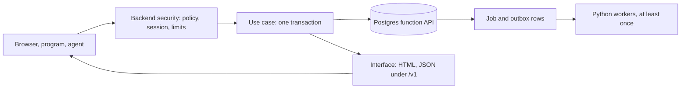

# Stack Defaults: Python Application Tier

How a Django backend carries the business logic tier above the Postgres [function API](glossary.md#function-api): one use-case layer, one typed function call per business operation, side effects delivered at least once, and HTML to browsers beside a described JSON interface to programs and agents. Backend security is in [Stack Defaults: Backend Security](stack_defaults_logic_security.md#backend-security-overview).

## Table of Contents

1. [Python Tier Overview](#python-tier-overview) _(Lines 16-40)_
1. [Business Logic Realization](#business-logic-realization) _(Lines 43-105)_
1. [Processing and Side Effects](#processing-and-side-effects) _(Lines 108-184)_
1. [HTTP Interface](#http-interface) _(Lines 187-286)_

---

## Python Tier Overview
<!-- Lines 16-40 -->

The Python backend is the gate every caller passes and the workflow tier above the Postgres function API. It realizes the [Business Logic Tier](philosophy.md#business-logic-tier) of the philosophy; the [placement](glossary.md#placement) of each responsibility is in the [Allocation Matrix](allocation.md#allocation-matrix).
- Django, synchronous handlers; asynchronous code only in the process type that holds long-lived connections. The framework choice rests on criteria inferred from settled decisions ([Framework Choice](#framework-choice)).
- Each backend is one deployable, not split into services without a measured need; several backends may share the database.
- Access is decided by one central, deny-by-default, object-level policy module; nothing the caller sends decides access ([Backend Security](stack_defaults_logic_security.md#backend-security-overview)).
- Each business operation is one call to a generated, typed wrapper of a database API function, in one transaction that also sets the verified [actor](glossary.md#actor).
- Side effects are rows written by database functions in the transaction of the change, delivered at least once to idempotent [consumers](glossary.md#consumer).
- Every interface description (OpenAPI, function catalogue, agent tool surface) is always in sync with the implementation, gated in CI.
- The backend is not the [authority](glossary.md#authority) for business rules on shared data and never writes shared tables directly.

Acceptable when one backend is the only database consumer and the team's SQL skill is low: the backend as the authority for all business rules, with Active Record models writing the tables.

`PIG-WEB-LOGIC`

## Business Logic Realization
<!-- Lines 43-105 -->

One use-case layer called by every entry point, writes only through generated wrappers, reads gathered in one statement with filtering, sorting and paging in Postgres. Refines [Business Core](philosophy.md#business-core). `PIG-WEB-LOGIC.ENFORCE`

### Use-Case Layer

Realizes [Business Rules and State Transitions](allocation.md#business-rules-and-state-transitions).
- One layer per backend, the only way into its logic: HTML views, JSON endpoints, the agent adapter, management commands and job handlers call the same functions. Handlers parse into Pydantic models, call one use case, map its outcome to status and representation.
- A use case holds the backend's share (product policy, workflow across operations, external calls) and never composes several API calls into one business operation.
- The use case decides whether to set a [writer function](glossary.md#writer-function)'s override flag, after the policy module authorizes it.
- State transitions stay in the database. ORM models are read mappers, never saved (inferred), except tables under the direct-write exception (the session table, other single-writer tables the backend owns).
- Forbidden: orchestration in each handler; state transitions in backend domain objects.

Acceptable when one backend is the only database consumer and SQL skill is low: ORM models as the domain (Active Record).
`PIG-WEB-LOGIC.ENFORCE.1`

### Transactions

- One business operation, one transaction, holding exactly the actor setting and one API call (`transaction.atomic(durable=True)` asserting outermost, `ATOMIC_REQUESTS` off); rolled back on any exception, no exception swallowed inside, errors mapped after the block.
- Never two API calls in one transaction, a transaction per request, or one open across a remote call or think time.
- Reads precede the write; the write carries the version it read, so the writer function rejects stale decisions.
- Plain reads (base tables under SELECT grants, no rule needing the actor) run in autocommit; a read needing the actor runs in a short read-only transaction through the generated wrapper; read functions refuse a missing actor.
- One connection per thread (per task under async). Isolation level set per [consumer role](glossary.md#consumer-role) in the database, never lowered per transaction.
- The wrapper retries the whole one-call transaction on SQLSTATE 40001 and 40P01, within the caps of [Resilience](#resilience); after an unknown commit outcome only keyed calls retry.
- Tests: never-committing transactions for logic on shared data; committing sessions in a disposable database for retries, lock waits, deferred constraints and the [outbox](glossary.md#outbox); concurrency tests in the default suite.

Acceptable when one backend is the only consumer and the request makes no remote call: a request-wide transaction.
`PIG-WEB-LOGIC.ENFORCE.2`

### Data Access

Refines [Filtering, Sorting, Paging and Search](allocation.md#filtering-sorting-paging-and-search).
- Writes only through the generated wrappers; the ORM writes only direct-write-exception tables.
- Reads: the ORM as read-only mappers for simple reads on base tables under SELECT grants; read functions where a read applies a rule.
- One statement per use case, related rows joined or eagerly loaded, never queries in loops; filtering, sorting and paging in the statement: keyset pages for structured-data collections and large or growing sets, with a server maximum page size.
- Raw SQL with bound parameters only; varying identifiers from an allowlist.
- Derived data from database cache tables or derived columns; no view as a contract; no read store outside the database.
- [Per-user read rules](glossary.md#per-user-rule): [sensitive reads](glossary.md#sensitive-read) go through the read function with the actor set, as [Access Control Enforcement](stack_defaults_logic_security.md#access-control-enforcement) sets, never by filtering loaded rows in Python; the table is not read directly for them.
- Forbidden: views as read contract; ORM-first writes; loading full sets into Python to reduce them; a second query layer beside the ORM.

Acceptable when one backend is the only consumer: ORM-first writes.
`PIG-WEB-LOGIC.ENFORCE.3`

### Concurrency Model

- Request paths are synchronous on a synchronous server: async is not inherently faster and Django transactions do not work in async mode.
- Async only in the separate process type holding long-lived connections, or a handler fanning out many concurrent external calls. Then: nothing blocking on the event loop; each transaction in one synchronous function (Django) or one `AsyncSession` per task (SQLAlchemy); `CONN_MAX_AGE` 0, pool sized to in-flight queries.

Acceptable when a process is dominated by long-lived connections or concurrent external I/O: async everywhere.
`PIG-WEB-LOGIC.ENFORCE.4`

### Framework Choice

Django, recorded as a decision with criteria (inferred from settled decisions; no neutral source ranks the frameworks).
- Criteria: server-held revocable sessions in Postgres, built-in [CSRF](glossary.md#csrf) protection, server-rendered HTML with forms, synchronous handlers, built-in password hashing and validators.
- Admin and Active Record are constrained by the function API: shared-table models are read mappers; an admin console never writes shared tables directly.
- Pydantic parsing is added at the boundary; Django forms stay for HTML. Django's task framework needs a worker backend, here the Postgres queue ([Background and Scheduled Jobs](#background-and-scheduled-jobs)).
- Gap: how Pydantic models and the OpenAPI 3.1 description are produced under Django was not read (candidate to verify: Django Ninja, Pydantic v2); the always-in-sync gate depends on it.

Changes when: the backend serves only programs and agents with bearer tokens; FastAPI then wins.

Principle: [Evaluation Process and Admission Gate](../software_development_guidelines/ownership_stance_selection.md#evaluation-process-and-admission-gate).
`PIG-WEB-LOGIC.ENFORCE.5`

## Processing and Side Effects
<!-- Lines 108-184 -->

Deferred work and side effects are rows written by database functions in the transaction of the change, claimed by Python workers, delivered at least once to idempotent consumers; no enqueue outside the data transaction. Refines [Processing Model](philosophy.md#processing-model) and [Side Effects and Integrations](allocation.md#side-effects-and-integrations). `PIG-WEB-LOGIC.PROCESS`

### Background and Scheduled Jobs

Realizes [Job and Schedule Host](allocation.md#job-and-schedule-host).
- Python workers (a separate process type) claim job rows with `FOR UPDATE SKIP LOCKED` inside the job table's writer functions: claim marks the job running with an expiry in one short call, no transaction held over the work, an expired job is claimable again, SIGTERM returns the job (claim protocol inferred).
- Pure data schedules run in the Postgres scheduler as named function calls; a schedule needing Python inserts a job row.
- Jobs take ids and re-fetch, are idempotent, never wait on another job (chain by inserting the next row), are short, named, error-handled with failures visible, without overlapping schedules, with documented duration and heavy work off-peak.
- Monitor failures, duration, missed runs (none within twice the interval) and backlog age.
- In-process background work only for small work that may be lost. A framework task backend that enqueues by its own insert outside the function's transaction is not used for work that must not be lost.
- Open: which Python runner; none was read over a queue table written by database functions.

Principle: [Scheduled Work Signals](../software_development_guidelines/operation_objectives_and_signals.md#scheduled-work-signals).
`PIG-WEB-LOGIC.PROCESS.1`

### Side Effects and Delivery

Refines [Side Effects and Integrations](allocation.md#side-effects-and-integrations) and [Deferred and Scheduled Work](allocation.md#deferred-and-scheduled-work).
- Effects that must not be lost are outbox or job rows written by the database function; workers deliver after commit, at least once. Each consumer is idempotent: it records the processed message id in the transaction of its own change and answers a repeat as the first.
- Foreign mutations run as atomic phases in a worker: the request writes the intent with its [idempotency key](glossary.md#idempotency-key) through one API call and answers 202 with a [status resource](glossary.md#status-resource); each local phase is one API call recording a recovery point on the key row; commit before each foreign call; the key is passed to the foreign system; a completer job for abandoned operations, a reaper for old keys.
- Never a transaction open across a remote call; no saga inside one Postgres.
- Post-commit hooks only for losable work, registered robust.
- Forbidden: post-commit hooks as default carrier; enqueueing to a broker before or after commit.

Acceptable when the user must see the foreign outcome in the same response and the call is expected to finish within a few seconds, under the request timeout: in-request phases.
`PIG-WEB-LOGIC.PROCESS.2`

### Resilience

- Every outbound call has a timeout shorter than the caller's remaining deadline.
- Retry only idempotent or keyed calls, exponential backoff with jitter, at exactly one layer: in the request path the outbound client (within the deadline, at most three attempts, 10% retry budget per client); for deferred work the job runner, with a failed state monitoring shows. HTTP client libraries do not retry beneath either.
- A circuit breaker, its state changes logged, only for an external dependency called from the request path that fails slowly or is shared by many callers; business errors stay business errors. Database retries follow [Transactions](#transactions).
- Forbidden: unbounded or immediate retries; retries at several layers; unkeyed retry of a non-idempotent call.

Principle: [Protecting Remote Calls](../software_development_guidelines/assurance_performance_availability.md#protecting-remote-calls).
`PIG-WEB-LOGIC.PROCESS.3`

### File Upload Path

- Default: direct to object storage (inferred: no source weighs the two paths). The backend authorizes the uploader, records a pending upload row through an API function, and issues a POST policy for one random, server-chosen key with content-length range, exact content type, key prefix and short expiry (minutes, value recorded per project).
- The signed upload policy and the signed download URL of [File Serving](#file-serving) are both cases of the single signed-file-URL exception ([URL as Public Interface](philosophy.md#url-as-public-interface)); the policy's scope is one upload to one key under its limits.
- Large files: multipart or resumable upload with checksums; a lifecycle rule deletes incomplete uploads.
- The policy-issuing endpoint carries the gates: authentication, authorization, CSRF, size and filename limits; the scanner checks post-decompression size of archives.
- Forbidden: an unconstrained presigned URL when storage must enforce limits.
- Gap: whether a presigned PUT can bound size was not verified.

Acceptable when a small file's content must be read in the same request: through the application, streamed, with body-size limits at proxy and framework, and the same gates.
`PIG-WEB-LOGIC.PROCESS.4`

### File Scanning and Storage

Applies the one-writer rule of [Business Rules and State Transitions](allocation.md#business-rules-and-state-transitions) to the upload's [state column](glossary.md#state-column).
- Every upload is a Postgres row (key, owner, size, content type, checksum, state); bytes in object storage; `bytea` only for small files that must commit atomically with other data.
- One writer function for state: pending at issue; available only after storage confirmation and clean scan; failed or expired otherwise; a scheduled sweep expires stale pending rows and deletes their objects (state machine inferred).
- Before availability the worker verifies the actual signature against an allowlist and sets the stored content type from it, not the declared header; mismatch means failed.
- Scanning is asynchronous (worker or provider), with disarm and reconstruction for documents; objects unreadable until clean; scan results reach the writer idempotently.
- No download URL for a row not available, the uploader included (inferred).
- Forbidden: serving before a clean scan; trusting the declared content type.

`PIG-WEB-LOGIC.PROCESS.5`

### File Serving

- The backend maps a file id to its row, checks authorization (product policy and the per-user read rule) and the available state, then redirects (`private, no-store`) to a short-lived signed URL (redirect pattern inferred): one GET of one object, no listing, minutes (value recorded per project). It is a case of the single signed-file-URL exception ([URL as Public Interface](philosophy.md#url-as-public-interface)).
- Serve from the storage host, another origin than the application, with the stored `Content-Type`, `nosniff`, and `attachment` with a sanitized filename unless meant to render inline.
- Forbidden: a public bucket for private files; exposing storage paths.
- Per-user read rule: the check is the file row's read through a read function with the actor set, and the file table is not read directly for it ([Access Control Enforcement](stack_defaults_logic_security.md#access-control-enforcement)).

Acceptable when storage cannot sign URLs or bytes must be transformed: proxying bytes through the application.
`PIG-WEB-LOGIC.PROCESS.6`

### Email and Push Delivery

Deferred: out of scope, recorded only, not researched. When taken up it inherits [Side Effects and Delivery](#side-effects-and-delivery) (outbox to idempotent consumers) and [Abuse and Rate Limits](stack_defaults_logic_security.md#abuse-and-rate-limits) (tighter limits, spending alerts).
`PIG-WEB-LOGIC.PROCESS.7`

## HTTP Interface
<!-- Lines 187-286 -->

HTML to browsers, resource-oriented JSON under `/v1` to programs and agents, problem details, idempotency, 202 status resources, labelled caches, one origin, Pydantic at every entry, additive evolution under a CI gate. Refines [Backend Interface](philosophy.md#backend-interface). `PIG-WEB-LOGIC.EXPOSE`

### Contract Style and Resources

Refines the paging rule of [Filtering, Sorting, Paging and Search](allocation.md#filtering-sorting-paging-and-search).
- Server-rendered HTML is the browser contract; OpenAPI describes only the JSON endpoints (inferred).
- JSON: named resources, standard methods; state transitions are custom methods (a POST naming the transition), each mapped to its one writer function, never a PATCH of the state field (inferred).
- Every collection paginated, with a server maximum page size. Structured-data and agent collections, and any list over a large or growing set, use keyset paging in the database behind an opaque continuation token or next link. The token encodes position only, carries no authorization, every page is re-authorized. No next link ends the collection; no total count by default.
- A human-facing HTML list over a bounded, filtered result may page by offset with page numbers; larger or growing HTML lists use keyset next links.
- Forbidden: offset and limit for structured-data and agent collections, for deep pages and for bulk work; PATCH of a writer-owned state column; RPC tunnelling of every operation.

Acceptable when many clients need different field subsets of one graph and the team designs authorization, pagination and limits itself: GraphQL.
`PIG-WEB-LOGIC.EXPOSE.1`

### Status Codes and Errors

- Every JSON error is `application/problem+json` with a stable `type` URI per kind and the matching status; `detail` helps the caller correct the request (agent tools included), never exposes internals; extensions are documented and ignored by clients that do not know them.
- Each named constraint and stable function error code maps to one problem type; a blockable business rule maps to a distinct type naming the override (inferred). The use case, not the request, decides to set it.
- HTML responses use the same statuses, with a page for humans.

| Situation | Status |
|---|---|
| Stale version | 412 |
| Missing required precondition | 428 |
| Conflict with current state | 409 |
| Well-formed but invalid input | 422 |
| Malformed input | 400 |
| Idempotency key reused with another payload | 422 |

- Forbidden: messages as the only error signal.

Acceptable when the API joins an ecosystem that uses them: Google's or Azure's error formats.

Principle: [Errors at the Boundary](../software_development_guidelines/construction.md#errors-at-the-boundary).
`PIG-WEB-LOGIC.EXPOSE.2`

### Retries and Asynchronous Operations

Expresses [Duplicate Suppression](allocation.md#duplicate-suppression) and [Deferred and Scheduled Work](allocation.md#deferred-and-scheduled-work) in HTTP.
- Natural idempotence first: PUT to client-chosen identifiers, upserts, `If-Match` updates. Otherwise an `Idempotency-Key` header, required on non-idempotent mutations offered to agents, payment-like creates and 202 submits (HTML forms carry the form token minted at render). The header's specification is an expired draft.
- The API function records the key in the transaction of the effect, scoped to the acting user; other payload 422; missing required key 400. Retention published, at least 24 hours (inferred), reaped by a scheduled job.
- Concurrent duplicates: single-call operations wait on the key's unique index, then get the replay. Multi-phase operations commit the key row in phase one with recovery point and an expiring lock: lock held gives 409 with `Retry-After`, completed gives the replay, expired lock waits for the completer, never re-running phases itself (wait and hand-off inferred).
- Long operations and foreign mutations answer 202 with `Location` of a status resource and `Retry-After`; the job record is written before the 202. Status set: pending, running, succeeded, failed, canceled, with `createdAt`, `lastUpdatedAt`, problem details on failure, `Expires`, 303 to the result, DELETE to cancel; clients never poll the target resource.
- Forbidden: replaying stored failures; a separate key store.

`PIG-WEB-LOGIC.EXPOSE.3`

### Response Caching

Every response carries an explicit `Cache-Control` from a middleware default, overridden per view on purpose. Realizes [Cache Store](allocation.md#cache-store).

| Response | Cache-Control |
|---|---|
| HTML | `no-cache` with validators |
| Personalised HTML and JSON | `private, no-cache` |
| Sensitive, session-identifier-bearing, 429 | `no-store` |
| Fingerprinted assets | `public, max-age=31536000, immutable` |

- `Vary` names every header the representation depends on (`Cookie` for personalised); never `Vary: User-Agent`.
- Application caches in Postgres tables (inferred), `UNLOGGED` when rebuildable, keys versioned and including user or session for personalised content, each with expiry or invalidation plan. A shared cache service only when measured latency or primary load demands it; no per-process memory cache beyond one request.
- Forbidden: heuristic caching by omission; personalised responses in shared caches.

`PIG-WEB-LOGIC.EXPOSE.4`

### Origin and CORS

Realizes the [CORS](glossary.md#cors) rule of [Hostile Page Script](philosophy.md#hostile-page-script).
- One origin for pages, JSON and agent surface (inferred); static assets may come from a [CDN](glossary.md#cdn) host without credentials; user files from the storage host.
- CORS off by default; when a browser consumer on another origin must read responses: explicit origin allowlist, `Vary: Origin` when computed, `Access-Control-Max-Age`. Credentialed access only for the team's own origins (inferred); third parties use bearer tokens.
- Forbidden: `*` with credentials; a separate API origin for the first-party interface.

`PIG-WEB-LOGIC.EXPOSE.5`

### Payload Schemas

Parses at the boundary named in [Validation](allocation.md#validation).
- Pydantic at every entry, forms and query strings included: strict for JSON bodies, lax coercion for forms and query strings.
- Request models forbid unknown fields (`additionalProperties: false`); response schemas stay open to readers (inferred). Separate input and output models; null and absent declared separately.
- OpenAPI 3.1 with JSON Schema 2020-12 kept in sync with the models by CI; fields echoing stored facts generated from or checked against the catalogue; the same always-in-sync rule covers the agent tool surface and the function API catalogue.
- A response that fails its model is a 500 and a defect, never sent malformed.
- TypeScript types for [islands](glossary.md#island) generated at build time only; runtime validation in islands is the browser tier's decision ([Browser Rendering](stack_defaults_interaction.md#browser-rendering)).
- Forbidden: closed response schemas; coercion everywhere or strict everywhere.

Acceptable when input and output shapes are equal (simple CRUD): one model for both.
`PIG-WEB-LOGIC.EXPOSE.6`

### API Evolution

The compatibility window is set by [Non-Atomic Deployment](philosophy.md#non-atomic-deployment).
- CI fails on drift between description and implementation and on a breaking diff not released as a new version; contract tests cover behaviour. Gate and window cover every description consumers read: HTTP, function catalogue, agent tool surface.
- Versioning follows consumer reach. For many, external or independently released consumers: JSON under `/v1` from the start (inferred: chosen among contested positions), the major version holds while changes are compatible, no minor version. For few, in-house, reachable consumers released with the API: additive change and a coordinated deploy, no version numbers. The default context is the first case: pages open in tabs outlive a deploy and agent clients run code the team does not release (inferred). HTML routes carry no version.
- Unavoidable break of a versioned interface: `/v2` beside `/v1` through a published window, announced with `Deprecation`, `Sunset`, a documentation link and the OpenAPI deprecated flag.
- Additive across a window at least as long as the absolute session timeout (inferred); clients tolerate unknown fields; new request fields ship server first, then client (inferred).
- Forbidden: unversioned JSON paths for consumers the team does not release together with the API.

Acceptable when joining an ecosystem that uses it: media-type versioning, a dated query parameter or a dated header; the dated header with account pinning also when many external integrators must keep working indefinitely and the team can maintain version transformations.

Principle: [What Counts as Compatible](../software_development_guidelines/assurance_interfaces_data.md#what-counts-as-compatible), [Announcing Retirement](../software_development_guidelines/evolution.md#announcing-retirement), [Support Window Before Removal](../software_development_guidelines/evolution.md#support-window-before-removal).
`PIG-WEB-LOGIC.EXPOSE.7`
