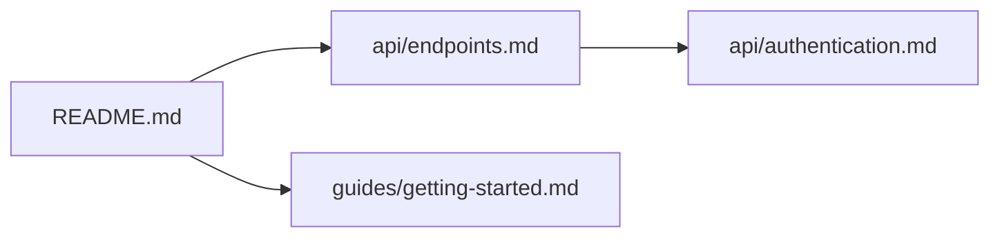

# Output Formats

Output format reference for the three md_structure_viz tools.

## 1. md-doc-tree-simple
<!-- Lines 7-9 -->

Two output formats selected via `--format`.

### Tree (default)
<!-- Lines 12-26 -->

Indented tree using box-drawing characters. Directories end with `/`.

```
docs/
├── README.md
├── api/
│   ├── authentication.md
│   ├── endpoints.md
│   └── schemas.md
└── guides/
    ├── getting-started.md
    └── deployment.md
```

### JSON (`--format json`)
<!-- Lines 29-45 -->

```json
{
  "root": "/absolute/path/to/docs",
  "file_count": 6,
  "files": [
    "/absolute/path/to/docs/README.md",
    "/absolute/path/to/docs/api/authentication.md"
  ]
}
```

Fields:
- `root` — absolute path to the scanned directory
- `file_count` — total `.md` files found
- `files` — flat array of absolute file paths, sorted alphabetically

## 2. md-doc-tree-rich
<!-- Lines 48-50 -->

Single output format: an indented tree with per-file metadata and a summary line.

### Line format
<!-- Lines 53-69 -->

```
├── filename.md  `[NL, NW, NS]`  : "Title"
```

| Token | Meaning | Source |
| --- | --- | --- |
| `NL` | Line count | `wc -l` |
| `NW` | Word count | `wc -w` |
| `NS` | Section count (H1 + H2 headings only) | `grep -E '^#{1,2} '` |
| `TOC` | File has a managed Table of Contents | Detected if file > 100 lines, > 3 sections, contains `## Table of Contents` with numbered line-range entries in the first 100 lines |
| `"Title"` | First `# ` heading in the file | Omitted if no H1 or if title equals the filename |

Stats are wrapped in backtick-brackets for visual distinction: `` `[120L, 850W, 3S]` ``

Zero-valued stats are omitted (e.g., a file with 0 sections shows `[50L, 200W]`).

### Summary line
<!-- Lines 72-78 -->

```
Total: N files | N lines | N words | N sections
```

Aggregated across all files found.

### Full example
<!-- Lines 81-93 -->

```
docs/
├── README.md  `[120L, 850W, 3S, TOC]`  : "Project Documentation"
├── api/
│   ├── authentication.md  `[100L, 700W, 5S]`  : "API Authentication"
│   └── endpoints.md  `[250L, 2100W, 12S]`  : "REST Endpoints"
└── guides/
    └── getting-started.md  `[85L, 600W, 4S]`  : "Getting Started"

Total: 4 files | 555 lines | 4250 words | 24 sections
```

## 3. md-doc-tree-full
<!-- Lines 96-98 -->

Three output formats selected via `--format`.

### Manifest (default)
<!-- Lines 101-103 -->

Produces two YAML files: `<prefix>_sections.yaml` and `<prefix>_cross_refs.yaml`.

#### Sections YAML
<!-- Lines 106-132 -->

```yaml
# doc_sections  |  root: docs  |  6 files, 38 sections

./:
  README.md: # 120 lines, 850 words, TOC@3-25
    - "1: # Project Documentation"
    - "15: ## Installation"
    - "42: ## Quick Start"
  api/:
    endpoints.md: # 250 lines, 2100 words
      - "1: # REST API Endpoints"
      - "18: ## Authentication"
      - "95: ## Error Handling"
    authentication.md: # 100 lines, 700 words
      - "1: # Auth Guide"
      - "12: ## OAuth2 Flow"
```

Structure:
- **Header comment** — file count and total sections
- **Folder keys** — nested YAML keys reflecting the directory tree, with intermediate empty folders collapsed (e.g., `doc/generated_doc/gen_ai_doc/`)
- **File entries** — `filename.md: # N lines, N words[, TOC@start-end]`
- **Heading entries** — `"LINE: ## Heading Text"` — line number, then the heading with its markdown `#` prefix
- **Adaptive depth** — if a file exceeds `--max-sections` headings at the requested `--heading-depth`, the tool falls back to shallower levels and adds a comment noting the collapse
- **Empty files** — shown as `filename.md: [] # N lines, N words`

#### Cross-refs YAML
<!-- Lines 135-153 -->

```yaml
# doc_cross_refs  |  root: docs  |  6 files, 7 references

./:
  README.md: # 120 lines, 850 words
    - api/endpoints.md
    - guides/getting-started.md
  api/:
    endpoints.md: # 250 lines, 2100 words
      - api/authentication.md
    authentication.md: [] # 100 lines, 700 words
```

Structure:
- Same folder nesting as sections YAML
- **Reference entries** — relative paths to outgoing markdown links
- **No refs** — shown as `filename.md: [] # N lines, N words`

### Flow (`--format flow`)
<!-- Lines 156-167 -->

Mermaid flowchart of cross-references between documents. Output to stdout (or file with `-o`).



When writing to file with `-o`, wraps in fenced code block (` ```mermaid ... ``` `).

### HTML (`--format html`)
<!-- Lines 170-171 -->

Interactive D3.js visualization saved to the path given by `-o`. Opens in any browser. See [HTML_USAGE_GUIDE.md](HTML_USAGE_GUIDE.md) for details.
