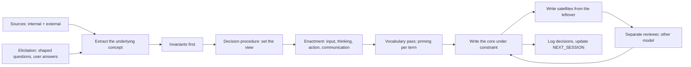

# Recipe — how the agent-facing files were made, and how to remake them

Purpose: the procedure that produced `LOD_CORE.md` and `drill_down/`, so a future session can redo it, improve it, or audit it. Read with `SOURCES.md` (ingredients), `DECISIONS.md` (choices), `VOCABULARY.md` (words), `ELICITATION_ROUND_1.md` (the user's intent in their own words).

## The pipeline
<!-- Lines 7-22 -->

## Steps
<!-- Lines 25-35 -->

1. **Ingest at variable detail.** Read the sources listed in `SOURCES.md` at the level the concept needs: primers in full where they define the mental model (philosophy, semantics, navigation, editing), headers only where they describe tooling. This step is itself the practice; do not read everything in full.
2. **Elicit.** Ask the user shaped questions: each question carries the ask and a recommended default at claim, grounds below, grouped, numbered, so "defaults" is a complete answer. Record questions and answers verbatim-ish in an `ELICITATION_ROUND_<n>.md`. Round 1 is the model.
3. **Extract the concept, not the tool.** From each source, take the underlying idea (a parent is the same thing at lower resolution; compression is grouping; certainty attaches to a claim at its height) and leave the formalism (identifiers, link types, commands). Test: would the sentence survive if the source tool did not exist?
4. **Write the invariants first**, then the decision procedure, then the enactment sections. Rules that cannot be traced to an invariant or to the procedure are suspect.
5. **Vocabulary pass.** For every term, list candidates, wanted and unwanted associations, pick, record in `VOCABULARY.md`. Then rewrite the drafts with the chosen words only. Search the agent-facing files for the "Terms not to use" list.
6. **Write the core under constraint.** About one hundred lines. Every line actionable or priming. Task-agnostic. No fixed numbers for budgets. Pointers only for edge cases and depth. Self-check with the criteria below.
7. **Write the satellites** from what did not fit: each assumes only the core, opens with when to read it, and ends with edge cases. Worked examples belong in satellites.
8. **Review with a different model** (Opus, fresh context), given only the artifacts and a structured brief. Ask for self-sufficiency, term associations, contradictions, actionability, and what a fresh agent would do differently on a sample task. Log its findings in `DECISIONS.md`, not the report itself. Revise; log the changes in `DECISIONS.md`.
9. **Update `NEXT_SESSION.md`** with what is open and which experiment comes next.

## Quality criteria for the core
<!-- Lines 38-46 -->

- A fresh agent with no other file can apply it to a non-software task (a message, a deck, a plan).
- No word count, line count, or per-channel budget appears; the derivation procedure does.
- Every term is in `VOCABULARY.md`; nothing from the "Terms not to use" list appears.
- Each rule traces to an invariant or to the decision procedure.
- Each satellite pointer names what the reader will find there.
- The self-check at the end can be executed in under a minute.
- Length about one hundred lines; adding a line means removing one.

## Rules for improvers
<!-- Lines 49-56 -->

- Never grow the core past its budget without removing something; move depth to a satellite.
- Never add fixed budgets to agent-facing files (D4).
- Log every change in `DECISIONS.md` with the ruled-out alternative.
- Change vocabulary in `VOCABULARY.md` first, then everywhere.
- Do not import the formalism of any single tool; the files must stand alone (Q7, D7).
- Keep agent-facing files task-agnostic (D3).
- Review with a model other than the author's, and log its findings in `DECISIONS.md`; do not keep the report.
