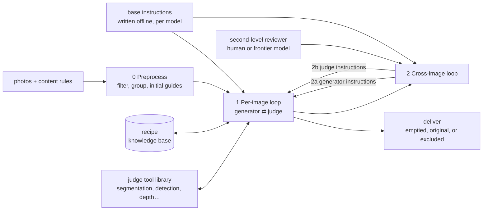
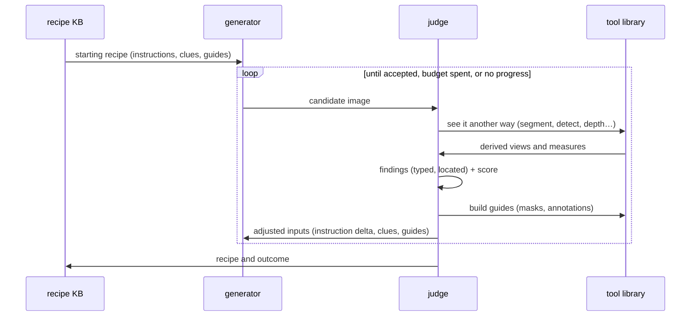
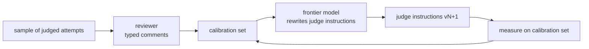
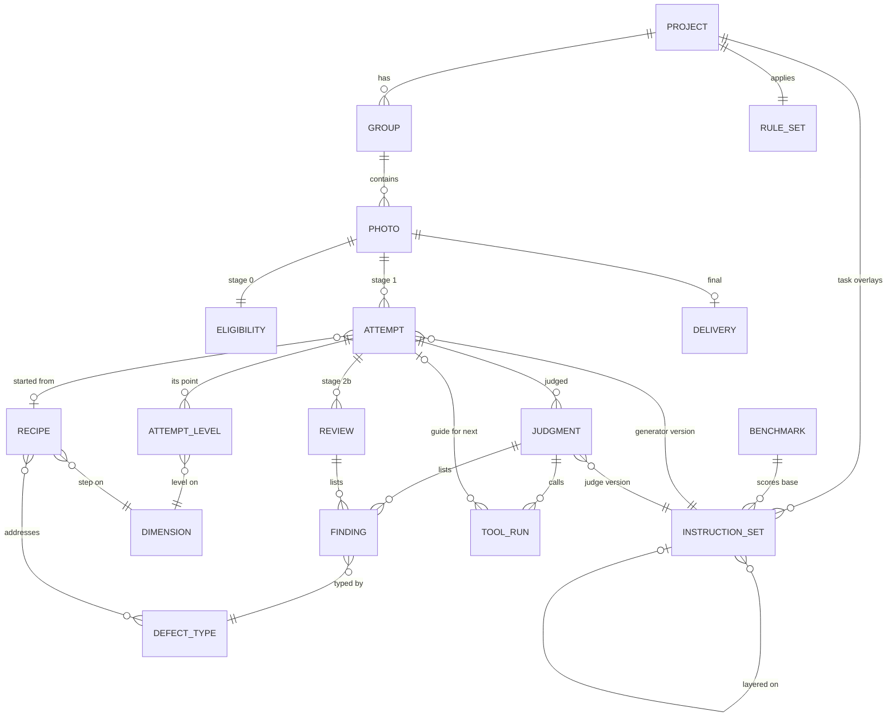

# Virtual unstaging — architecture

Turn photos of an occupied interior into the same photos of the empty building: furniture and belongings
removed, the building and its fixed equipment kept, the camera viewpoint unchanged. An image-editing model
(the **generator**) does the edit; a vision-language model (the **judge**) checks it and steers the
generator; a second level of review (a human or a very powerful model) corrects the judge.

> **Status:** architecture agreed enough to start detailed design and implementation; no code yet. The architecture below (stages, the two
> loops, the three inputs, the knowledge base, the second review level, the judge's tool library, the
> offline writing of base instructions) is the owner's; items marked
> *proposal* are the assistant's and not decided. Lessons come from a first prototype run on a survey of
> ~800 photos of one house ([Lessons](#lessons-from-the-first-prototype)).

## Table of Contents

1. [Scope](#scope) _(Lines 46-61)_
1. [Stages](#stages) _(Lines 64-91)_
1. [Base instructions — offline optimization](#base-instructions--offline-optimization) _(Lines 94-124)_
1. [Stage 0 — Preprocess](#stage-0--preprocess) _(Lines 127-140)_
1. [Stage 1 — Per-image loop](#stage-1--per-image-loop) _(Lines 143-143)_
   1. [An optimization under a compute budget](#an-optimization-under-a-compute-budget) _(Lines 146-176)_
   1. [Optimization engine, pluggable](#optimization-engine-pluggable) _(Lines 179-190)_
      1. [Dimensions of exploration](#dimensions-of-exploration) _(Lines 193-222)_
      1. [Pre-loaded and judge-designed dimensions](#pre-loaded-and-judge-designed-dimensions) _(Lines 225-247)_
      1. [Engine contract](#engine-contract) _(Lines 250-273)_
   1. [The judge](#the-judge) _(Lines 276-285)_
   1. [Judge tool library](#judge-tool-library) _(Lines 288-312)_
   1. [Recipe knowledge base](#recipe-knowledge-base) _(Lines 315-324)_
1. [Stage 2 — Cross-image loop](#stage-2--cross-image-loop) _(Lines 327-327)_
   1. [2a. Judge findings retune the generator instructions](#2a-judge-findings-retune-the-generator-instructions) _(Lines 330-340)_
   1. [2b. Second-level review retunes the judge](#2b-second-level-review-retunes-the-judge) _(Lines 343-362)_
1. [Defect taxonomy](#defect-taxonomy) _(Lines 365-381)_
1. [Data model](#data-model) _(Lines 384-431)_
1. [Lessons from the first prototype](#lessons-from-the-first-prototype) _(Lines 434-455)_
1. [Open questions](#open-questions) _(Lines 458-472)_

---

## Scope
<!-- Lines 46-61 -->

- **Input:** a set of photos of one building, a **content rule set** (what belongs to the building and stays,
  what is movable and goes), optionally groups (rooms) and camera poses.
- **Output:** per photo, an emptied image, or an explicit fallback (keep the original, exclude the view),
  with the findings that justify the choice.
- **Quality bar:** an emptied photo is a *simulation*: whatever the furniture hid is invented. It must be
  plausible and never contradict what the photo shows; it is never evidence about the hidden surfaces.
- **Not in scope:** virtual *staging* (adding furniture), relighting, exterior landscaping.

Design constraints:
- the generator is guided (instructions, references, masks), never pixel-recomposited: segmentation may
  guide the model, the output image is the model's own;
- every model is swappable (generator, judge, reviewer, segmenter);
- all model inference runs on **rented GPUs** (owner): open-weight models, served by the tool itself;
- compute is budgeted per image and per batch.

## Stages
<!-- Lines 64-91 -->

| Stage | Question it answers | Runs |
|---|---|---|
| Base instructions | What should each model be told, whatever the building? | offline, once per tool release; frozen during a task |
| 0 Preprocess | Is this photo worth an attempt, and with what starting inputs? | once per photo |
| 1 Per-image loop | What inputs make the generator produce a correct emptied version of *this* photo? | per photo, iterates within a budget |
| 2a Generator retuning | What do the per-image findings say about the generator instructions of this task? | after a pilot, then every N photos |
| 2b Judge retuning | Where does the judge disagree with a stronger reviewer, and how should its instructions change? | on a reviewed sample |

The two loops differ in what they change: loop 1 changes one photo's inputs; loop 2 changes the instructions
every photo starts from (2a) and the instructions the judge applies (2b). Both start from the base
instructions, which no task changes.

## Base instructions — offline optimization
<!-- Lines 94-124 -->

A one-off layer: writing the base instructions of the models involved. It does not vary while a task runs;
it is closer to writing good code, or to training a model, than to the loops above.

- **What is written:** one base instruction set per model role, and per model, since instructions are tuned
  to the model that reads them:
  - generator (how to empty a room, what never to invent);
  - judge (what to check, how to report findings, when and how to call the tool library, how to adjust the
    three inputs, how to design a new dimension of exploration);
  - *proposal:* second-level reviewer when it is a model, and the frontier model that rewrites instructions
    in 2a and 2b.
- **Frozen during a task:** a run reads one released version; what loops 1 and 2 learn is layered on top,
  never written into it.
- **Optimized like code or a model:** versioned, measured on a benchmark of reviewed photos, released with
  the tool, with its score per defect type.

*Proposal* — the instruction stack, from slowest to fastest:

| Layer | Written by | Lifetime |
|---|---|---|
| base | offline optimization | a tool release |
| task overlay | loop 2 (2a for the generator, 2b for the judge) | one task (one building) |
| per-photo delta | loop 1 | one photo |

This is a machine-learning project whose parameters are prompts, not weights: training data, performance
measure and search method are in [training.md](training.md); the training data comes from a synthetic
benchmark of clean and cluttered pairs, a separate project: [clutter_pairs](../clutter_pairs/README.md).

*Proposal:* a task overlay that recurs across buildings is a candidate change of the base, re-measured on
the benchmark before release.

## Stage 0 — Preprocess
<!-- Lines 127-140 -->

Filter out what is useless or has a low chance of success, then prepare the starting point.

- **Filter, each rejection with its reason:**
  - unusable: blurred, dark, duplicate;
  - low chance of success: close-up where a piece of furniture fills the frame (the model cannot recover a
    room it never saw and invents one); views with nothing to remove;
  - *proposal:* a predicted success score (frame share of the mask, distance to the nearest wall), so the
    budget goes where it pays.
- **Group:** photos of the same room share context (reference pool, room-specific fixed elements).
- **Initial guides:** segmentation of movable objects minus fixed elements, from the content rules; exact
  detection for known markers (calibration targets).
- **Initial recipe:** the best known starting inputs for this kind of photo, from the knowledge base.

## Stage 1 — Per-image loop
<!-- Lines 143-143 -->

### An optimization under a compute budget
<!-- Lines 146-176 -->

The judge guides the generator iteratively toward a better result. Framed as optimization under constraint:

- **decision variables — the three inputs of the generator:**
  - **instructions:** the text prompt (base, plus the task overlay, plus a per-photo delta);
  - **visual clues:** reference images (other views of the same room, already-emptied views);
  - **visual guides:** mask, annotations, crop, or any image condition that says *where* to act;
- **objective:** the judge's findings on the output, reduced to a score;
- **constraint:** a compute budget (attempts, GPU-seconds) per photo, inside a batch budget.

The best attempt is kept, not the last. Stopping on "no progress" matters: some photos have no good answer
(see close-ups) and should fall back early.

### Optimization engine, pluggable
<!-- Lines 179-190 -->

The project and the code are agnostic of the engine that runs loop 1: an engine can be tried and swapped for
another. Loop 1 is a classical optimization problem of a **non-differentiable** function: as in
derivative-free optimization, look around the current point, grade the neighbours, decide which way to
pursue. What differs from the usual case is the search space, instructions rather than numbers: no
difference can be computed between two candidates, so the engine needs more flexibility. **The key is to
define the dimensions of exploration.**

Ruled out as an engine (owner): exploring only the generator's random initialization (best-of-N, ADE-CoT
in [state of the art](state_of_the_art.md)). The seed is not a dimension of the problem; varying it only
samples the generator's noise.

#### Dimensions of exploration
<!-- Lines 193-222 -->

*Proposal* — each dimension acts on one of the three inputs, has a type and ordered levels (or a small set of
values), a default, and a cost:

| Input | Dimension (examples) | Levels |
|---|---|---|
| instructions | rule "behind removed furniture, continue the wall" | absent, present, emphasized |
| instructions | fixed elements named | none, those visible, the room's full list |
| instructions | scope of removal | named objects only, everything movable |
| instructions | fidelity clause (viewpoint, light, colours) | absent, present, emphasized |
| visual clues | number of reference photos | 0, 1, 2, 4 |
| visual clues | how references are chosen | nearest viewpoint, least cluttered, same wall |
| visual guides | mask extent | tight, dilated, per-object, union |
| visual guides | protected-elements mask (fixed elements to keep) | off, on |
| visual guides | depth or normal map of the walls as a condition | off, on |
| visual guides | annotation of the removal zone | none, outline, fill, text label |
| settings | steps, guidance strength, resolution | ordinal |

- **A point** is one level per dimension; **a neighbour** differs by one step on one dimension (or a few):
  this is what "look around the point" means here.
- **The seed is a nuisance, not a dimension:** a neighbour is graded on more than one seed when its
  difference to the current point is smaller than the seed noise.
- **The findings point to dimensions.** A defect type suggests which dimensions to probe first:
  `opening_invented` → the wall rule, the depth condition; `viewpoint_changed` → fewer or other references;
  `movable_left` → mask extent; `fixture_removed` → named fixed elements, protected mask. This map starts
  hand-written and is learned in the knowledge base.
- **The knowledge base estimates directional effects:** for a condition and a defect, what one step on one
  dimension did, counted over past photos. It is the finite-difference analogue of a gradient, accumulated
  across images instead of recomputed on each.

#### Pre-loaded and judge-designed dimensions
<!-- Lines 225-247 -->

Dimensions are **pre-loaded** (the registry above, from the base layer and the task overlay), and the judge
can also **iterate along other axes** it designs itself while working on a photo. The condition: the judge is
given good instructions on how to design a dimension; those instructions are part of its base instructions,
written and optimized offline ([Base instructions](#base-instructions--offline-optimization)).

*Proposal* — what those instructions require of a judge-designed dimension:
- **motivated:** it answers a finding that no pre-loaded dimension covers, and states which defect it should
  reduce and in which direction;
- **one factor:** it changes one thing in one input; a change that mixes two factors is two dimensions;
- **not a duplicate:** checked against the registry first; a near-equal pre-loaded dimension is used instead;
- **ordered levels, few of them:** two to four, the current state being one level (usually "absent"), each
  step meaningful;
- **feasible:** expressible as an input the generator actually takes (a phrase, a reference choice, a guide
  the tool library can build);
- **costed:** its cost per probe is known before it is tried.

*Proposal* — lifecycle: a judge-designed dimension is recorded with its rationale and the photo it was made
for; its directional effect is counted like any other. One that recurs and pays across photos is promoted to
the task overlay (loop 2a), then proposed for the base at the next offline round. The quality of the
dimensions a judge designs (did probing them reduce the defect they targeted?) is a measure of its base
instructions.

#### Engine contract
<!-- Lines 250-273 -->

*Proposal* — the **ask / tell** style of black-box optimization libraries (Optuna, Nevergrad):
- `ask()` → the next point(s) to generate, or `stop` with the chosen attempt;
- `tell(point, evaluation)` → the engine updates its state; an evaluation carries the findings, the score,
  the constraint status (blocking defects are constraints, not score terms), the cost, and the judge's
  free-text critique;
- the system owns the dimension registry, the generator, the judge, the tools and the knowledge base; the
  engine owns only the policy: which neighbours, how many seeds, when to move, when to stop;
- the objective is black-box, expensive, noisy and multi-objective (one criterion per defect type); the
  budget counts attempts, GPU-seconds and judge calls.

Candidate engines, all derivative-free:

| Engine | How it moves |
|---|---|
| coordinate (compass) search | probe one step either way on each dimension in turn; move to the best neighbour; stop when none improves |
| judge-guided local search (the owner's loop) | probe first the dimensions the findings point to, in the order the knowledge base ranks them |
| *proposal:* bandit over dimensions | each "one step on dimension d" is an arm; spend the budget on the arms that have paid for this defect |
| *proposal:* population search | keep a few points, a Pareto set over defect types, recombine their levels |

*Proposal:* the offline layer (base instructions, default levels, the defect-to-dimension map) is the same
kind of problem at a larger scale, the objective being a benchmark score; the same contract could serve
both levels.

### The judge
<!-- Lines 276-285 -->

The judge does more than accept or reject: it names what is wrong, where, and what to change.

- **Inputs:** original, candidate, the visual guide (where something was removed), the content rules, the
  room's fixed elements; *proposal:* the history of attempts on this photo.
- **Output:** a list of findings from the defect taxonomy ([Defect taxonomy](#defect-taxonomy)), each with a location and a severity;
  a verdict; an adjustment of the three inputs.
- **Tools:** the judge calls a tool library ([Judge tool library](#judge-tool-library)) to see the images
  another way, for judging and for building guides.

### Judge tool library
<!-- Lines 288-312 -->

The judge has a library of tools at hand. Both judging and guiding may require seeing the data another way
than as two RGB images.

- **Two uses of the same tools:**
  - **to judge:** derive views of the original and the candidate and compare them (what appeared, what
    disappeared, what moved);
  - **to guide:** turn a finding into a visual guide for the next attempt (a mask of the region to redo, an
    annotation of the wall to continue, a crop).
- **Tools (full list to be decided):**

| Tool | Sees | Judging use (examples) | Guiding use (examples) |
|---|---|---|---|
| semantic segmentation | per-pixel class (wall, door, window, radiator…) | a door appearing inside the removed region; a fixed element disappearing | mask of an invented element to remove; mask of fixed elements to protect |
| open-vocabulary detection + promptable segmentation | named objects, boxes, masks | a movable object left; a fixed element present in the original, missing in the candidate | mask of a left object |
| monocular depth | relative depth, surface normals | a wall pushed back or a recess opened (invented opening, scene change) | depth or normal map as a condition: continue the wall plane |
| *proposal:* optical flow | pixel motion between original and candidate | viewpoint change, drift outside the region | — |
| *proposal:* colour statistics | exposure and colour per region | colour shift | colour correction target |

- **Contract (*proposal*):** each tool takes images and parameters, returns a derived image or measure plus
  a short text summary the VLM can read; every call is recorded (tool, version, inputs, output) so a
  judgment can be replayed.
- Tools locate and measure; the VLM decides. On the first prototype a door detector alone did not separate
  good from bad images ([Lessons](#lessons-from-the-first-prototype)).

### Recipe knowledge base
<!-- Lines 315-324 -->

What the judge learns on one photo is reused on the next.

- **Entry:** a condition (photo traits, room type, defect seen) → one step on one dimension of exploration
  ([Dimensions of exploration](#dimensions-of-exploration)), with its outcome counts (tried, fixed, made
  worse): a directional effect.
- **Read:** at the start of a photo (starting recipe) and when a defect appears (known fixes first).
- **Write:** after each attempt.
- *Proposal:* an entry that keeps working on many photos is a candidate for the task overlay (2a).

## Stage 2 — Cross-image loop
<!-- Lines 327-327 -->

### 2a. Judge findings retune the generator instructions
<!-- Lines 330-340 -->

After a few photos or a pilot, the judging sessions have accumulated enough recurring issues to change the
instructions every photo of the task starts from (the generator's task overlay).

- Example: after 10 photos, the findings say that with the current setup the generator invents doors where
  furniture stood. The task overlay gains a rule (behind removed furniture, continue the wall).
- **Input:** findings aggregated by defect type and condition; the recipe knowledge base.
- **Output:** a new version of the generator's task overlay, with the findings that motivated it.
- *Proposal:* a change is accepted only if a re-run on a fixed probe set lowers that defect without raising
  others.

### 2b. Second-level review retunes the judge
<!-- Lines 343-362 -->

A second level of QA, by a human or a very powerful model, reviews a sample of the judge's decisions.

- The reviewer gives **detailed comments on what failed**, not only a verdict: which defect, where, how bad.
- A **frontier model** turns these comments into changes of the judge's task overlay.
- *Proposal:* the reviewed sample doubles as a **calibration set**: judge agreement with the reviewer, per
  defect type (missed defects, false alarms), measured before and after each change. The sample mixes
  photos the judge accepted, photos it rejected, and photos the probes flagged.
- A human reviewer works on a local review page; the same page records typed comments, so every review is
  reusable.

## Defect taxonomy
<!-- Lines 365-381 -->

One vocabulary for the judge, the reviewer and the knowledge base. *Proposal*, to be refined on reviews.

| Code | Defect | Typical cause |
|---|---|---|
| `viewpoint_changed` | framing, perspective or camera position differs | reference images copied |
| `scene_invented` | the room is not the room of the original | close-up, too little context |
| `fixture_removed` | a fixed element is missing or replaced | over-cleaning; element not named |
| `opening_invented` | a door, window or passage appears where furniture stood | model's prior for "space behind furniture" |
| `element_added` | anything else not in the original and not a revealed surface | element named in the prompt, copied from references |
| `movable_left` | a movable object remains | object not masked, too small |
| `surface_implausible` | revealed wall or floor does not continue the visible ones | material, joints, lines broken |
| `drift` | change outside the removed region beyond tolerance | regeneration of the whole image |
| `colour_shift` | global exposure or colour change | generator brightens the image |

Each finding: code, region (box or mask), severity (`minor`, `blocking`), free comment.

## Data model
<!-- Lines 384-431 -->

*Proposal.* Storage is an open question ([Open questions](#open-questions)); the structure comes first.

| Entity | Holds |
|---|---|
| `RULE_SET` | fixed and movable element lists, global and per group |
| `INSTRUCTION_SET` | versioned text, role (`generator`, `judge`, `reviewer`, `rewriter`), target model, layer (`base`, `task`, `photo`), the set it is layered on, parent version, motivating findings |
| `BENCHMARK` | reviewed photos from several buildings, tuning and test split by building; scores of each base version per defect type |
| `ELIGIBILITY` | stage 0 measures, decision, reason |
| `ATTEMPT` | the three inputs actually used (instruction delta, clue photo ids, guide file), output file, cost |
| `JUDGMENT` / `REVIEW` | who judged (model and version, or human), verdict, score |
| `FINDING` | defect code, region, severity, comment; belongs to a judgment or a review |
| `TOOL_RUN` | tool and version, inputs, parameters, output file or measure, text summary; may produce the guide of the next attempt |
| `DIMENSION` | input it acts on (instructions, clues, guides, settings), type, ordered levels, default, cost; layer that added it (base, task, or photo), origin (pre-loaded or judge-designed), rationale and targeted defect |
| `ATTEMPT_LEVEL` | the level of one dimension in one attempt: the attempt's point, one row per dimension |
| `RECIPE` | condition, defect, dimension, step, outcome counts (tried, fixed, made worse) |
| `DELIVERY` | chosen attempt or fallback (`original`, `excluded`), decided by |

A judge finding and a reviewer finding on the same attempt are comparable row by row: that comparison is the
calibration measure of 2b.

## Lessons from the first prototype
<!-- Lines 434-455 -->

One house, ~800 photos, one generator call per variant, a judge that accepted or rejected, a human review of
the rejected photos and of a random sample of accepted ones.

- **The judge saw original and candidate and still missed invented doors.** It had no mask, so it did not
  know where furniture had been removed, and its instructions excluded "revealed empty surfaces" from the
  additions: a door in place of a wardrobe passed as a revealed surface.
- **Behind furniture there is almost always a wall; but things hang *on* doors** (towels, coats). A door
  probe flags both; only context tells them apart.
- **Verdict-only reviews cannot be reused.** The human review recorded one choice per photo; when a new
  defect type (doors) was noticed later, no label existed for it. Hence typed findings in reviews.
- **The judge was both too strict and too lax:** about a third of the photos it rejected were usable; about
  one in six it accepted was not. Its own verdict was noisier than a verdict recomputed from its structured
  fields.
- **References help and hurt:** other views of the room improve surfaces, but cause viewpoint jumps and
  copying; an already-emptied anchor propagates its own errors to the whole room.
- **Naming an element can make the generator add it** ("keep the firewood" adds firewood where there was
  none).
- **Close-ups fail by construction** and belong to stage 0, not to more attempts.
- **When the edit succeeds, geometry barely moves** (a few pixels at 1024 px outside the removed region);
  failures are gross (viewpoint change, invented scene), which a drift probe alone does not catch.

## Open questions
<!-- Lines 458-472 -->

- Loop 1: the first registry of dimensions and their levels; which engine to implement first behind the
  ask / tell contract; how engines are compared (same photos, same budget, same seeds).
- Granularity of the knowledge base: free-text recipes read by the judge, or structured entries.
- 2a trigger: fixed pilot size, or a threshold on recurring findings.
- Who reviews in 2b by default, human or frontier model, and how big the calibration sample must be.
- Judge model class: same family as now with better inputs, a larger VLM, or a frontier model behind an
  API; cost per image matters for loop 1, less for 2b.
- The tool library: which tools, how the judge chooses which to call, and the cost of each call inside the
  per-photo budget.
- Base instructions: which roles get one, where the benchmark photos come from for a public release
  (consent, licence), and when a recurring task overlay is promoted to the base.
- Default generator with a licence compatible with open-source use.
- Storage: files (JSONL) or a database (SQLite by default); same schema either way.
- Name of the tool.
