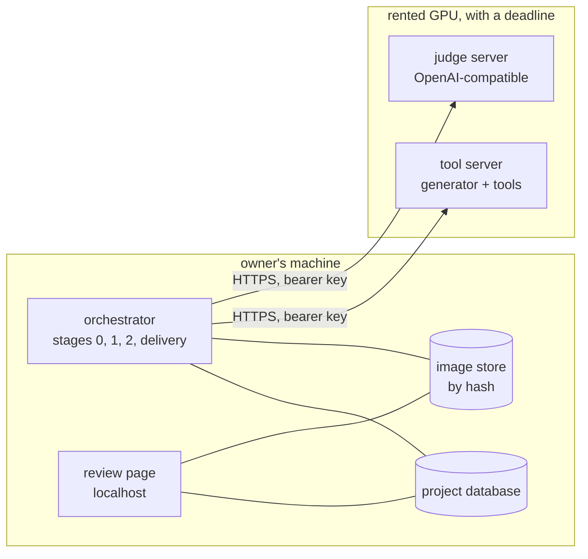
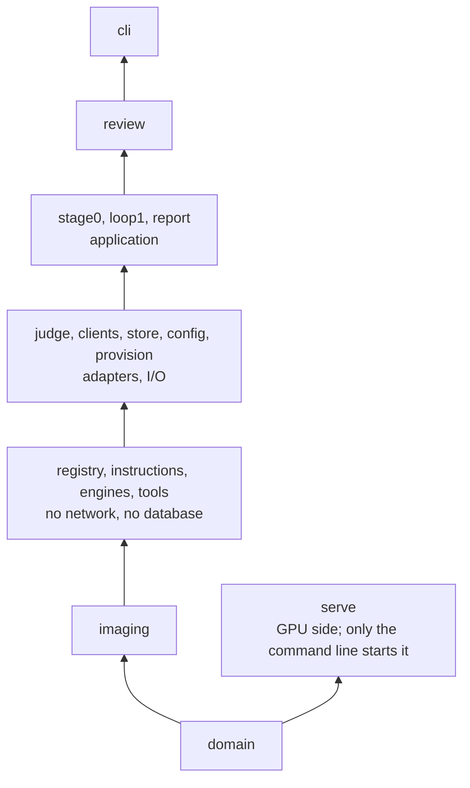

# virtual_unstaging — detailed design

How the [architecture](../architecture.md) becomes a program, derived in the order of the repository's
[construction guideline](../../dev_guidelines/software_development_guidelines/construction.md#derivation-order):
usage, required properties, functions, system shape, stored data, components, then code.

> **Status:** draft for the owner's review; every decision here is a *proposal* until the owner accepts it. Slice 1
> is implemented and tested offline (store, registry, engines, judge, runner with resume, tool server, review page,
> GPU provisioning); nothing has yet run on a real model or a rented GPU. The architecture stays the reference; what this design would change in it is listed under
> [Changes proposed to the architecture](#changes-proposed-to-the-architecture). Drilled in full: the data model
> ([data_model.md](data_model.md)) and the per-image loop ([loop1.md](loop1.md)). At claim level only: model
> services, provisioning, review page, stage 2, offline training.

## Table of Contents

1. [N0](#n0) _(Lines 39-50)_
1. [Usage scenarios](#usage-scenarios) _(Lines 53-63)_
1. [Required properties](#required-properties) _(Lines 66-78)_
1. [Functional hierarchy](#functional-hierarchy) _(Lines 81-101)_
1. [System shape](#system-shape) _(Lines 104-141)_
1. [Components and layering](#components-and-layering) _(Lines 144-189)_
1. [Trust boundaries](#trust-boundaries) _(Lines 192-207)_
1. [Dependencies](#dependencies) _(Lines 210-227)_
1. [Design decisions](#design-decisions) _(Lines 230-249)_
1. [Extension points](#extension-points) _(Lines 252-274)_
1. [Command line](#command-line) _(Lines 277-300)_
1. [Model services and provisioning](#model-services-and-provisioning) _(Lines 303-347)_
1. [Review page](#review-page) _(Lines 350-363)_
1. [Build order](#build-order) _(Lines 366-378)_
1. [Guidelines applied](#guidelines-applied) _(Lines 381-396)_
1. [Changes proposed to the architecture](#changes-proposed-to-the-architecture) _(Lines 399-410)_
1. [Open](#open) _(Lines 413-420)_

---

## N0
<!-- Lines 39-50 -->

- One local program, the **orchestrator**, holds all state: one SQLite database and one content-addressed image
  store per project (one building). The rented GPU holds nothing that cannot be lost.
- Models run as **services on a rented GPU**: an OpenAI-compatible server for the judge, and the tool's own server
  for the generator and the judge's tools. No GPU starts without a time limit.
- The per-image loop **compiles a point** (one level per dimension) into a model-neutral generator request,
  **scores** the judge's typed findings by one rule defined in the database, and lets a **pluggable engine** pick
  the next point through `ask` / `tell`. Engines are pattern searches that differ by how they order the
  neighbours they probe, and decide from the stored history alone, so an interrupted run resumes.
- First slice: loop 1 end to end on a small set of photos, three engines compared at equal budget, a local
  review page.

## Usage scenarios
<!-- Lines 53-63 -->

What the owner does with the tool; every later section serves one of these.

| # | Scenario | Commands, in order (name `unstage` provisional, see [Open](#open)) |
|---|---|---|
| S1 | **Empty a building's photos.** Create a project, import the photos grouped by room, write the content rules, start a GPU with a time limit, prepare the masks, optimize, review, decide and export | `init`, `import`, `rules`, `gpu up`, `prepare`, `run`, `review`, `deliver`, `export`, `gpu down` |
| S2 | **Compare engines or generators.** Same photos, budget and versions but one factor: one run per engine, or one `single` run per generator (one rental per generator recipe, since the tool server loads one); blind comparison on the review page; a report per run: photos accepted, preferences won, cost | `run` × N (`gpu up --recipe` per generator), `review --compare`, `report` |
| S3 | **Resume.** The GPU deleted itself at its deadline mid-run; start another, continue the run; nothing already generated is generated again | `gpu up`, `run --resume` |
| S4 | **Re-judge.** A new judge instruction version judges stored attempts again, without generating (calibration, slice 3) | `rejudge` |
| S5 | **Retune and train** (stage 2, offline training): later slices, not designed here | — |

## Required properties
<!-- Lines 66-78 -->

Each is checkable; the constraints of the design serve them, and each check is a test.

| # | Property | Check |
|---|---|---|
| P1 | No durable fact lives only on the rented machine | kill the GPU server during a run; only in-flight calls are lost |
| P2 | Every attempt and judgment can be replayed: inputs, versions, seed and settings are recorded | a finished run started again makes zero generator calls |
| P3 | Every model is swappable: no model name, weight path or provider in code outside adapters and configuration | layering check; the test suite runs end to end on fake adapters |
| P4 | The budget is never exceeded, and no GPU runs without a time limit | an attempt beyond the budget is refused; `gpu up` and `serve` refuse to start without a limit |
| P5 | Runs are comparable: same photos, seeds, budget and versions, but for one factor under test, the engine or the generator | `report` refuses to compare runs that differ in anything else, or in both factors |
| P6 | The public code carries no private data: projects live outside the package | no project path or name in the repository; the package ships no images |
| P7 | An interrupted run resumes to the result it would have reached | interrupt and resume on fakes, compare with an uninterrupted run |

## Functional hierarchy
<!-- Lines 81-101 -->

**L0** — turn the photos of an occupied building into plausible empty versions, within a compute budget, with a
justified outcome per photo (emptied, original kept, excluded).

**L1** — the flows, each with its stage in the architecture:

| Flow | Does | Stage |
|---|---|---|
| F1 Set up | register photos, groups, content rules, model endpoints, budget | — |
| F2 Prepare | assess eligibility, build the initial guides, choose the starting point | 0 |
| F3 Optimize a photo | search the generator's inputs under the judge's findings, keep the best attempt | 1 |
| F4 Retune the project | aggregate findings into a generator overlay (2a); calibrate the judge on reviews (2b) | 2 |
| F5 Review | collect typed human findings, verdicts and blind preferences | 2b |
| F6 Deliver | decide each photo's outcome, export the images | — |
| F7 Serve models | run generator, tools and judge on a rented GPU, with a deadline | — |
| F8 Train offline | optimize base instructions on a benchmark | base |

**L2** — the operations of F3, in the order one attempt runs them: `compile` a point into a generator request →
`generate` → automatic tool runs on original and candidate → `judge` → `score` → engine `tell`, then `ask` for
the next point → on stop, `select` the best attempt. Detailed in [loop1.md](loop1.md).

## System shape
<!-- Lines 104-141 -->

- **Two deployable units, one package.** The orchestrator and the tool server are split by a named force: a
  different runtime (GPU, deep-learning libraries, tens of gigabytes of weights) and a different lifetime (the
  GPU is rented by the hour and deletes itself; the project state must outlive it). The judge server is adopted,
  not written ([Dependencies](#dependencies)).
- **The distribution premium, paid in slice 1:** deployment by one bootstrap script the provider runs at start;
  monitoring by `GET /health` and run progress written to the database; failure handling by a timeout on every
  call, bounded retries on transport errors, failed attempts recorded with their error, and resume (P7). There
  is no eventual consistency to manage: the orchestrator is the only writer, the tool server a cache and a
  function.
- **The boundary moves in lock-step, knowingly:** both units ship in one release and have one consumer, so a
  coordinated change is acceptable. The server reports its API version in `GET /capabilities`; the client
  refuses a different major version.
- **Growth horizon.** Present need: one building, about 1,000 photos, about 10 attempts each, so about 10,000
  attempts, 50,000 findings and 20 GB of images. The design holds ten times that in one SQLite file. The signal
  that ends it: two machines writing one project, or a knowledge base shared across buildings; then Postgres.
  The schema stays in portable SQL for that move.

## Components and layering
<!-- Lines 144-189 -->

One Python package, `src` layout, its own `pyproject.toml` and lock file, as the other tools of this repository.
GPU-side dependencies are an optional extra (`[serve]`). Modules are cut by the decision each hides; the
interface style says whether it hides a representation or varies an implementation behind one protocol.

| Module | Hides | Interface |
|---|---|---|
| `domain` | nothing: the shared value types (Point, Dimension, Level, GeneratorRequest, Finding, Move, Evaluation, Budget) | types |
| `imaging` | image decoding limits and the cheap pixel operations (dilation, outline, colour difference) | operations |
| `registry` | the registry file format, its validation, pruning by generator capability | hides representation |
| `instructions` | how instruction layers compose into prompt text | hides representation |
| `engines` | the search policy | varies implementation: `Engine` protocol |
| `tools` | which provider runs which tool; the tools cheap enough to run locally | varies implementation: `ToolProvider` protocol |
| `judge` | the judge's request, its output contract (a JSON Schema generated per run) and the strict parse | hides representation |
| `clients` | transport (tool server, OpenAI-compatible chat and image edits), generator adapters, remote tools, stand-in models | varies implementation: `Generator` protocol |
| `store` | SQL, the schema, the image-store layout: **the only module that holds SQL** | hides representation |
| `config` | the project file and the GPU session file, parsed strictly; secrets from key files or commands | hides representation |
| `provision` | renting a GPU with a deadline, per provider | varies implementation per provider |
| `stage0` | masks from files or segmentation, eligibility measures | operations |
| `loop1` | compile a point; the order of one attempt's operations; budget; resume by replay | operations |
| `report` | run summaries, blind-comparison tallies, the comparability check | operations |
| `review` | the localhost review page | presentation |
| `cli` | the command line; builds the adapters from the configuration | presentation |
| `serve` | GPU side: HTTP server, generator adapters driven by recipes, tool implementations | varies implementation |

**Declared layering**, a blocking check (an import-contract linter run with the tests):

Each layer imports only from the layers below it, and modules of one layer do not import each other. The two
contracts live in `pyproject.toml` (`[tool.importlinter]`) and run as `lint-imports`.

**Paradigm by intent:** pure functions where the work is a transform (compile, render, scoring comparison, an
engine's `ask`); protocols and small classes where the work is a taxonomy (engines, generator and judge
adapters); imperative code where the work is control (the runner). No module performs an effect when imported;
adapters and engines are registered by an explicit table at start-up.

## Trust boundaries
<!-- Lines 192-207 -->

Everything below is parsed once, where it enters, into the types of `domain`, under a positive definition of
valid; code past the boundary relies on the parsed form.

| Boundary | Parsed into | Rejected, and what then |
|---|---|---|
| Judge response (model output) | findings with a code from the taxonomy, a severity, a box in [0, 1] with x0 < x1 and y0 < y1; moves on dimensions of the run's release, to existing levels | any other content: the judgment is stored with its raw text and the parse error, counts against the budget, and is retried once |
| Tool-server response | typed response; every returned image's hash checked against its bytes | mismatch or unknown field: the call fails with a stable error code |
| Project files: configuration, content rules, registry | typed configuration from TOML; unknown keys rejected | the command stops before any call |
| Imported photos | decoded with a pixel-count limit; hashed; EXIF orientation applied once | non-image, oversize |
| Review-page requests | see [Review page](#review-page) | refused |
| Judge-designed dimensions (slice 2) | a realizer from a fixed list, text-only levels with length limits | anything else |

Model text reaches the generator only as prompt text, never as code, a path or a query; image-store paths are
built from hashes alone; every query is fixed text with bound parameters.

## Dependencies
<!-- Lines 210-227 -->

Nothing is added without a reason, per the [ownership guideline](../../dev_guidelines/software_development_guidelines/ownership.md);
installed from the lock file only. The tool never ships model weights. Each model's licence (weights and
outputs) is recorded with its adapter and shown to the user; it never excludes a model (owner): choosing one is
the user's call.

| Need | Stance | Choice | Reason | Exit |
|---|---|---|---|---|
| Judge serving | adopt | vLLM, or any OpenAI-compatible server | standard API, image input, JSON-schema constrained output | another compatible server: a configuration change |
| Generator serving | adopt | vLLM-Omni where it serves the model; otherwise diffusers and PyTorch in the tool server | an existing server for each model it covers; diffusers holds the reference implementations of the others | the other protocol, one adapter per model family |
| Tool-server HTTP | adopt | FastAPI and uvicorn, server side only | request validation at the edge; the interface description (OpenAPI) is generated from the code, so it cannot drift | Starlette or the standard library |
| Orchestrator HTTP client | write | standard library (`urllib`), own User-Agent | no dependency for two endpoints | httpx |
| Configuration, rules, registry | standard library | TOML (`tomllib`) | comments allowed, no dependency | — |
| Images | adopt | Pillow, NumPy | universal | — |
| Search engines | write | own pattern searches | no library polls ordinal dimensions in an order given by a critic | an Optuna or Nevergrad engine behind the same protocol |
| Storage | standard library | `sqlite3` | one file per project | Postgres, at the horizon |
| Review page | standard library | `http.server` and one static page | localhost, one user | — |

## Design decisions
<!-- Lines 230-249 -->

All *proposal*. The ones costly to reverse first; each names the alternative and when it would win.

| # | Decision | Alternative, and when it wins |
|---|---|---|
| D1 | Orchestrator on the owner's machine, models behind endpoints on the GPU ([System shape](#system-shape)) | Everything on the GPU (first prototype): a batch with no review between attempts; loses state when the machine deletes itself |
| D2 | One SQLite file per project and an image store addressed by SHA-256 ([data model](data_model.md)) | Postgres: several writers, or a knowledge base shared across buildings |
| D3 | The generator request is **model-neutral**: images carry roles (`original`, `reference`, `removal_mask`, `protected_mask`, `depth`, `annotation`); a generator adapter, per model family and endpoint protocol, maps roles to the model's inputs and declares a **capability profile**; levels a model cannot take are pruned before the search. None of the open models surveyed takes a mask argument: masks travel as condition images | Model-specific requests: simpler for one model; breaks P3 |
| D4 | The score is computed from findings by **one rule, defined once** (a database view); the judge's own verdict is recorded, never scored | The judge's verdict: noisier than the recomputed one on the first prototype |
| D5 | **Common random numbers:** one seed per photo, shared by every point probed on it, so two neighbours differ only by the change tested | A new seed per attempt: only once the engine replicates points on several seeds |
| D6 | **Automatic tool runs** before every judgment feed it; the judge does not call tools itself in slice 1 | Judge tool calling: the architecture's target; needs a tool-calling judge and a cost per call |
| D7 | One judge call returns two sections, **evaluation** (findings) and **guidance** (moves) | Two calls: when the judge is re-run on stored attempts as a classifier only (S4) |
| D8 | Directional effects (the knowledge base's counts) are a **view over pairs of attempts**, not stored counters | Stored counters: if the view grows past a second to compute |
| D9 | Base instructions, dimension registry, defect taxonomy and defect-to-dimension map are **files in the package**, copied into the database by content hash when a run starts; the file is the source, the row an immutable copy that cannot drift | Database only: loses review and history in git |
| D10 | Engines are **deterministic functions of the stored history** and the seed: resume is a replay (P7) | Engines with private state: needs checkpointing |
| D11 | Several photos are optimized at once (K workers), so one photo's generation overlaps another's judging | Sequential: simpler; the GPU idles half the time |
| D12 | Every generation and tool run is keyed by a hash of its full request (model revision, inputs, seed, settings); an identical request reuses the stored result. Immutable, so no expiry | No reuse: the first attempt of each engine is the same request, generated three times |
| D13 | **Override files** layered over `project.toml` and `gpu.toml` per command ([Command line](#command-line)); the project files are never rewritten by a tool or a script | Editing the files: one less flag, but a variant leaks into later commands and into other sessions on the project. `--set key=value` flags: when single values vary; can be added beside the files |
| D14 | A **speed version** is recorded with what it shapes: generator settings in each attempt's settings (as today); the judge's request options as a suffix of the judge's recorded revision (`+jpeg@1024+answer:6/2/100/200`, findings / moves / comment / critique), as a generator's `+fp8` storage is: a judge that sees smaller images and must answer shorter is another judge, and reports group by it | A column on `run`: once the schema has migrations (it has none: version 1) |
| D15 | The judge reads an **element inventory** (`element_inventory`, [tool server API](tool_server_api.md#element-inventory)): the room's named elements detected in both pictures and matched by place, each kept, revealed, changed, removed, new or left; turned on per project (`[tools] inventory`), so a run with and one without it can be compared on the same images | Pixel and class differences alone (slice 1): they cannot tell a revealed surface from an invented one, and the judges reported invented defects from them. A judge that calls detection itself (D6's alternative) |

## Extension points
<!-- Lines 252-274 -->

For a program that imports this package. The owner's rule: a change made for such a program only adds modularity or
an override; it defaults to the behaviour described above and names no caller.

| Point | What a caller can change or reuse |
|---|---|
| `engines.SearchEngine[ProblemT, CandidateT, EvaluationT]` | the ask / tell contract with its candidate as a type parameter; `Engine` binds it to points of the lattice, and `make_engine` returns that binding |
| `engines.replay` | tells a started engine its stored history and raises `ReplayMismatch` when it asks another candidate (D10); the runner uses it for its own resume |
| `clients.http.Endpoint.observer` | sees every attempt of every request (`Exchange`: the request as sent, without the key, and the answer as received); what it raises fails the call |
| `provision.lifecycle.Context.plan_source` | where a rental's plan comes from: the project folder's files by default; `project` is then only the folder of the session file |
| `provision.plan.ProjectPlan.tools` | the tool server's tools, by name; the server's default set when unset |
| recipe field `inputs.text_only` | a generator that also makes an image from the prompt alone ([tool server API](tool_server_api.md#generate), version 1.2). Not an extension point but a new request form, accepted by the owner as the one exception to the rule: opt-in per recipe, nothing changes without it |

**The surface an importing program may rely on**, beyond the points above: `provision.lifecycle` (`Context`, `up`,
`down`, `SESSION_FILE`), `provision.plan` (`ProjectPlan`, `JudgePlan`, the `DEFAULT_*` machine settings),
`provision.userfiles` (`config_dir`, `state_dir`), `provision.errors.ProvisionError`, `provision.switch.switch_judge`;
`clients.toolserver.ToolServerClient`, `clients.generators.ToolServerGenerator`, `clients.openai_compatible`
(`chat_json`, `image_part`, `text_part`), `clients.http` (`Endpoint`, `EndpointError`, `Exchange`),
`clients.fakes.FakeGenerator`; `engines.ReplayMismatch`; `imaging`; `serve.images.output_size` (the sizing rule, no
server dependency); `domain.sha256_text`, `domain.sha256_bytes`, `domain.canonical_json` and the generator request
types; `store.blobs.BlobStore`, `store.db.connect`, `store.db.transaction`; `config.Secret`; the packaged recipes. A change to one of these names is a
change of contract: the repository's instructions say which other tests run with it.

## Command line
<!-- Lines 277-300 -->

Per the repository's [CLI guidelines](../../dev_guidelines/cli_guidelines/cli_guidelines.md):

- One command with subcommands (S1 to S4); the name is short, lowercase, two to nine characters.
- Data on stdout, progress and messages on stderr; `--json` on every command that reports; `--help`, `--version`.
- Never requires interactivity: `gpu up` shows the hourly price and the time limit and asks for confirmation on a
  terminal; `--yes` elsewhere. `run --dry-run` prints the plan and the estimated cost.
- Exit codes: 0 success, 1 failure, 2 usage error, and distinct codes for "budget exhausted" and "endpoint
  unreachable".
- Configuration: `project.toml` in the project folder (models, endpoints, budget, engine); secrets never in it.
- **Override files** (D13): `--override FILE`, before the command and repeatable, layers a TOML file over the
  project's configuration for that one command, the last file winning, key by key (tables such as `settings` merge
  key by key, lists are replaced). The file has the sections of `project.toml` (`[generator]`, `[judge]`, `[tools]`,
  `[budget]`, `[search]`) and those of `gpu.toml` under `gpu` (`[gpu.machine]`, `[gpu.judge]`); the loaders check
  the merged result as they check the files. Refused in an override file: `[project]`, and any endpoint or key
  (`endpoint`, `key_file`, `key_command`), which come only from the project and its GPU session. No project file is
  ever rewritten, so a variant (another judge, a speed version, an instruction overlay named by `overlay` in
  `[generator]` or `[judge]` in place of the project's `instructions/<role>.md`) cannot leak into the next command or into another
  session working on the same project. Precedence, lowest first: `project.toml` and `gpu.toml`, the session's
  endpoints and keys, the override files in order.
- **Secrets** (endpoint keys): read from a file (mode 600) or from a secret-manager command named in the user
  configuration, run without a shell. Never from a flag. On the rented GPU, the provider passes a key generated
  for that session only, as an environment variable: the platform offers nothing else, the key dies with the
  machine. This is the recorded exception the configuration guideline requires.

## Model services and provisioning
<!-- Lines 303-347 -->

Detailed in [tool_server_api.md](tool_server_api.md) (the HTTP contract, with polled jobs) and
[provisioning.md](provisioning.md) (renting, the self-delete guard, keys). The default models are the owner's choice:
generator FLUX.2 klein 4B (owner, 2026-10-22, after a clocking and a blind review: the fastest, and the one whose
images the owner kept most); judge open.

- **Judge:** any OpenAI-compatible chat endpoint with image input and JSON-schema output. Images travel as data
  URLs. Coordinates are normalized to [0, 1] by the judge adapter (models differ: absolute pixels, 0-1000 grid).
- **Generator:** behind one of two endpoint protocols, chosen per model: an adopted server where one serves the
  model (vLLM-Omni serves some image-editing models behind an OpenAI-style `/v1/images/edits`), otherwise the tool
  server's `/generate` running the model through diffusers. The generator adapter sits on the orchestrator side
  and speaks either protocol.
- **Tool server** (`serve`, extra `[serve]`): `GET /health`, `GET /capabilities` (API version, generator profile,
  tools and their versions), `PUT|HEAD|GET /blobs/{sha256}`, `POST /generate`, `POST /tools/{name}`. Errors carry
  stable codes. Models stay resident; one GPU queue. Slow start is accepted (weights load once) and budgeted in
  the time limit.
- **One 80 GB GPU** (owner): generator and judge share it; a model is made to fit or dropped. The judge runs from
  an FP8 checkpoint at its memory share (about 36 GB); the generator must peak under about 40 GB, by offloading
  whole models in turn and storing a large transformer in FP8 (recipe key `fp8_storage`). Arithmetic on published
  sizes, not measured.
- **Generation in a few seconds, 10 s at most** (owner): the method explores many versions of a photo under the
  judge's guidance, so a generator is chosen for its seconds per image on the rented GPU as much as for its quality.
  Distilled few-step models qualify; 40-50-step models do not (measured on an 80 GB A100, about 1 megapixel out: a
  7B editor at 40 steps took about a minute per image; at 4-8 steps a 4B editor 5-6 s, a 7B 7.5-8 s, a 20B kept whole
  on the GPU 7-8 s at 0.55 megapixel; the 20B offloaded 42-55 s). The judge is held to the same bound (owner): a few
  seconds per judgment, 10 s at most (measured on an A100, one judgment at a time, full request: 14-20 s for a 27B
  dense judge, 6-10 s for an 8B dense or a 3B-active mixture-of-experts judge, of which 1-4.5 s is the upload of five
  2-megapixel PNGs, 9 MB as data URLs; two judgments sharing the GPU take up to twice as long). Speed versions halve
  these: with JPEG images at 768-1024 px and a capped answer, 7-9 s for the 27B and 3.5-5 s for the others.
- **Speed versions** (owner: "for each model 3 versions [...] with more and more compromise for speed", D14): the
  same model asked for less. Judge, in `[judge]`: `image_side` (long side of every image sent, 0 = as stored),
  `image_format` (`png` or `jpeg`), and caps on the answer, `max_findings`, `max_moves`, `comment_chars` (each finding's
  comment and each move's reason), `critique_chars` (0 = no cap); the caps go into the output schema, and the request
  states them so the model writes short rather than being cut off. Generator: the settings `output_side` and
  `condition_side` (condition images reduced to about that side squared in pixels before the pipeline sees them, as
  `output_side` sizes the output; 0 = as given; masks resized without blending), and
  `[generator] roles` and `max_images`, which narrow what the recipe accepts (never widen it). A version is an
  override file; nothing is preset in the package until a measurement says which versions are worth keeping.
- **What the generator is assumed to take** (owner): a few context images, a prompt, and optionally a mask. The
  adapters are written to that; a model that needs more (a depth map, a structured caption) gets a recipe of its own.
  A recipe may also declare `text_only`: the model then also makes an image from the prompt alone, for a caller that
  creates images rather than edits them.
- **Licences are recorded, never a filter** (owner): each adapter declares its model's licence and the command
  line shows it when the model is chosen; the choice is the user's.
- **Deadline:** `serve` refuses to start without `--deadline`; at the deadline it stops accepting work, finishes
  or fails the calls in flight, and exits.
- **Provisioning:** behind a provider interface (`up`, `down`, `ls`, price). `up` refuses to start without a
  limit and arms a self-delete on the machine that does not depend on the owner's machine. A first provider for
  one GPU rental service; others plug in.

## Review page
<!-- Lines 350-363 -->

Detailed in [review_page.md](review_page.md) (views, keys, security, data written).

- Served by the standard library on `127.0.0.1` only; reads the project database and image store; writes only
  reviews, findings, preferences and deliveries.
- **Typed review:** original, candidate, removal-region outline, the judge's findings drawn on the image; the
  reviewer adds findings (defect code, a box drawn on the image, severity, comment) and a verdict.
  Keyboard-first.
- **Blind comparison:** two results of one photo, sides randomized, engines hidden; better, equal, or both
  unusable. The success measure of slice 1.
- **Security of a local page:** a random session token in the URL the command prints; requests refused unless
  the `Host` header is the local address (defeats DNS rebinding), and writes refused unless the token matches
  and the request is same-origin (Fetch Metadata or `Origin`).

## Build order
<!-- Lines 366-378 -->

Thin end to end first, then the riskiest branch to full.

| Slice | Delivers | Left out |
|---|---|---|
| 1 | Store, registry of six pre-loaded dimensions, compile, tool server with one generator and two automatic tools (semantic-class difference, change map), judge client, three engines (single attempt, coordinate, guided), runner with budget and resume, review page with blind comparison, provisioning with deadline, fake adapters for tests | stage 0 filtering (photos chosen by hand; masks from the initial-guide tool only), judge tool calling, judge-designed dimensions, stage 2, offline training |
| 2 | Judge-designed dimensions; stage 0 filter; directional effects used to rank moves | stage 2 |
| 3 | Stage 2a (project overlay from aggregated findings); 2b (calibration on typed reviews, re-judging) | offline training |
| 4 | Offline training of the judge on labelled triplets, then of the generator instructions ([training.md](../training.md)) | — |

Slice 1 answers one question: **at equal budget, does a findings-driven search fix more photos than one attempt,
and more than a fixed-order search?** Engines and the experiment: [loop1.md](loop1.md#engines).

## Guidelines applied
<!-- Lines 381-396 -->

Where this design meets the repository's guidelines, and where it departs from them on purpose.

- [Software development, construction](../../dev_guidelines/software_development_guidelines/construction.md):
  derivation order (this file's order), properties first, growth horizon, one unit unless a named force, cut by
  hidden decision, declared layering as a check, parse at the edge, data never becomes code, one place per fact,
  third normal form, no effects at import, a process that stops cleanly.
- [Ownership](../../dev_guidelines/software_development_guidelines/ownership.md): [Dependencies](#dependencies).
- [Configuration and secrets](../../dev_guidelines/software_development_guidelines/transverse_config_environments.md):
  [Command line](#command-line), with one recorded exception.
- [Web architecture](../../dev_guidelines/web_architecture_guidelines/README.md): **departs on its default
  context.** That guideline assumes a database shared by several backends, hence database functions as the API.
  Here one package owns the database and is its only consumer, so its own `store` module is the interface;
  integrity stays in the database (keys, foreign keys, CHECK constraints), append-only tables carry no update
  column. Changes when a second consumer reads the database directly.

## Changes proposed to the architecture
<!-- Lines 399-410 -->

Not applied; for the owner to accept.

- New entities: `IMAGE` (content-addressed file), `MODEL` (name and revision per role), `RUN` (one execution of
  loop 1 with an engine and a budget), `OPTIMIZATION` (one engine on one photo in a run), `MOVE` (a step the judge
  proposes), `PREFERENCE` (blind comparison), `REGISTRY_RELEASE` (a versioned set of dimensions and the
  defect-to-dimension map).
- `RECIPE` becomes a view over pairs of attempts (D8), no longer a stored entity.
- The defect-to-dimension map carries a **direction** per pair (which way to step), not only the dimension.
- One name per concept: the architecture says both *task* and *project* for one building; *project* everywhere
  (so *project overlay*). *Probe* stays a verb (try a neighbour); the deterministic checks are *tools*.

## Open
<!-- Lines 413-420 -->

- **Default generator and judge:** the owner's choice, from the open-weight survey; it sets the capability
  profile, the endpoint protocol, and whether generator and judge share one GPU.
- **First-slice scope and budget:** the owner's call; photos, per-photo budget and cost estimate in
  [loop1.md](loop1.md#first-slice-experiment).
- **Name of the command:** `unstage` is a placeholder; the owner names the tool.
- **The independent check on changes**, per the [assurance rules](../../dev_guidelines/software_development_guidelines/assurance_rules.md):
  which change classes an automated reviewer may pass, and which the owner reviews.
