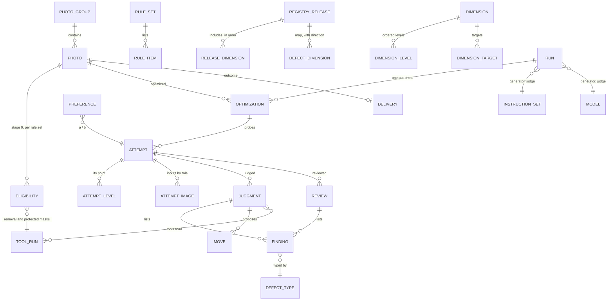

# virtual_unstaging — data model

The structure of one project's database: what each table holds, the keys and constraints that keep it valid,
and the views that derive scores and directional effects. It refines the conceptual model of the
[architecture](../architecture.md#data-model).

> **Status:** *proposal*, implemented in slice 1. The authoritative schema is
> [`schema.sql`](../src/virtual_unstaging/store/schema.sql); this page explains it and never repeats its DDL.
> SQLite, one database per project ([design D2](README.md#design-decisions)).

## Table of Contents

1. [Principles](#principles) _(Lines 23-41)_
1. [Overview](#overview) _(Lines 44-72)_
1. [Tables](#tables) _(Lines 75-99)_
1. [Views](#views) _(Lines 102-111)_
1. [Image store](#image-store) _(Lines 114-120)_

---

## Principles
<!-- Lines 23-41 -->

- **Third normal form.** A fact is stored once; scores, counts and effects are views.
- **Append-only history.** Attempts, tool runs, judgments, findings, moves, reviews and preferences are inserted,
  never updated. Only state rows change: an optimization's status, a delivery, an eligibility.
- **Versions are rows, identified by content hash.** An instruction set, a dimension, a registry release, a rule
  set: the same content is the same row; a change is a new row. A run points at the exact rows it used, and a
  resumed run reads them back from the database, never from the files that may have changed since.
- **JSON only for payloads never joined on:** a tool's measures, a raw model response, a budget, the generator's
  capability profile. Everything a query groups, filters or joins on is a column.
- **Integrity in the database:** keys, foreign keys (composite where a level must exist on its dimension), and
  CHECK constraints for every rule that holds whoever writes (a finding belongs to a judgment or a review, never
  both; a box lies in [0, 1]; a failed attempt has an error and no output; a skipped photo has a reason).
- **Images are hashes.** Every image column holds a SHA-256 that keys the [image store](#image-store).
- Timestamps are ISO 8601 UTC text. Surrogate integer keys; natural keys carry a `UNIQUE` constraint.
- **Portable SQL**, for the move to Postgres at the [growth horizon](README.md#system-shape): `COALESCE`,
  `COUNT(*) FILTER (WHERE …)`, no sum over booleans.
- Every connection sets `foreign_keys = ON`, WAL mode (the review page reads while a run writes) and a busy
  timeout; every write runs in a `BEGIN IMMEDIATE` transaction.

## Overview
<!-- Lines 44-72 -->

## Tables
<!-- Lines 75-99 -->

| Group | Table | Holds |
|---|---|---|
| reference data, loaded from package files by hash | `defect_type` | the defect taxonomy |
| | `model` | one row per role, name and weights revision |
| | `instruction_set` | versioned text per role and target model; layer `base`, `project` or `photo`, the set it is layered on, the previous version |
| | `dimension`, `dimension_level`, `dimension_target` | a dimension's input, realizer and its realizer-specific field (slot, role or setting), origin, default; its ordered levels and what each sends; the defects it targets |
| | `registry_release`, `release_dimension`, `defect_dimension` | a registry as loaded: its dimensions in poll order, and the defect-to-dimension map with direction and priority |
| project content | `image` | a stored image's size and media type |
| | `photo_group`, `photo` | rooms, and photos with their source name |
| | `rule_set`, `rule_item` | content rules: fixed and movable elements, for the whole project or a room |
| stage 0 | `eligibility` | per photo and rule set: decision, reason, measures (mask share, sharpness, fixed elements found), the tool runs that made the masks |
| tools | `tool_run`, `tool_run_input`, `tool_run_output` | every tool call, local or remote, with version, params, inputs, outputs, measures, summary; unique by cache key |
| loop 1 | `run` | one engine, budget, acceptance tolerance, generator and its capability profile, judge, instruction sets, registry release, rule set, code version |
| | `optimization` | one engine on one photo in a run: the seed (common random numbers), status, stop reason, best attempt |
| | `attempt`, `attempt_level`, `attempt_image` | one generation: the prompt and settings as sent, the request's cache key, the output, GPU-seconds, cached or not, error; its point; its images by role, with the tool run that built each guide |
| judging and review | `judgment` | the judge's raw answer, parse error if any, own verdict (recorded, not scored), critique, request key, cached or not |
| | `finding` | a defect code, severity, box and comment, from a judgment or from a review |
| | `move` | a step the judge proposed: dimension, target level, targeted defect, reason, rank |
| | `review`, `preference` | a person's verdict on an attempt; a blind comparison of two attempts with the side shown on the left |
| delivery | `delivery` | each photo's outcome (`emptied` with an attempt, `original`, `excluded`) and who decided; a rule never overrides a person |

Not yet used: `dimension.created_by_judgment_id` and the `photo` layer of `instruction_set` (judge-designed
dimensions and per-photo deltas, slice 2).

## Views
<!-- Lines 102-111 -->

| View | Derives | Used by |
|---|---|---|
| `judgment_score` | the one definition of the score ([design D4](README.md#design-decisions)): count of blocking findings, then of minor ones; none for a judgment that broke the output contract | the runner (each evaluation), the choice of the best attempt, reports |
| `judgment_defect` | which defect codes a judgment found, with how many blocking | `directional_effect` |
| `neighbour_pair` | two attempts of one optimization, same seed, one step apart on exactly one dimension, the first probed before the second | `directional_effect` |
| `directional_effect` | the knowledge base as finite differences ([design D8](README.md#design-decisions)): per dimension, step and defect, how often the step was tried, fixed the defect, or made it appear; per judge model | slice 2: ranking moves |

The condition of an architecture recipe (photo traits, room type) joins in when stage 0 records those traits.

## Image store
<!-- Lines 114-120 -->

- Files at `blobs/<first two hex digits>/<sha256>` beside the database; written to a temporary file then renamed,
  never modified; read back with their hash checked.
- An `image` row is written after its file. Paths are built from validated hashes only.
- Inputs, outputs, masks, tool maps: all blobs. Photos are stored as PNG, orientation applied, once imported.
- Garbage collection (blobs no row references) is a command, never automatic; deleting a project is deleting its
  folder.
