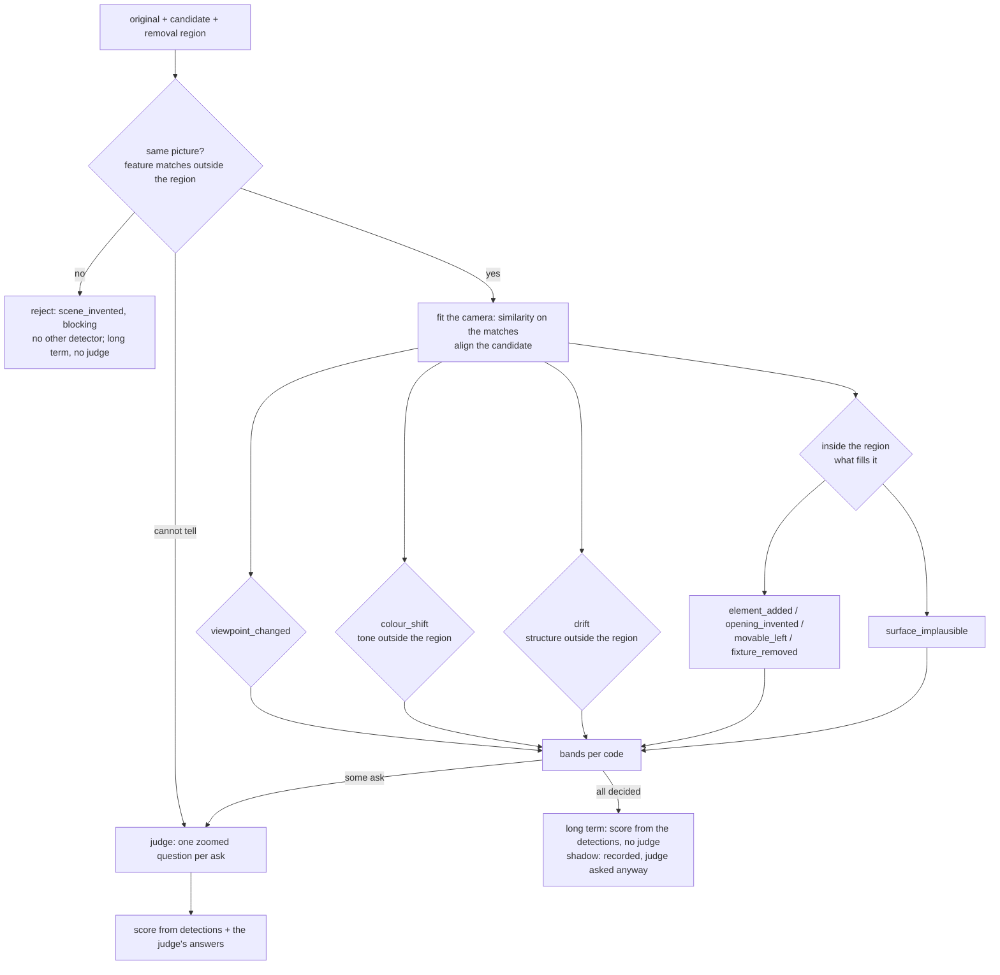

# virtual_unstaging — defect detectors

One detector per defect type: it settles the cases it measures reliably, and turns the rest into a narrow, zoomed
question for the judge, so that the judge no longer has to find every defect in two whole pictures, and sometimes
does not run at all. Answers the owner's direction of 2026-10-23: "build tools that reliably detect problems, instead
of asking the LLM to judge everything", "as filter / zoomer, so judge has specialized/focus input".

> **Status:** *proposal*, 2026-10-23. Pixel detectors (same picture, viewpoint, colour shift, drift) prototyped and
> measured offline on a pilot set of 16 reviewed pairs and on injected defects; inside-the-region detectors designed,
> not measured. Owner's ruling (2026-10-23): detectors that decide are the long-term target, but for now they run in
> **shadow**: their decisions are recorded, the judge is still asked every question, and the two are compared, "as it
> allows to gather data on how often the judge makes the right decision" ([Shadow mode](#shadow-mode)).

## Table of Contents

1. [N0](#n0)
1. [Why](#why)
1. [The triage contract](#the-triage-contract)
1. [Shadow mode](#shadow-mode)
1. [The cascade](#the-cascade)
1. [Detectors per defect](#detectors-per-defect)
1. [Zooms: what the judge gets instead](#zooms-what-the-judge-gets-instead)
1. [The zoom judge (build step 4)](#the-zoom-judge-build-step-4)
1. [Measuring a detector](#measuring-a-detector)
1. [Data model](#data-model)
1. [Build order](#build-order)
1. [Change to the architecture](#change-to-the-architecture)
1. [Open](#open)

---

## N0
<!-- Lines 34-47 -->

- Each defect code gets a **detector** that returns one of three **bands** per attempt: `absent` and `present`
  (decided, with a severity and a location), or `ask` (the detector cannot tell; the judge gets a zoomed question).
- Detectors run as a **cascade**: first "is this the same picture?", then the camera, the tone and the structure
  outside the region, then what fills the region. A failure upstream makes the downstream measures meaningless, and
  stops the cascade.
- A detector's bands are set from the owner's reviews and its reliability from **injected defects** of known size.
  It may decide only what it decided without error on both; everything else is `ask`.
- The judge answers **one question per zoom** (crops of the region at issue, the removal area shaded), not "find
  every defect". Long term, an attempt whose every code is decided needs no judge; for now (owner, 2026-10-23) the
  detectors run in **shadow**: recorded, compared with the judge and the owner, never acting.
- Measured (pilot, 16 pairs, bands drafted on the same pairs): 38 of 55 pixel-level questions decided, none wrong;
  three wholly failed outputs (a copied reference, another scene, another framing) rejected with no judge.

## Why
<!-- Lines 50-56 -->

The judges were measured against the owner's blind review of 16 pairs, with more evidence (element inventory), with
rules drawn from the reviews (instruction overlay) and with a better change map (`structure_map`): each moved
agreement a little, none made the verdicts usable; the judges rejected nearly every image the owner would keep. The
judge is asked to do two things at once: find small differences between two whole pictures, which vision-language
models do badly ([state of the art](../state_of_the_art.md)), and weigh them. Detectors take the first job.

## The triage contract
<!-- Lines 59-76 -->

For each attempt and each defect code, one **detection**:

| Field | Meaning |
|---|---|
| `band` | `absent`, `present` (decided by the detector), `ask` (the judge decides, on a zoom), `skipped` (an upstream detector failed the attempt) |
| `severity` | for `present`: `minor` or `blocking`, by the detector's rule; for `ask`: none |
| `regions` | boxes in [0, 1] where the defect is or may be; for `ask`, the zooms are cut from these |
| `measures` | the numbers the band was read from, and the thresholds used |
| `reason` | for `ask`, why the detector could not tell ("too few features to fit the camera", "a change of 3% of the frame outside the region") |

- Thresholds live in a versioned data file of the package (`data/detectors.toml`, as `defects.toml`), overridable per
  project through the override files (D13). A detector's version is its code version plus its thresholds' hash.
- **Never wrong before useful:** a band a detector has not earned stays `ask`. A detector with no earned band is a
  zoomer only, and still saves the judge the search.
- A `decide` switch per detector, off by default (shadow mode, below): off, the detector's band is recorded but the
  judge is asked anyway, so a run measures the detector and the judge on the same questions.

## Shadow mode
<!-- Lines 79-91 -->

The owner's ruling, 2026-10-23: "I think long term yes. However for now we should still ask the judge, as it allows
to gather data on how often the judge makes the right decision."

- Every detector runs and records its detection (band, severity, regions, measures) on every attempt.
- The judge is asked as if no detector had decided: its findings alone make the score (D4), as before. It also
  answers the zooms of the `ask` bands, and, for each code a detector decided, the same closed question on the same
  zoom, so that every decision has a judge's answer beside it.
- Each reviewed attempt then gives, per code, three answers: the detector's, the judge's, the owner's. Reports count
  per code and per detector how often each is right, and on which cases they disagree.
- `decide` is switched on per detector once its record shows it right where the judge is wrong, or as right at lower
  cost, and the owner agrees.

## The cascade
<!-- Lines 94-118 -->

- Order matters because each step's measure assumes the previous one passed: tone and structure compared on another
  picture, or on a misaligned one, measure the failure, not the defect (on the pilot, an alignment that silently
  failed reported "no motion" on a picture of another scene).
- Outside the region, the original is the reference: any change is a defect or noise. Inside the region, change is
  the point of the edit: the question is what the new content is.

## Detectors per defect
<!-- Lines 121-138 -->

Pixel detectors need no learned model (OpenCV, NumPy); semantic ones run the tool server's existing models.

| Code | Detector and signal | Decides `absent` | Decides `present` | Asks the judge | Measured |
|---|---|---|---|---|---|
| (gate) `scene_invented`, whole picture | SIFT features outside the region matched to the candidate; RANSAC similarity; share of the original's features that fit; structure change outside | a fit on at least 12 matches | under 5% of features fit **and** over 20% of the outside changed: another picture (copied reference, other scene, other framing) | too few features (bare walls), or one signal without the other | 17 of 17 other pictures caught (14 injected, 3 real); none of 13 real outputs nor 147 injected variants of the same picture flagged |
| `viewpoint_changed` | scale, rotation and shift of the fitted similarity | within the generator's own reframing on kept outputs (scale 0.97-1.04, rotation under 1°) | beyond scale 0.95-1.05 or 2° | between the two, or no feature fit (the ECC fallback is too loose to decide) | injected reframings recovered within 0.01 of scale and 0.1°; one real case only, caught by the gate |
| `colour_shift` | Lab difference outside the region after alignment: its uneven part (90th percentile of the low-frequency difference after the median shift is removed) and the median shift | uneven part under 8 | over 13; severity `minor` unless the owner rules otherwise (the owner marked most colour shifts minor) | between 8 and 13 | separates the owner's answers on 15 pairs without error (AUC 1.0); a uniform shift alone separates worse (AUC 0.92) |
| `drift` | `structure_map` regions outside the region, after the feature alignment | no region (under 1% of the outside) | over 10% of the outside changed; severity asked | regions between 1% and 10%: one zoom per region | injected patches visibly different from what they cover, at least 1% of the frame: located 13 of 13; at 0.5%: 2 of 5 |
| `fixture_removed` | outside: a drift region whose original crop holds a fixed element (detection on the crop only); inside: a fixed element the original shows crossing the region's edge, absent from the candidate (visible names only, score at least 0.4) | no fixed element at any changed place | — (detection errors too frequent to decide) | each such element, as a zoom | not measured (2 cases in the pilot) |
| `opening_invented` | inside the region: pixels whose class became door, window or passage (`class_diff`), and whether they continue an opening at the region's edge | no opening class inside the region | — until measured | every opening inside the region: zoom of the region with its edge | not measured (4 cases) |
| `element_added` | inside the region: blobs of the candidate that are not a surface class (wall, floor, ceiling) nor a continued fixed element; outside: drift regions | the region holds surfaces only | — until measured | each blob, as a zoom: revealed (partly visible in the original) or invented? | not measured (7 cases) |
| `movable_left` | inside the region: the movable names detected in the candidate (score at least 0.4) | none detected | a detection of high score and size, once measured | weaker detections, as zooms | no positive case in the pilot |
| `surface_implausible` | none that decides: the revealed surfaces, cropped with a ring of their surroundings | — | — | always, one zoom per revealed area | — |

Every number in this table is drafted on 16 pairs of one building; each must hold on a second set before its band
is switched to decide.

## Zooms: what the judge gets instead
<!-- Lines 141-159 -->

- **A zoom** is a pair of crops (original, aligned candidate) around one **place** (a region a detector found),
  grown by its own size on each side for context and at least an eighth of the long side, enlarged to the judge's
  image size; the removal area shaded in both, so the judge does not count the intended change. Several zooms go in
  one call. On the pilot, against the owner's boxes: 16 of 18 defects outside the removal area lie at least 80% inside
  a zoom so cut (median zoom 21% of the frame); grown by half its size, 11 of 18 (drafted on the same boxes).
- **One question per zoom, closed options, several allowed:** a defect often belongs to more than one code (owner,
  2026-10-23: "in several cases the defect does not fit neatly in one category": an invented opening that also makes
  the scene another one; a stain that is both drift and an added element). Outside the region: "the same / only
  sharper or softer / something added / a belonging removed (harmless) / a fixed element removed / something changed
  shape / the surface is wrong";
  inside: "a wall or floor that continues / an element revealed (partly visible in the original) / an element
  invented / an opening invented / an object left / the surface is wrong". Each option maps to one or more codes;
  findings take the zoom's box.
- **Cost:** on the pilot, at most 4 zooms per attempt outside the region; small crops and short closed answers
  should let a smaller or faster judge answer within the owner's 10 seconds. Not measured.
- On the pilot's prototype, the zooms show defects the whole-picture judges missed or misread: an object and a
  stain appearing outside the region of a kept image; a wall sliver, the defect that sank a discarded one.

## The zoom judge (build step 4)
<!-- Lines 162-188 -->

*Proposal*, 2026-10-23; the owner's go "lets go" on a separate call. In shadow mode the zoom questions are a **second
judge call** per attempt, so the whole-picture judgment stays as it was and every place gets three answers: the zoom
judge's, the whole-picture judge's, the owner's.

- **Places:** the `structure_map` regions outside the removal area (at most 4, largest first) and the removal area
  itself (each of its at most 2 largest parts), since inside it no detector is built yet and the zoom alone narrows
  the question. A picture the gate calls another picture gets no zooms.
- **Zoom image:** one image per place, original crop and aligned candidate crop side by side, each at most 512 pixels
  on its long side; the candidate is aligned by the warp `structure_map` reports (`alignment.warp`, at the size it
  compared), applied by the orchestrator at full resolution. Outside zooms shade the removal area; inside zooms outline
  it.
- **Question:** per zoom, the answers that apply among a closed list (several allowed), a severity (`none`, `minor`,
  `blocking`) and a comment under 120 characters. Outside: `same`, `sharper_or_softer`, `added`, `removed_belonging` (harmless: the
  edit's purpose, even beyond the drawn area), `removed_fixed`, `changed_shape`, `tone`, `surface_wrong`. Inside: `continues`, `revealed`, `invented_element`, `invented_opening`,
  `object_left`, `surface_wrong`. Each answer maps to defect codes in `data/detectors.toml` (`[zoom_answers]`).
- **Command:** `unstage zooms RUN…` asks the configured judge on every judged attempt of the runs, once per
  candidate; a request already answered by the same judge is reused. Stored as `zoom_judgment`, `zoom`,
  `zoom_answer` (schema version 2; a version 1 database is migrated by adding these tables).

- **Measured** (pilot, 16 pictures, 3 judges × 2 speed versions, keyed answer schema): 0 broken answers of 78 calls,
  median 2.2-6.0 s per call; the gate spared the judge the 3 wholly failed outputs. Verdicts (a blocking zoom rejects)
  right on 6-9 of 16, no better than the whole-picture judges (7-10). Two causes seen: belongings the generator removed
  beyond the drawn area are places the outside question can only call `removed` (the 35B judge: 19 of 30 outside zooms);
  inside zooms marked blocking on kept photos. Next: split `removed` into a belonging removed (harmless) and a fixed
  element removed; the owner answering the same closed questions on the same zooms, as the judge's ground truth.

## Measuring a detector
<!-- Lines 191-207 -->

Three measures, all offline on stored images, before a judge reads a detector's output:

1. **Injection bench:** known defects of known size injected into outputs the owner kept (tone shifts, reframings,
   patches pasted outside the region, another photo given as the output); what the detector reads back, and from
   what size it finds the defect. Says whether the detector *can* see a defect, and how precisely.
2. **The owner's reviews:** per code, the owner's answer (absent, minor, blocking) against the detector's band;
   sets the thresholds of the bands. A band is earned when it is never wrong on the reviews. For local defects, by
   **place** first (did a detector find the place the owner boxed; does the zoom contain it), then by label, lenient:
   a place's label is right when it is any of the codes the owner gave that place, as the owner files one place under
   one code and leaves its other codes unboxed.
3. **Hold-out:** thresholds drafted on one set are checked on another before `decide` is switched on.
4. **Against the judge (shadow mode):** per code, the detector's band, the judge's answer and the owner's, on the
   same attempts.

The scripts live with the project's runs; the tool's tests use synthetic images only.

## Data model
<!-- Lines 210-225 -->

*Proposal*, to [data_model.md](data_model.md) once accepted. While detectors only run in shadow, a detection is a
pure function of a stored `structure_map` run and the thresholds file, so it is computed when reported
(`unstage report --detectors`), not stored, as the knowledge base's view (D8); no schema change until the judge's
zoom answers need storing (build step 4):

- `detection` (attempt, defect code, detector, detector version, tool run, band, severity, measures, reason), one
  per attempt and code, for the whole-image codes (same picture, viewpoint, colour shift) and for each local code's
  overall band.
- `place` (attempt, detector, box, where: outside, inside or across the removal area's edge): a region a detector
  found; its codes are not fixed by the detector but answered per zoom (several allowed), stored as `place_code`.
- `finding` gains a third source beside `judgment` and `review`: a `detection` whose band is `present`. In shadow
  mode the score (D4) counts the judgment's findings only; once a detector decides, the findings of its detections
  replace the judge's for its code.
- The judgment of an attempt records which zooms it answered (a `zoom` row: detection, crop box, images).

## Build order
<!-- Lines 228-245 -->

*Proposal*, cheapest and most measurable first:

1. **Camera fit** (done, 2026-10-23): feature alignment (SIFT, similarity, RANSAC) in `structure_map`, ECC as the
   fallback, a failed fit said as such, and the feature counts the gate reads. Tests on synthetic pictures.
2. **Tone measure** (done, 2026-10-23) in the same tool: median shift and uneven part, as numbers, also in the summary
   the judge reads.
3. **Triage layer** (done, 2026-10-23, pixel detectors): `detectors.py` reads the bands from
   `data/detectors.toml`; `unstage report --detectors` gives per code the bands and, where a detector decided, how
   often the judge and the latest review agree. On the pilot's stored judgments (9 judge variants, 16 photos, maps of
   the tool's first version): where the drift detector decided, it matched the owner on 72 of 75 judgments (the 3
   misses: a copied reference the gate catches with the current version), the judges on 55 of 75.
4. **Zooms** and the closed-question judge contract; measured on the stored pilot attempts (judges only, no
   generation).
5. **Inside-the-region detectors** (`element_added`, `opening_invented`, `movable_left`, `fixture_removed`), each
   measured on stored detections before a judge reads it.
6. `decide` switched on per detector, after its hold-out check and the owner's go.

## Change to the architecture
<!-- Lines 248-253 -->

Accepted by the owner as the long-term target (2026-10-23), applied to [Judge tool library](../architecture.md#judge-tool-library):
a detector decides the defects it measures without error on the owner's reviews and on injected defects; the VLM
decides the rest, on the detector's zooms. Until then, shadow mode. Still a *proposal*: [The judge](../architecture.md#the-judge)'s
input becoming the zooms and their questions, beside or instead of the whole pictures.

## Open
<!-- Lines 256-265 -->

- **Ground truth with locations:** being marked by the owner (2026-10-23) on the pilot's 16 pairs; a second, held-out
  set needs one more generation run.
- **Viewpoint tolerance:** from what reframing does the owner see a changed viewpoint? The bands use the generator's
  own range on kept outputs. The owner's.
- **Severity by a detector:** whether a detector may say `blocking` (the gate does; drift and colour shift ask).
- **Overlapping codes:** the taxonomy names causes and places at once (`drift` is "outside the region",
  `element_added` "anything new"), so one defect fits several. Places with several answers sidestep it for now; a
  taxonomy along two axes (where: outside, inside, across the edge; what: added, removed, changed shape, tone,
  surface wrong, scene other) is a possible change to the architecture, for the owner.
