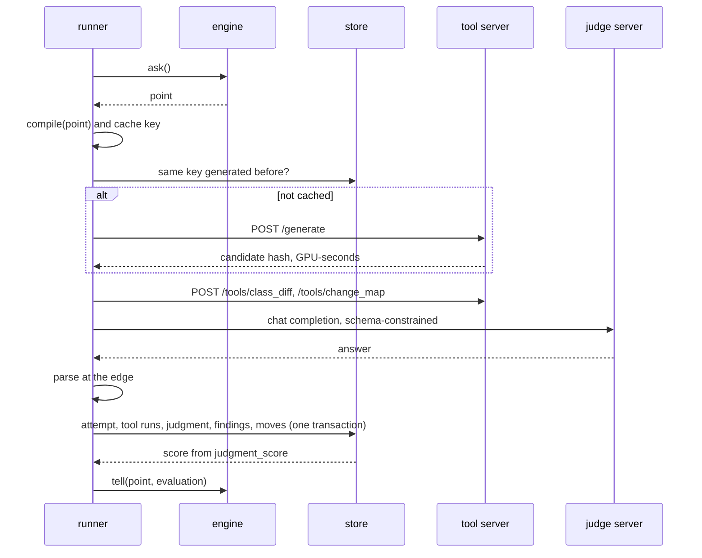

# virtual_unstaging — the per-image loop

How one photo is optimized: the dimension registry and how a point becomes a generator request, the automatic
tool runs, the judge call and its output contract, the score, the budget, the engine contract, the three engines
of the first slice, the runner, and the experiment the first slice runs.

> **Status:** *proposal*, not accepted. Refines [Stage 1](../architecture.md#stage-1--per-image-loop) of the
> architecture; the tables named here are in [data_model.md](data_model.md), the decisions D1-D12 in
> [README.md](README.md#design-decisions).

## Table of Contents

1. [Vocabulary](#vocabulary) _(Lines 29-40)_
1. [Dimension registry](#dimension-registry) _(Lines 43-101)_
1. [Compile: point to generator request](#compile-point-to-generator-request) _(Lines 104-123)_
1. [Automatic tool runs](#automatic-tool-runs) _(Lines 126-136)_
1. [The judge call](#the-judge-call) _(Lines 139-182)_
1. [Scoring](#scoring) _(Lines 185-195)_
1. [Budget](#budget) _(Lines 198-205)_
1. [Engine contract](#engine-contract) _(Lines 208-241)_
1. [Engines](#engines) _(Lines 244-272)_
1. [Runner](#runner) _(Lines 275-308)_
1. [First-slice experiment](#first-slice-experiment) _(Lines 311-333)_

---

## Vocabulary
<!-- Lines 29-40 -->

| Term | Meaning |
|---|---|
| dimension | one factor of one generator input, with two to four ordered **levels** ([architecture](../architecture.md#dimensions-of-exploration)) |
| point | one level per dimension of the run's registry release, plus the photo's seed |
| neighbour | a point that differs from another on exactly one dimension |
| incumbent | the best point evaluated so far on this photo |
| attempt | one generation at one point, stored with everything sent (`attempt`) |
| probe | (verb) make an attempt at a neighbour, to grade it |
| evaluation | what an engine is told about an attempt: score, accepted or not, findings, the judge's moves, cost |
| poll order | the order in which an engine probes the neighbours of its incumbent: what distinguishes the engines |

## Dimension registry
<!-- Lines 43-101 -->

A TOML file shipped in the package (design D9). Each dimension names its input, a **realizer** (how a level
becomes something the generator receives), its levels in order, its default, and its probe cost. The realizers
form a closed list, so a dimension can only ever produce prompt text, a reference choice, a guide or a setting:

| Realizer | Input | A level is | Built by |
|---|---|---|---|
| `text_slot` | instructions | a text fragment for a named slot of the prompt template | `instructions` |
| `reference_count` | visual clues | how many reference photos are sent | `registry`, from the photo's candidates |
| `mask_dilation` | visual guides | a dilation radius of the removal mask, in % of the long side | tool `mask_ops`, cached |
| `guide_toggle` | visual guides | whether an image of a given role is sent | `registry` |
| `setting` | settings | the value of one generator setting | `registry` |

The six dimensions of slice 1, with provisional defaults (the start point):

| Key | Realizer | Levels (default in bold) | Targets |
|---|---|---|---|
| `wall_rule` | `text_slot` (constraints) | absent, **present**, emphasized | `opening_invented`, `surface_implausible` |
| `fixed_elements_named` | `text_slot` (keep) | none, **visible**, group list | `fixture_removed`, `element_added` |
| `fidelity_clause` | `text_slot` (fidelity) | absent, **present**, emphasized | `viewpoint_changed`, `drift`, `colour_shift` |
| `reference_count` | `reference_count` | 0, **1**, 2, 4 | `surface_implausible`, `scene_invented`, `viewpoint_changed` |
| `mask_extent` | `mask_dilation` | tight 0 %, **dilated 1.5 %**, wide 4 % | `movable_left`, `drift` |
| `protected_mask` | `guide_toggle` (`protected_mask`) | **off**, on | `fixture_removed` |

```toml
[[dimension]]
key = "wall_rule"
input = "instructions"
realizer = "text_slot"
slot = "constraints"
default = "present"
probe_cost = 0
targets = ["opening_invented", "surface_implausible"]
levels = [
  { label = "absent",     text = "" },
  { label = "present",    text = "Where furniture is removed, continue the wall, floor and skirting behind it. Do not add doors, windows or openings." },
  { label = "emphasized", text = "Most important: behind every removed object there is a continuous wall. Never add a door, a window or an opening that is not visible in the original." },
]
```

**Defect-to-dimension map** (in the same file): for a defect seen, which dimension to step first, and which way.
Hand-written, learned later from the directional effects ([data_model.md](data_model.md#views)).

| Defect | First steps, in priority order |
|---|---|
| `opening_invented` | `wall_rule` +1; `reference_count` +1 |
| `viewpoint_changed` | `reference_count` −1; `fidelity_clause` +1 |
| `scene_invented` | `reference_count` +1; `fidelity_clause` +1 |
| `fixture_removed` | `protected_mask` +1; `fixed_elements_named` +1; `mask_extent` −1 |
| `element_added` | `fixed_elements_named` −1; `reference_count` −1 |
| `movable_left` | `mask_extent` +1 |
| `surface_implausible` | `reference_count` +1; `wall_rule` +1 |
| `drift` | `mask_extent` −1; `fidelity_clause` +1 |
| `colour_shift` | `fidelity_clause` +1 |

**Pruning by capability** (design D3): before the search, a level the generator cannot take is removed (a
reference count above what the model accepts once the original and the guides are counted; a guide role the
adapter cannot map). A dimension left with one level is dropped from the run.

## Compile: point to generator request
<!-- Lines 104-123 -->

A pure function: `compile(point, photo_context, release, instruction_stack) -> GeneratorRequest`.

- **Prompt:** the generator's instruction stack (base, then the project overlay) is a template with named slots;
  each `text_slot` dimension fills its slot with its level's fragment, in registry order; empty slots vanish;
  whitespace is normalized. The prompt as sent is stored on the attempt.
- **Images, each with its role:** `original`; `removal_mask`, dilated per `mask_extent`; `protected_mask` when on;
  then the references. The adapter maps roles to the model's inputs (for the models surveyed, masks travel as
  condition images, since none takes a mask argument).
- **References:** candidates are the other photos of the same group, ordered by the least removal-mask share
  (the least cluttered first), then by name; the first *k* are sent. Choosing by viewpoint needs camera poses: a
  later slice.
- **Fixed elements named:** `visible` lists the fixed elements of the content rules that the initial
  segmentation found in this photo; `group list` lists every fixed element of the group's rules.
- **Settings and seed:** the adapter's defaults, then `setting` dimensions; the optimization's seed (D5).
- **Cache key:** SHA-256 of the canonical JSON of model name and revision, prompt, image hashes with roles,
  settings and seed (D12).

`photo_context` is read once per optimization: original, masks, fixed elements found, reference candidates.

## Automatic tool runs
<!-- Lines 126-136 -->

Two tools run on every attempt before it is judged (design D6). Each returns derived images, measures and a
short text summary; each run is cached by its key and linked to the judgment that read it.

| Tool | Computes | The judge receives |
|---|---|---|
| `class_diff` | semantic segmentation of original and candidate; inside the dilated removal region, the share of pixels whose class became an opening (door, window, passage) or a class absent from the original; outside it, fixed-element classes that vanished | a colour map of class changes; e.g. "inside the removed region, 3.1 % of pixels became door, at (0.42, 0.30)-(0.55, 0.81)" |
| `change_map` | outside the removal region: optical-flow displacement (median and 95th percentile, in % of the long side), colour difference ΔE (median), a heat map | the heat map; e.g. "outside the region: median shift 0.2 %, 95th percentile 0.9 %, ΔE 1.8" |

Tools locate and measure; the judge decides ([architecture](../architecture.md#judge-tool-library)).

## The judge call
<!-- Lines 139-182 -->

One call per attempt, with two sections in the answer (design D7).

**Images, in order, each named in the text:** the original; the candidate; the original with the removal region
outlined; the `class_diff` map; the `change_map` heat map.

**Text:** the judge's instruction stack (base, then project overlay), rendered with: the content rules of the
photo's group (fixed and movable elements) and the fixed elements found in it; the defect taxonomy, codes and
descriptions from `defect_type`; the tool summaries; the history of this photo (per earlier attempt: which
dimensions differ from the start point, its findings and score), text only; the dimensions of the run with their
levels and the current point, for the guidance section.

**Output contract**, a JSON Schema **generated per run** from the database (defect codes from `defect_type`,
dimension keys and level labels from the release), so it cannot drift from what the parser accepts. The same
schema constrains decoding on the server and parses the answer here:

```json
{
  "evaluation": {
    "findings": [
      { "code": "opening_invented", "severity": "blocking",
        "box": [0.42, 0.30, 0.55, 0.81], "comment": "a door where the wardrobe stood" }
    ],
    "verdict": "reject",
    "critique": "free text, at most 600 characters"
  },
  "guidance": {
    "moves": [
      { "dimension": "wall_rule", "to_level": "emphasized",
        "targets": "opening_invented", "reason": "the wall rule did not prevent the door" }
    ]
  }
}
```

- At most 12 findings and 4 moves; `box` may be `null` (the whole image). A move changes one dimension, to any
  of its levels other than the current one.
- **Parsing at the edge:** the adapter converts the model's coordinate convention to [0, 1]; every finding and
  move is checked against the contract; a failure stores the judgment with its raw text and parse error, and the
  call is retried once; a second failure gives the attempt no evaluation.
- **Reproducibility:** temperature 0, so an identical request is a cache hit (D12). Whether the judge reasons
  before answering (some models do by default) is a measured choice, not a design one: its cost in time against
  its gain in agreement with the owner.

## Scoring
<!-- Lines 185-195 -->

- **Score** of a judgment: `(blocking, minor)`, the count of findings per severity, read from the view
  `judgment_score`, its one definition (D4).
- **Order:** fewer blocking findings is better; then fewer minor ones. Blocking findings are constraints in the
  architecture, so this is the order of a constrained search where infeasible points are ranked by how badly they
  violate the constraints (as in the progressive barrier of mesh adaptive direct search).
- **Accepted:** no blocking finding and at most `minor_tolerance` minor ones (project setting, default 1).
- **Tie** between two attempts: the incumbent stays. A probe replaces the incumbent only if strictly better, which
  is also the guard against the judge's noise in slice 1.
- An attempt without evaluation (generation failed, judge failed twice) is worse than any evaluated one.

## Budget
<!-- Lines 198-205 -->

- **Per optimization:** attempts (default 6, the start point included), GPU-seconds, judge calls (retries
  included). **Per run:** GPU-seconds, or a cost ceiling at a stated hourly price.
- The runner checks before each generation and refuses one that would exceed a limit: the optimization stops with
  reason `budget`.
- **A cache hit counts as an attempt** but costs no GPU-seconds. Counting it keeps runs comparable: otherwise an
  engine run after another would get free probes wherever their requests coincide.

## Engine contract
<!-- Lines 208-241 -->

The ask / tell contract of the [architecture](../architecture.md#engine-contract), with one added requirement:
**given the same problem and the same sequence of `tell`, an engine asks the same points** (design D10).

```python
class Engine(Protocol):
    def start(self, problem: Problem) -> None: ...
    def ask(self) -> Point | Stop: ...
    def tell(self, point: Point, evaluation: Evaluation | None) -> None: ...

@dataclass(frozen=True)
class Problem:
    dimensions: tuple[Dimension, ...]          # pruned, with ordered levels
    start: Point                               # defaults, or a recipe later
    defect_map: tuple[DefectStep, ...]         # defect, dimension, direction, priority

@dataclass(frozen=True)
class Evaluation:
    score: tuple[int, int]                     # (blocking, minor), from the database view
    accepted: bool
    findings: tuple[Finding, ...]
    moves: tuple[Move, ...]                    # the judge's guidance, in rank order
    critique: str
    cost: Cost                                 # GPU-seconds, judge calls
```

- The system owns everything else (registry, generator, judge, tools, store, budget); the engine owns only the
  policy. Acceptance (`minor_tolerance`) is decided by the runner and arrives in `Evaluation.accepted`.
- **Resume is a replay:** a new engine is started on the same problem, and every stored attempt is told in order;
  before each `tell`, the replayed `ask` must return the stored point. A mismatch is an error: the engine is not
  deterministic, and the run refuses to continue. Library engines that keep internal state (Optuna, Nevergrad)
  fit the same contract when seeded.
- `Stop` carries a reason: `accepted`, `no_progress`, or `engine` (the engine's own rule, e.g. single attempt).

## Engines
<!-- Lines 244-272 -->

All three are pattern searches on the lattice of levels, with the mesh fixed at one step and **opportunistic
polling**: the first probe that beats the incumbent becomes the incumbent, and polling restarts around it. They
differ only in the poll order, so the comparison of slice 1 measures the value of the judge's guidance.

| Engine | Poll order around the incumbent |
|---|---|
| `single` | none: asks the start point, then stops. The baseline. |
| `coordinate` | registry order; for each dimension, one step up, then one step down |
| `guided` | 1. the judge's moves on the incumbent, in its rank order; 2. the defect-to-dimension map for the incumbent's findings, blocking findings first, by priority; 3. the remaining one-step neighbours in registry order |

```text
guided.ask():
    if incumbent is accepted:                  return Stop(accepted)
    for point in poll_order(incumbent):        # deterministic, ties by registry order
        if point not in evaluated and fits(point, budget):
            return point
    return Stop(no_progress)                   # no untried neighbour: a local optimum for this seed

guided.tell(point, evaluation):
    record(point, evaluation)
    if better(evaluation, incumbent.evaluation):
        incumbent = point                      # poll order is rebuilt from its findings and moves
```

- A judge move may jump more than one level on its dimension: it still changes one factor.
- `no_progress` is the architecture's early fallback: a photo whose neighbours all fail stops before its budget.
- Bandit and population engines (architecture, *proposal*) fit the same contract and come later.

## Runner
<!-- Lines 275-308 -->



- **Workers:** K optimizations run at once (D11), each in its own thread with its own engine and database
  connection (WAL mode, busy timeout); the GPU servers queue the calls.
- **Failures:** a transport error is retried up to three times with backoff; a generation error is recorded on the
  attempt, counts against the budget, and the engine is told no evaluation; an endpoint unreachable beyond a
  timeout pauses the run and exits with its own code, and `run --resume` continues it later.
- **Stop:** on `Stop` or budget, the best attempt (best score, then earliest) is written to the optimization. The
  delivery is a separate decision (`deliver`): a rule (best accepted attempt, else the original) or the owner.
- **Interrupt:** Ctrl-C stops asking, lets in-flight calls finish or time out, and leaves the run resumable.

## First-slice experiment
<!-- Lines 311-333 -->

The question: **at equal budget, does a findings-driven search fix more photos than one attempt, and more than a
fixed-order search?** The decision rule is written before the run.

- **Photos:** about 20 from one real project, kept outside this repository: photos where one attempt invented an
  opening, photos the owner sent back in review, and photos the first judge rejected that the owner found
  fixable.
- **Arms:** `single`, `coordinate`, `guided`; same photos, same seed per photo, same versions, 6 attempts per photo.
  The start point is the same request in all three arms, generated once (D12): at most 20 + 2 × 20 × 5 = 220
  generations and as many judgments.
- **Measures:** per arm, photos with an attempt the owner judges usable; blind preferences, guided against single
  and guided against coordinate; cost per usable photo; agreement of the judge with the owner's typed review of
  each arm's best attempts.
- **Decision rule (proposal):** guided is worth building on if it gives more usable photos than single and wins
  more blind comparisons against single than it loses. If guided and coordinate tie, the guidance adds nothing at
  this budget: the next work is the judge ([train the judge first](../training.md#train-the-judge-first)).
- **Cost, inferred, nothing measured:** 220 generations at about 20 s and 220 judgments at about 15 s are about
  2.2 hours of one 80 GB GPU ([model services](README.md#model-services-and-provisioning)), plus model loading;
  at about 1.8 $/h, about 4 $.
  The model survey found no measured time per edit on a named GPU; the first hour of the run measures it, and the
  budget is set from that.
- **Owner's time:** about 40 blind comparisons (a few seconds each) and a typed review of about 20-60 best
  attempts (15-20 minutes).
