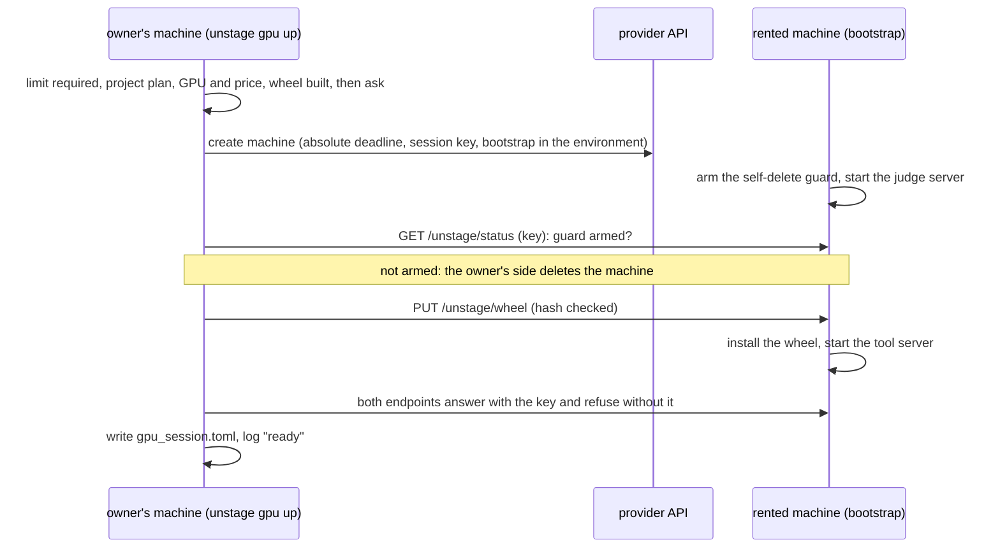

# virtual_unstaging — GPU provisioning

How `unstage gpu up|down|ls|price` rents a machine that serves the generator, the tools and the judge, with a time
limit that cannot be skipped. Part of the [design](README.md#model-services-and-provisioning); the machine's tool
server is described in the [tool server API](tool_server_api.md#deadline).

> **Status:** implemented and tested against fakes only. Nothing here has run against a real rental service yet:
> see [Not tested live](#not-tested-live).

## Table of Contents

1. [Flow](#flow) _(Lines 22-52)_
1. [The guard](#the-guard) _(Lines 55-68)_
1. [Keys](#keys) _(Lines 71-83)_
1. [The wheel route](#the-wheel-route) _(Lines 86-96)_
1. [Costs](#costs) _(Lines 99-105)_
1. [Files](#files) _(Lines 108-120)_
1. [Provider interface](#provider-interface) _(Lines 123-131)_
1. [Not tested live](#not-tested-live) _(Lines 134-140)_
## Flow
<!-- Lines 22-52 -->

- **Before anything is rented**, in this order: the limit (`--limit`, 5 minutes to 24 hours, refused when absent),
  the recipe name, the project's plan, a live-session check, the provider key, the GPU and its price, the wheel
  build, then the confirmation. A terminal gets a question showing the GPU, the hourly price, the limit and the
  most it can cost; without a terminal `--yes` is required. No flag skips the limit.
- **After the machine exists**, any failure, Ctrl-C, SIGTERM or SIGHUP deletes it before `up` exits. If the delete
  itself fails, the error says the machine may still be billing and names it. A create whose answer was lost is
  looked up by its unique name (`unstage-<session>`), never retried blindly.
- **The deadline counts from the create call**, so start-up time (image pull, weight download) is inside the limit.
- `down` deletes this project's machine, checks it is gone, removes `gpu_session.toml` (only if this session wrote
  it) and the key file. `ls` compares the log with the provider's machines (a read): it closes a session whose
  machine is gone (billed no later than the deadline plus grace), and warns about a machine alive past its deadline
  (the guard failed) or one named `unstage-…` that the log does not know. Without a readable provider key it lists
  the log only. `price` lists GPU types with their hourly list price and stock.

## The guard
<!-- Lines 55-68 -->

The machine's entrypoint is the bootstrap (`provision/bootstrap.py`, standard library only), sent in the
environment with the provider's self-delete (`provision/runpod_guard.py`) appended.

- It arms first: the provider's `SelfDelete.probe()` says whether the machine can delete itself, and the status
  endpoint reports it. `up` refuses to keep a machine whose guard did not arm or did not report.
- It deletes the machine at the **absolute** deadline plus 30 seconds, from the machine itself, so the owner's
  computer can be off. A container restart does not extend it; a restart after the deadline deletes at once.
- It fails closed: any supervisor error, a missing deadline, or a session key that is empty or still a placeholder
  ends the machine. A service that dies and stays down for 10 minutes ends it too. With no guard it starts
  nothing expensive and exits after 10 minutes.
- If every way of deleting is refused (terminate, delete, stop; three rounds) it exits, which stops the container.
- Runpod's ladder: REST terminate, REST delete, GraphQL terminate (key as bearer, then as query parameter), stop.

## Keys
<!-- Lines 71-83 -->

- One **session key** per `up` (32 random bytes), written to `<config>/keys/session-<id>.key`, mode 600, and
  referenced by `key_file` in `gpu_session.toml` for `[generator]`, `[judge]` and `[tools]`. The session file holds
  no key. `down` deletes the key file.
- The key reaches the machine as the environment variable `UNSTAGE_SESSION_KEY`: the recorded exception of the
  [command line](README.md#command-line). It is visible to whoever can read the pod through the provider's API with
  the account key, for the life of the machine; it opens only that machine's endpoints.
- The **provider API key** is read from a file (mode 600) or a command run without a shell, named in
  `<config>/provision.toml` (`[runpod]`), default `<config>/runpod.key`; never a flag, never on the machine.
  An optional `[huggingface]` section does the same for a token, sent as `HF_TOKEN` only when present (gated models).
- Judge server on loopback; the bootstrap's front port is the only way in. It checks the bearer key (constant-time)
  and passes only `/v1/…` paths, so the judge server's other routes (some answer without a key) are unreachable.

## The wheel route
<!-- Lines 86-96 -->

The package is on no index and its code is pushed nowhere, so `up` runs `uv build --wheel` and **uploads the wheel
over the same authenticated HTTPS channel** (`PUT /unstage/wheel` through the provider's proxy), not over SSH. The
machine accepts one wheel, of the name and SHA-256 fixed in the plan at creation, and installs it with the `[serve]`
extra into an environment that shares the image's packages (so the judge server's libraries are untouched).

Why not SSH: it needs an SSH key registered on the account, a machine that runs `sshd` (the judge server's image
does not), a published TCP port, an `ssh` binary and host-key handling on the owner's side, none of which the
HTTPS channel needs; and a wheel of a few hundred kilobytes fits one request. The cost is a small upload handler in
the bootstrap, which a test exercises on loopback.

## Costs
<!-- Lines 99-105 -->

- Shown at confirmation: GPU count × list price per hour, the limit, and their product as the most the rental can
  cost. Recorded in the log: the machine's own `cost` as the provider reports it, hours from creation to end.
- `ls` and `down` print an **estimate** (list price × wall time); the provider's billing page is the truth.
- Also billed while the machine runs: its container disk (`disk_gb`, default 200). Weights are downloaded at each
  start (no volume): the generator's and the judge's, which counts against the limit.

## Files
<!-- Lines 108-120 -->

| File | Where | Holds |
|---|---|---|
| `provision.toml` | user config folder | `[runpod]` and `[huggingface]`: `key_file` or `key_command` |
| `runpod.key`, `keys/session-<id>.key` | user config folder, mode 600 | the provider key; one session key per rental |
| `gpu_sessions.jsonl` | user state folder | the append-only session log: requested, created, ready, failed, ended |
| `gpu.toml` (optional) | project folder | `[machine]` image, CUDA floor, disk, minimum VRAM, preferred GPUs; `[judge]` vLLM options: quantization, context length, images per prompt, memory share, concurrent sequences (default 16: vLLM's 256 reserve a state block each on hybrid models, which may not fit) |
| `gpu_session.toml` | project folder | written by `up`, removed by `down`: endpoints and key files |

The judge's model and revision come from the project's `[judge]` section; the server options come from `gpu.toml`
because `project.toml` rejects unknown keys and its `[judge] extra` is sent with every request. Every value is
checked against a positive definition (repository ids, image with a version tag, an allowlist of quantizations).
Override files (`--override FILE`, [design D13](README.md#command-line)) layer over both for `up` and `judge`: the
judge model from their `[judge]`, the server options from their `[gpu.judge]`. `gpu judge` restarts the judge
server with the merged model, revision and memory share (`POST /unstage/judge` takes `gpu_memory_utilization`, 0.1
to 0.95; the other server options stay as `up` set them), so a small judge can leave more memory to the generator.

## Provider interface
<!-- Lines 123-131 -->

`provision/provider.py`: `offers`, `create`, `get`, `find`, `list_machines`, `delete`, `url`, plus the source of
the machine-side self-delete. A new service is one module like `runpod.py` and one line in `providers.py`; the bootstrap,
the lifecycle and the tests do not change.

`provision` sits in the adapters layer next to `config` and `clients`, which may not import each other. It therefore
re-implements two small things instead of importing them: the key-file reader (`config.Secret`) and the
name `gpu_session.toml`. Tests keep both equal to the originals.

## Not tested live
<!-- Lines 134-140 -->

Everything above runs in tests with the network cut and the provider replaced by a fake. Unverified until one real
rental: the Runpod REST shapes beyond the published schema; that the pod-scoped key may terminate its own pod; the
bootstrap's behaviour on the real image (Python version, `uv` or `venv`, the `vllm serve` options); vLLM's
`--limit-mm-per-prompt` syntax and image counts on the chosen judge model; the proxy's behaviour on a 100 kB upload
and on long judge calls (the provider documents a 100-second cut of a request that has not answered; calls that
need longer must stream); the default GPU memory share when generator and judge share one GPU (a guess); start-up time.
